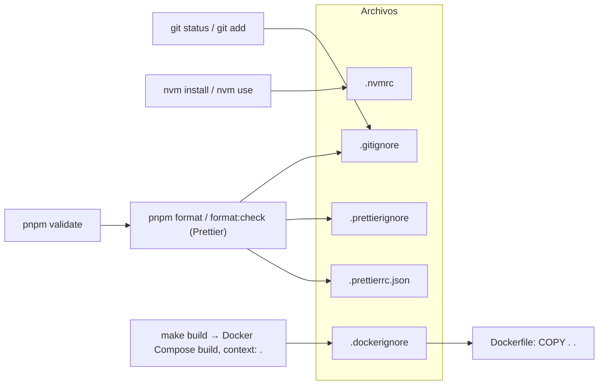

# Los archivos de configuración ocultos del repositorio (dotfiles)

> Fecha: 2026-11-11 · Cambios cubiertos: cambios sin confirmar sobre `5edbb07` (los cinco archivos preparados con `git add`: `.gitignore`, `.dockerignore`, `.nvmrc`, `.prettierignore`, `.prettierrc.json`)

## 1. ¿Qué se ha implementado?

Se han preparado para commit (_staged_, «en el área de preparación») cinco archivos pequeños de la raíz del proyecto. Ninguno contiene lógica de la web; todos son **instrucciones para herramientas**:

- `.gitignore`: qué archivos debe ignorar **Git**.
- `.dockerignore`: qué archivos **no** debe enviar Docker al construir la imagen.
- `.nvmrc`: qué versión exacta de **Node.js** usa el proyecto.
- `.prettierrc.json`: cómo debe dar formato al código **Prettier**.
- `.prettierignore`: qué archivos no debe tocar ni revisar Prettier.

Estos archivos ya existían en tu disco y el proyecto funcionaba con ellos, pero según `MEMORY.md` nunca se habían confirmado en Git hasta ahora. Eso significa que alguien que clonase el repositorio (o tú mismo en otro ordenador) no los tendría, y varias cosas fallarían o se comportarían distinto. Por eso este cambio, aunque pequeño, es importante: convierte una configuración «que solo existe en mi máquina» en una configuración **reproducible**.

La especificación `specs/001-project-foundation/` ya los pedía (requisito R6 en `spec.md`; tareas T103, T104 y T205 en `task.md`).

> Fuera del alcance de esta lección: en la misma ronda de cambios sin confirmar hay también `AGENTS.md`, `MEMORY.md`, `CLAUDE.md`, `BACKLOG.md`, `.agents/`, `.opencode/` (documentación y herramientas para agentes) y `public/homepage/hero.webp` (una imagen que todavía no usa ningún componente). No contienen código de la aplicación, así que no se explican aquí.

## 2. Tecnologías y conceptos implicados

### 2.1. ¿Qué es un _dotfile_?

En Linux y macOS, un archivo cuyo nombre empieza por punto (`.gitignore`) está **oculto**: `ls` no lo muestra salvo que uses `ls -a`. Por convención, las herramientas guardan ahí su configuración, para que no estorbe entre los archivos «de verdad» del proyecto. A estos archivos se les llama _dotfiles_ («archivos punto»).

Lo importante: cada herramienta busca **su** archivo con un nombre fijo y en un lugar fijo (normalmente la carpeta desde la que se ejecuta). No hay que «registrarlos» en ningún sitio; si el archivo existe con ese nombre, la herramienta lo lee.

### 2.2. Patrones de exclusión (_ignore patterns_)

Tres de los cinco archivos (`.gitignore`, `.dockerignore`, `.prettierignore`) comparten la misma idea: son **listas de patrones** que dicen «estos archivos no existen para ti». Un patrón es como una plantilla de nombre:

- `dist/` → la carpeta `dist` y todo lo que contiene.
- `*.log` → cualquier archivo que termine en `.log` (`*` significa «cualquier texto»).
- `.env.*` → `.env.local`, `.env.production`, etc.
- `!.env.example` → el `!` **invierte** la regla: «aunque una regla anterior lo excluya, este sí cuenta».

Regla clave común a los tres: **gana la última línea que coincide**. Por eso `!.env.example` va _después_ de `.env.*`. Si estuviera antes, `.env.*` lo volvería a excluir.

Una diferencia sutil (y fuente habitual de errores) entre Git y Docker:

- En `.gitignore`, un patrón sin `/` en medio (como `*.log` o `node_modules/`) coincide **a cualquier profundidad**: `logs/a.log` también queda ignorado.
- En `.dockerignore`, los patrones son **relativos a la raíz** del contexto. La documentación oficial de Docker lo ilustra con `*.md` seguido de `!README.md`: excluye los Markdown de la raíz, pero los de subcarpetas siguen incluidos. Para coincidir a cualquier profundidad hay que escribir `**/*.log`.

### 2.3. Git y el área de preparación

Git solo guarda en la historia lo que tú añades con `git add`. `.gitignore` sirve para que archivos generados o privados **ni siquiera aparezcan** como candidatos en `git status`, y así no se añadan por accidente con un `git add .`.

Ojo: `.gitignore` solo afecta a archivos que **todavía no** están en seguimiento. Si un archivo ya se confirmó antes, añadirlo a `.gitignore` no lo saca de la historia.

### 2.4. El contexto de construcción de Docker (_build context_)

Cuando ejecutas `docker build .` (o `make build`, que acaba llamando a Docker Compose), Docker empaqueta la carpeta indicada —el **contexto**— y se la envía al motor de construcción. Las instrucciones `COPY` del `Dockerfile` solo pueden copiar archivos de ese paquete. `.dockerignore` decide qué entra en él.

Analogía (solo como ayuda): es como preparar una caja para mandarla a un taller. `.dockerignore` es la lista de «esto no lo metas en la caja». Lo que no va en la caja, el taller no puede usarlo… ni filtrarlo.

### 2.5. Versiones de Node.js y `nvm`

Node.js es el entorno que ejecuta JavaScript fuera del navegador; aquí lo usan Astro, Vite, Vitest, ESLint y Prettier **durante el desarrollo y la construcción** (no en producción: la web final la sirve Caddy). Distintas versiones de Node pueden tener comportamientos distintos, así que conviene que todos usen la misma.

`nvm` (_Node Version Manager_) permite tener varias versiones de Node instaladas. Al ejecutar `nvm install` o `nvm use` sin argumentos dentro del proyecto, lee el archivo `.nvmrc` y activa esa versión.

### 2.6. Formateador de código: Prettier

Un _formatter_ (formateador) reescribe el código con un estilo uniforme: comillas, sangría, longitud de línea, comas… No cambia lo que hace el programa, solo su aspecto. Así las revisiones de código muestran cambios reales y no discusiones de estilo. Prettier tiene valores por defecto; `.prettierrc.json` los cambia para este proyecto.

## 3. Entendiendo la implementación

### 3.1. `.gitignore`: qué no debe entrar nunca en Git

```gitignore
# Dependencies
node_modules/
.pnpm-store/

# Build output
dist/
.astro/

# Environment files
.env
.env.*
!.env.example
```

(Fragmento de `.gitignore`, líneas 1-12.)

Cada bloque responde a una razón distinta:

- **Dependencias** (`node_modules/`, `.pnpm-store/`): se regeneran con `pnpm install` a partir de `package.json` y `pnpm-lock.yaml`. Guardarlas en Git añadiría decenas de miles de archivos.
- **Salida de construcción** (`dist/`, `.astro/`): `astro build` crea `dist/` (la web estática final) y Astro guarda en `.astro/` tipos y datos generados. Se reconstruyen siempre desde el código fuente.
- **Variables de entorno** (`.env`, `.env.*`): pueden contener datos propios de cada máquina o, en el futuro, secretos. **`.env.example`** sí se versiona: es la plantilla documentada (`SITE_URL`, `SITE_ENV`, `SITE_ADDRESS`) que copias con `cp .env.example .env`, tal como indica el `README.md`.

El resto del archivo excluye artefactos de pruebas (`coverage/`, `playwright-report/`, `test-results/`, `blob-report/`), archivos del editor y del sistema (`.DS_Store`, `.idea/`, `.vscode/`, `*.log`) y una carpeta temporal `.tmp/`.

Comprobado con `git check-ignore -v`: `.env` queda ignorado por la línea 10, `dist/`, `node_modules`, `.astro` y `test-results` por sus líneas respectivas, y `.env.example` está en seguimiento (`git ls-files .env.example`).

### 3.2. `.dockerignore`: qué no entra en la imagen

Para entender este archivo hay que mirar el `Dockerfile`. La etapa `build` hace esto:

```dockerfile
COPY package.json pnpm-lock.yaml ./
RUN pnpm install --frozen-lockfile

COPY . .
```

Primero copia solo los manifiestos e instala dependencias **dentro del contenedor** (Linux, Node 24.16.0). Después, `COPY . .` copia **todo el contexto**. Aquí está el porqué de varias líneas de `.dockerignore`:

```text
node_modules
dist
.astro
.git
...
.env
.env.*
!.env.example
```

- **`node_modules`**: sin esta línea, `COPY . .` pisaría el `node_modules` recién instalado en el contenedor con el de tu ordenador, que puede tener binarios compilados para otro sistema o versiones distintas. Es probablemente la línea más importante del archivo.
- **`dist` y `.astro`**: el contenedor genera los suyos con `RUN pnpm build`; los de tu máquina solo podrían confundir.
- **`.env` y `.env.*`**: la configuración de la construcción llega por otro camino. `compose.yaml` lee tu `.env` **en el ordenador anfitrión** y pasa los valores como argumentos de construcción:

  ```yaml
  args:
    SITE_URL: ${SITE_URL:?SITE_URL is required (see .env.example)}
    SITE_ENV: ${SITE_ENV:-staging}
  ```

  y el `Dockerfile` los convierte en variables de entorno (`ARG SITE_URL` … `ENV SITE_URL=$SITE_URL`). Así el archivo `.env` nunca entra en ninguna capa de la imagen, lo que importará cuando haya secretos.

  Detalle interesante: `astro.config.mjs` llama a `loadEnv(mode, process.cwd(), '')` de Vite, que **sí** leería un `.env` si estuviera en la carpeta. Pero el código da prioridad a `process.env`: `const site = process.env.SITE_URL || loaded.SITE_URL || 'http://localhost:4321';`. Por tanto, aunque el `.env` se colase en el contexto, en este proyecto ganarían los valores que llegan desde Compose. Excluirlo sigue siendo la decisión correcta: evita sorpresas y fugas.

- **`.git`, `specs`, `tests`, `.agents`, `.opencode`, `README.md`, `AGENTS.md`, `MEMORY.md`, `skills-lock.json`**: no hacen falta para `pnpm build`. Excluirlos hace el contexto más pequeño (la construcción empieza antes) y evita que un cambio en, por ejemplo, `MEMORY.md` invalide la caché de Docker de la capa `COPY . .` y obligue a reconstruir sin necesidad.

### 3.3. `.nvmrc`: una sola línea

```text
24.16.0
```

Es la misma versión que usa la imagen de construcción (`FROM node:24.16.0-bookworm-slim AS build` en el `Dockerfile`). Ojo: **ninguna herramienta conecta automáticamente** las dos; si actualizas Node, tienes que cambiar ambos sitios a mano. En `package.json` hay además `"engines": { "node": ">=24.0.0" }` (una versión mínima, no exacta) y `"packageManager": "pnpm@12.16.1"`, que fija la versión de pnpm que activa `corepack enable`.

El `README.md` documenta el flujo:

```bash
nvm install
nvm use
corepack enable
pnpm install --frozen-lockfile
```

### 3.4. `.prettierrc.json`: el estilo del proyecto

```json
{
  "plugins": ["prettier-plugin-astro"],
  "singleQuote": true,
  "trailingComma": "all",
  "printWidth": 100,
  "overrides": [
    {
      "files": "*.astro",
      "options": {
        "parser": "astro"
      }
    }
  ]
}
```

- **`plugins`**: Prettier no entiende los archivos `.astro` por sí mismo. `prettier-plugin-astro` (en `devDependencies`) le enseña a hacerlo.
- **`overrides`**: aplica opciones solo a ciertos archivos. Aquí indica que los `*.astro` se analicen con el _parser_ (analizador) `astro` que aporta el plugin.
- **`singleQuote: true`**: comillas simples en JS/TS (`'es'` en vez de `"es"`). El valor por defecto de Prettier es `false`.
- **`trailingComma: "all"`**: coma final en listas y objetos de varias líneas. En Prettier 3 ya es el valor por defecto; dejarlo escrito lo hace explícito.
- **`printWidth: 100`**: Prettier intenta no pasar de 100 caracteres por línea (por defecto, 80).

Estas opciones no son decorativas: `pnpm validate` ejecuta `pnpm format:check` (`prettier --check .`), que **falla** si algún archivo no cumple el estilo. Lo he comprobado: con la configuración del proyecto, `prettier --check .` responde «All matched files use Prettier code style!»; ignorando la configuración (`prettier --no-config --check src/lib src/config`), Prettier marca 7 archivos como mal formateados. Es decir: en un clon sin `.prettierrc.json`, la validación principal del proyecto fallaría sin que nadie hubiera tocado el código.

### 3.5. `.prettierignore`: qué no revisa Prettier

```text
node_modules
dist
.astro
.agents
.opencode
specs
pnpm-lock.yaml
...
AGENTS.md
MEMORY.md
skills-lock.json
```

Excluye archivos generados (`dist`, `.astro`, `pnpm-lock.yaml`, informes de pruebas), archivos gestionados por instaladores (`.agents`, `skills-lock.json`) y documentos que se prefieren tal cual (`specs`, `AGENTS.md`, `MEMORY.md`).

Según la documentación oficial, Prettier **también lee `.gitignore`** si está en la carpeta desde la que se ejecuta, e ignora `node_modules` por defecto. Por eso varias líneas de `.prettierignore` son redundantes; no hacen daño y dejan la intención por escrito.

Consecuencia práctica: lo que **no** aparece aquí sí se revisa. Por ejemplo, `CLAUDE.md`, `BACKLOG.md` y los documentos de `docs/learning/` (incluido este) entran en `pnpm format:check` (comprobado con `prettier --file-info`).

## 4. Flujo de ejecución

No hay un «flujo» de programa, sino herramientas que leen su archivo cuando se ejecutan. Este diagrama muestra quién lee qué (solo relaciones verificadas en el código y la documentación oficial):



Ejemplo del camino completo de una construcción de imagen:

1. Ejecutas `make build`. Compose lee tu `.env` en el anfitrión y prepara `SITE_URL` y `SITE_ENV` como argumentos.
2. Docker empaqueta el contexto `.` aplicando `.dockerignore`: sin `node_modules`, `.git`, `.env`, `specs`, `tests`…
3. En la etapa `build`, `pnpm install --frozen-lockfile` instala dependencias limpias; `COPY . .` añade el código sin pisarlas.
4. `pnpm build` genera `dist/` dentro del contenedor, y las etapas `web`/`edge` copian solo lo que necesitan.

## 5. Decisiones técnicas importantes

- **Versionar la configuración de herramientas.** La especificación 001 lo exige (R6). Sin estos archivos en Git, el proyecto no es reproducible: la validación de formato fallaría, `nvm use` no sabría qué versión activar y un `git add .` podría subir `node_modules` o un `.env`.
- **Versión exacta en `.nvmrc`, mínima en `engines`.** _Interpretación mía, no declarada por el autor:_ `.nvmrc` fija la versión exacta para que el entorno local coincida con la imagen Docker, mientras que `engines` solo marca el mínimo aceptable.
- **Listas explícitas aunque haya redundancia.** `.prettierignore` repite entradas que `.gitignore` ya cubre. Es más largo, pero cada archivo se entiende por sí solo.
- **Al modificar:**
  - Si añades una carpeta de salida nueva (por ejemplo, un informe de otra herramienta), añádela a `.gitignore` y, si no la necesita la construcción, a `.dockerignore`.
  - Si cambias la versión de Node, cambia `.nvmrc` **y** la línea `FROM node:…` del `Dockerfile`.
  - Si cambias una opción de `.prettierrc.json`, ejecuta `pnpm format` para reformatear todo el proyecto, o `pnpm format:check` empezará a fallar.
  - En `.dockerignore`, recuerda que los patrones son relativos a la raíz: usa `**/` si quieres excluir a cualquier profundidad.

## 6. Ejemplos prácticos

- **Crear un `.env.local`**: `git status` no lo mostrará (lo cubre `.env.*`). Crear un `.env.example` modificado: sí aparecerá, porque `!.env.example` lo reincluye.
- **Escribir `"hola"` en un archivo `.ts`**: `pnpm format:check` lo marcará; `pnpm format` lo cambiará a `'hola'` por `singleQuote: true`.
- **Un archivo `logs/debug.log`**: Git lo ignora (`*.log` vale a cualquier profundidad), pero Docker **sí** lo enviaría en el contexto, porque en `.dockerignore` `*.log` solo coincide en la raíz.
- **Versión de Node equivocada**: durante este análisis, la terminal sin `nvm use` tenía `node --version` → `v22.22.3`, no la `24.16.0` del proyecto. Es exactamente la situación que `.nvmrc` ayuda a corregir: `nvm use` en la raíz cambiaría a la versión correcta.

## 7. ¿Qué debo recordar?

- Cada _dotfile_ es configuración para **una herramienta concreta**, que lo busca por nombre al ejecutarse.
- Los tres archivos `*ignore` son listas de patrones donde **gana la última línea que coincide**; `!` reincluye.
- `.gitignore` protege la historia de Git; `.dockerignore` protege la imagen (y la caché de construcción); `.prettierignore` limita el formateo y la validación.
- `.dockerignore` es imprescindible aquí por `COPY . .`: evita que tu `node_modules` y tu `.env` acaben en el contenedor.
- `.prettierrc.json` define el estilo que `pnpm validate` exige; sin él, la validación falla.
- La versión de Node vive en dos sitios (`.nvmrc` y `Dockerfile`) que debes mantener sincronizados a mano.

## 8. Para seguir aprendiendo

- Git, formato de `.gitignore`: <https://git-scm.com/docs/gitignore>
- Docker, contexto de construcción y `.dockerignore`: <https://docs.docker.com/build/concepts/context/>
- Prettier, opciones: <https://prettier.io/docs/options> y archivos ignorados: <https://prettier.io/docs/ignore>
- `nvm` y `.nvmrc`: <https://github.com/nvm-sh/nvm#nvmrc>
- Siguiente lección natural: la web en sí. Puedes pedir `/lesson 001-project-foundation` (arquitectura, Docker y Caddy) o `/lesson 002-homepage` (portada y presentaciones de fotos).

## Limitaciones y puntos sin verificar

- No he ejecutado `make build` (no tengo acceso a Docker), así que el efecto de `.dockerignore` sobre el contexto está razonado a partir del `Dockerfile` y la documentación oficial, no observado.
- No he verificado si pnpm muestra un aviso o un error al usar Node 22 con `engines` `>=24.0.0`; el proyecto no configura `engine-strict`.
- Observaciones sobre el código (no corregidas, solo señaladas):
  - `.dockerignore` excluye `AGENTS.md` y `MEMORY.md`, pero no `CLAUDE.md`, `BACKLOG.md` ni `docs/`. No afectan al resultado de `pnpm build`, pero entran en el contexto y un cambio en ellos invalida la caché de la capa `COPY . .`.
  - En `.dockerignore`, `*.log` y `.DS_Store` solo coinciden en la raíz; si se quisiera excluirlos en subcarpetas haría falta `**/*.log` y `**/.DS_Store`.
  - Como `docs/` no está en `.prettierignore`, la documentación de aprendizaje también debe respetar el formato de Prettier para que `pnpm validate` pase.
