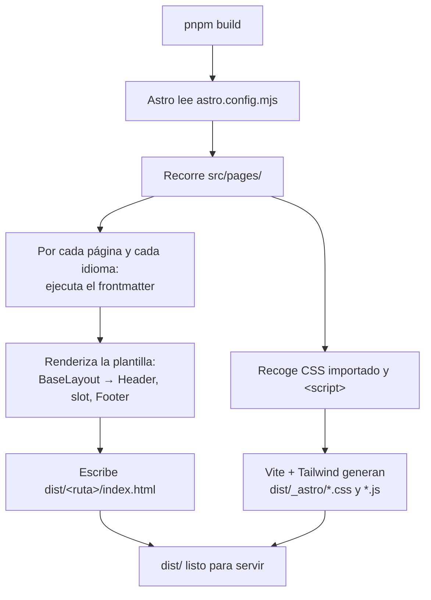

# Astro y el sitio estático

> Fecha: 2026-11-11 · Cambios cubiertos: estado del proyecto en `5edbb07` (commits `14cb2af` y `5edbb07`): `astro.config.mjs`, `tsconfig.json`, `src/layouts/`, `src/components/ui/`, `src/components/layout/Header.astro` y `Footer.astro`, `src/pages/`, `src/styles/global.css`

Esta es la primera lección sobre la web en sí. Explica **cómo está construido el sitio**: qué es Astro, qué es un sitio estático, cómo se escriben los componentes y cómo se aplican los estilos. Las lecciones siguientes (rutas e idiomas, SEO, contenedores, portada, slideshow y pruebas) se apoyan en esta.

## 1. ¿Qué se ha implementado?

Una web corporativa para EA electricidad y multiservicios con cinco tipos de página (inicio, servicios, contacto, aviso legal y 404), en tres idiomas (`es`, `en`, `fr`). Toda la web se genera **antes** de publicarse: el resultado es una carpeta `dist/` con archivos HTML, CSS, JavaScript e imágenes ya terminados. En producción no hay ningún programa que «fabrique» páginas: un servidor (Caddy) se limita a entregar esos archivos.

Las piezas de esta lección:

- `astro.config.mjs`: la configuración central de Astro.
- `src/pages/`: cada archivo es una página (una URL).
- `src/layouts/BaseLayout.astro`: el «esqueleto» HTML común a todas las páginas.
- `src/components/`: piezas reutilizables (`ButtonLink`, `Container`, `Section`, `Header`, `Footer`…).
- `src/styles/global.css`: Tailwind CSS 4 y los colores y fuentes de la marca.

## 2. Tecnologías y conceptos implicados

### 2.1. Sitio estático frente a sitio dinámico

Hay dos formas de servir una web:

- **Dinámica**: cada vez que alguien pide una página, un programa en el servidor (PHP, Node.js…) la genera en ese momento, a menudo consultando una base de datos.
- **Estática** (_static site_): las páginas se generan **una sola vez**, en el momento de la construcción (_build_), y se guardan como archivos. El servidor solo los entrega.

Analogía (solo como ayuda): un restaurante que cocina cada plato al pedirlo (dinámico) frente a una panadería que hornea por la mañana y luego solo vende lo ya hecho (estático). La panadería atiende más rápido y tiene menos cosas que puedan fallar, pero si cambias la receta tienes que volver a hornear.

Para este negocio el contenido cambia poco, así que el modelo estático es el adecuado: más rápido, más barato y con menos superficie de ataque, porque en producción no hay código ejecutándose (lo confirma `specs/001-project-foundation/plan.md`: «Production runtime: Caddy … no Node.js»). La contrapartida es que **cualquier cambio de texto exige reconstruir** (`pnpm build` o `make build`).

### 2.2. Astro: un generador de sitios

Astro es un _framework_ (marco de trabajo) que convierte componentes en HTML. Su lema práctico es «cero JavaScript por defecto»: lo que escribes en un componente se ejecuta **en la construcción** y al navegador solo llega HTML y CSS, salvo que pidas expresamente un script.

En `astro.config.mjs`:

```js
export default defineConfig({
  site,
  output: 'static',
  trailingSlash: 'always',
```

- `output: 'static'`: genera todo como archivos (sin servidor).
- `trailingSlash: 'always'`: todas las URL terminan en `/` (`/es/services/`, nunca `/es/services`). Esto importa para el servidor y para el SEO; lo verás en las lecciones 004 y 005.
- `site`: la URL pública del sitio, necesaria para generar enlaces absolutos (lección 004).

### 2.3. Anatomía de un componente `.astro`

Un archivo `.astro` tiene dos partes separadas por `---`:

```astro
---
// 1. Frontmatter: código TypeScript que se ejecuta en la CONSTRUCCIÓN.
const nombre = 'mundo';
---

<!-- 2. Plantilla: HTML con expresiones entre llaves. -->
<p>Hola, {nombre}</p>
```

(Ejemplo simplificado, no es del proyecto.)

El _frontmatter_ (la zona entre `---`) es como la cocina: allí se preparan los datos. La plantilla es el plato servido. **El código del frontmatter nunca llega al navegador**: se ejecuta una vez en tu ordenador (o en el contenedor de construcción) y desaparece; solo queda el HTML resultante.

Tres herramientas aparecen en casi todos los componentes del proyecto:

1. **Props** (propiedades): los datos que un componente recibe de quien lo usa, como los argumentos de una función. Se declaran con una `interface Props` y se leen en `Astro.props`.
2. **`<slot />`**: un hueco donde se inserta el contenido que el componente envuelve, como el relleno de un sándwich.
3. **`class:list`**: una directiva de Astro que combina varias clases CSS a partir de una lista, ignorando los valores vacíos o `undefined`.

### 2.4. Tailwind CSS 4

Tailwind es un sistema de estilos «de utilidades»: en lugar de escribir CSS aparte, compones el estilo con clases pequeñas en el HTML (`px-5` = relleno horizontal, `font-semibold` = negrita media, `lg:flex` = `display: flex` a partir de pantallas grandes). Al construir, Tailwind analiza qué clases usas y genera **solo** el CSS de esas.

Los prefijos como `sm:`, `md:` y `lg:` son puntos de ruptura (_breakpoints_): la clase se aplica a partir de cierto ancho de pantalla. El diseño es _mobile-first_: las clases sin prefijo son para móvil y los prefijos añaden cambios para pantallas mayores.

En la versión 4, la configuración vive en el propio CSS, dentro de un bloque `@theme`. Lo verás en la sección 3.5.

## 3. Entendiendo la implementación

### 3.1. Páginas = archivos en `src/pages/`

Astro usa **enrutado basado en archivos** (_file-based routing_): la ruta del archivo dentro de `src/pages/` decide la URL. Lo comprobé en la salida de la última construcción que hay en `dist/`:

```text
src/pages/[locale]/services.astro  →  dist/es/services/index.html  →  /es/services/
src/pages/[locale]/index.astro     →  dist/es/index.html           →  /es/
src/pages/index.astro              →  dist/index.html              →  /
```

El `[locale]` entre corchetes es una **ruta dinámica**: un solo archivo genera una página por idioma. Es el tema central de la lección 003; de momento basta con saber que `[locale]` se convierte en `es`, `en` o `fr`.

En total, `dist/` contiene 16 archivos HTML: cinco páginas × tres idiomas, más `dist/index.html` (la redirección a `/es/`) y `dist/404.html`. Además genera `robots.txt` y el sitemap.

### 3.2. El layout: `BaseLayout.astro`

Todas las páginas comparten la misma estructura HTML: `<head>` con metadatos, cabecera, contenido y pie. En lugar de repetirla, existe un **layout** (plantilla de página), que es un componente normal que envuelve el contenido con `<slot />`:

```astro
---
import '@fontsource-variable/space-grotesk';
import '@fontsource-variable/source-sans-3';
import '@/styles/global.css';
...
interface Props {
  locale: Locale;
  title: string;
  description: string;
  path: string;
  noindex?: boolean;
}

const { locale, title, description, path, noindex = false } = Astro.props;
const t = getDictionary(locale);
const currentPath = localizedPath(locale, path);
---

<!doctype html>
<html lang={locale} dir="ltr">
  <head>
    <meta charset="utf-8" />
    <meta name="viewport" content="width=device-width, initial-scale=1" />
    <link rel="icon" href="/logo.jpg" type="image/jpeg" />
    <Seo locale={locale} title={title} description={description} path={path} noindex={noindex} />
  </head>
  <body class="min-h-dvh bg-white text-ink">
    <a href="#main" class="skip-link">
      {t.nav.skipToContent}
    </a>
    <Header locale={locale} currentPath={currentPath} />
    <main id="main" tabindex="-1" class="focus:outline-none">
      <slot />
    </main>
    <Footer locale={locale} />
  </body>
</html>
```

(`src/layouts/BaseLayout.astro`, con las importaciones de componentes abreviadas.)

> Actualización 2026-11-21: el `<link rel="icon" href="/logo.jpg">` de este fragmento se sustituyó por un icono PNG de 32×32 y un `apple-touch-icon` de 180×180, ambos tomados de `brandAssets` (`src/config/brand.ts`). Ver [009](009-logo-y-fila-de-categorias.md).

Qué hay que entender:

- **Importar CSS desde el frontmatter** (`import '@/styles/global.css'`) le dice a Astro: «esta página necesita este CSS». Astro lo procesa, lo junta y lo enlaza como archivo externo (`dist/_astro/BaseLayout.*.css`). Igual con las fuentes de `@fontsource-variable`, que se descargan con el proyecto (en `dist/_astro/` hay archivos `.woff2`) en vez de pedirse a Google Fonts.
- **`noindex = false`**: un valor por defecto en la desestructuración. Si la página no pasa `noindex`, vale `false`.
- **`lang={locale}`**: el atributo `lang` del HTML le dice al navegador y a los lectores de pantalla en qué idioma está la página.
- **_Skip link_** (enlace «Saltar al contenido»): el primer elemento enfocable. Está fuera de la pantalla (`.skip-link` en `global.css` usa `left: -9999px`) hasta que recibe el foco con el tabulador; entonces aparece y permite saltar la navegación. Es una práctica básica de accesibilidad.
- **`<slot />` dentro de `<main>`**: aquí aterriza el contenido de cada página.

Así lo usa una página (`src/pages/[locale]/legal.astro`):

```astro
<BaseLayout
  locale={locale}
  title={t.meta.legal.title}
  description={t.meta.legal.description}
  path="/legal/"
  noindex
>
  <section class="on-dark bg-brand text-white">...</section>
</BaseLayout>
```

Todo lo que hay entre `<BaseLayout>` y `</BaseLayout>` acaba donde estaba `<slot />`.

### 3.3. Componentes pequeños de UI

`src/components/ui/` contiene piezas genéricas sin conocimiento del negocio.

**`Container.astro`** centra el contenido y limita su anchura:

```astro
---
interface Props {
  class?: string;
}

const { class: className } = Astro.props;
---

<div class:list={['mx-auto w-full max-w-6xl px-5 sm:px-6 lg:px-8', className]}>
  <slot />
</div>
```

Fíjate en `class: className`: `class` es una palabra reservada en JavaScript, así que se renombra al desestructurar. `class:list` añade las clases extra que pase quien lo use (por ejemplo, `<Container class="py-20 sm:py-28">` en la página 404); si no pasa ninguna, `className` es `undefined` y se ignora.

**`Section.astro`** envuelve un `Container` en una `<section>` con un «tono» de fondo:

```astro
const tones = {
  light: 'bg-white text-ink',
  muted: 'bg-surface-muted text-ink',
  brand: 'on-dark bg-brand text-white',
} as const;
```

y lo aplica con `class:list={['py-14 sm:py-20', tones[tone], className]}`. Es un patrón que se repite: **un objeto que traduce una opción con nombre a un conjunto de clases**. Así las páginas dicen `tone="muted"` en vez de repetir clases.

**`ButtonLink.astro`** aplica el mismo patrón a los botones:

```astro
interface Props {
  href: string;
  variant?: 'primary' | 'accent' | 'ghost' | 'outline-light' | 'whatsapp';
  icon?: 'whatsapp' | 'phone';
  class?: string;
}
```

El tipo `'primary' | 'accent' | …` es una **unión de literales** de TypeScript: solo admite esos textos exactos. Si escribes `variant="primari"`, `astro check` dará error en la construcción. Los iconos se pintan solo si se piden:

```astro
{icon === 'whatsapp' && <IconWhatsApp />}
{icon === 'phone' && <IconPhone />}
<slot />
```

`condición && <Componente />` es la forma habitual de «pintar solo si…»: si la condición es `false`, no se pinta nada.

Un detalle de accesibilidad en la clase base: `transition-[background-color,color]`. Solo se animan el fondo y el color, **no** el contorno. Según `MEMORY.md`, así el anillo de foco aparece al instante en vez de «fundirse».

**`PlaceholderMedia.astro`** es un recuadro de «Imagen pendiente» para cuando no hay fotos reales. Existe porque las reglas del negocio (`AGENTS.md`) prohíben presentar fotos de archivo como trabajos propios. En `5edbb07` no lo usa ninguna página.

### 3.4. Cabecera y pie

`Header.astro` construye la navegación a partir de una lista de datos:

```astro
const navItems = [
  { key: 'home', href: localizedPath(locale, '/'), label: t.nav.home },
  { key: 'services', href: localizedPath(locale, '/services/'), label: t.nav.services },
  { key: 'contact', href: localizedPath(locale, '/contact/'), label: t.nav.contact },
];
```

y la pinta con `navItems.map(...)`. En una plantilla Astro, `.map()` es la forma de repetir HTML: por cada elemento de la lista devuelve un `<li>`. El enlace de la página actual recibe `aria-current="page"`, que indica a los lectores de pantalla «estás aquí».

El menú de escritorio lleva `hidden lg:block`: oculto en móvil y visible desde `lg`. En móvil aparece `MobileNav.astro`, que usa un elemento HTML nativo: `<details>`/`<summary>`, un desplegable que **funciona sin JavaScript**. El pequeño script del final solo lo mejora (cierra el menú al pulsar un enlace o la tecla Escape):

```astro
<script>
  document.querySelectorAll<HTMLDetailsElement>('details[data-mobile-nav]').forEach((details) => {
    ...
    document.addEventListener('keydown', (event) => {
      if (event.key === 'Escape' && details.open) {
        details.open = false;
        details.querySelector<HTMLElement>('summary')?.focus();
      }
    });
  });
</script>
```

Esta idea —que la base funcione sin JavaScript y el script solo **añada** mejoras— se llama **mejora progresiva** (_progressive enhancement_) y recorre todo el proyecto. La retomaremos en las lecciones 006 y 007.

**¿Qué hace Astro con un `<script>`?** Según la documentación oficial, por defecto lo trata como TypeScript, lo empaqueta con sus importaciones, lo convierte en `type="module"` y lo incluye una sola vez aunque el componente aparezca varias veces. En la salida real se ve así:

```text
<script type="module" src="/_astro/MobileNav.astro_astro_type_script_index_0_lang.DepPTETv.js"></script>
```

### 3.5. Estilos: `global.css`

```css
@import 'tailwindcss';

@theme {
  --color-brand: #00208f;
  --color-brand-strong: #001a73;
  --color-accent: #fad951;
  ...
  --font-display:
    'Space Grotesk Variable', ui-sans-serif, system-ui, -apple-system, 'Segoe UI', sans-serif;

  --radius-card: 0.75rem;
  --radius-panel: 0.25rem;
}
```

Cada variable de `@theme` se convierte en clases utilitarias según su prefijo:

- `--color-brand` → `bg-brand`, `text-brand`, `border-brand`…
- `--font-display` → `font-display`.
- `--radius-card` → `rounded-card`.

Por eso en los componentes ves `bg-brand` o `rounded-card`, que no existen en Tailwind «de serie»: son **tokens de diseño** del proyecto. Si cambias `--color-brand` aquí, cambia en toda la web.

Debajo, `@layer base { ... }` define estilos por defecto de etiquetas (`h1`, `a`, `:focus-visible`…). Destaca esta pareja:

```css
:focus-visible {
  outline: 3px solid var(--color-brand);
  outline-offset: 3px;
}

.on-dark :focus-visible {
  outline-color: var(--color-accent);
}
```

Un contorno azul sería invisible sobre fondo azul. Por eso las zonas oscuras llevan la clase `on-dark` (un marcador propio, no una utilidad de Tailwind) y dentro de ellas el contorno de foco pasa a ser amarillo.

El resto de `global.css` (fondo degradado del hero, slideshow y animaciones) se explica en las lecciones 006 y 007.

### 3.6. El alias `@/`

En vez de `../../components/ui/Container.astro`, el código escribe `@/components/ui/Container.astro`. El alias `@` apunta a `src/` y está declarado en **tres sitios**, uno por herramienta:

- `astro.config.mjs` → `vite.resolve.alias` (para construir).
- `tsconfig.json` → `"paths": { "@/*": ["src/*"] }` (para que TypeScript y el editor lo entiendan).
- `vitest.config.ts` → `resolve.alias` (para las pruebas).

Si añades otro alias, debes añadirlo en los tres sitios.

## 4. Flujo de ejecución

Qué ocurre al ejecutar `pnpm build` (`astro build`):



Y en el navegador, al visitar `/es/services/`:

1. Caddy devuelve `dist/es/services/index.html` tal cual (lección 005).
2. El navegador pide el CSS enlazado (`/_astro/BaseLayout.*.css`) y las fuentes.
3. Si hay scripts (el menú móvil, y en la portada el slideshow), los descarga y ejecuta. Si fallan o están desactivados, la página sigue siendo usable.

## 5. Decisiones técnicas importantes

- **Astro estático, sin Node en producción.** Decisión registrada en `specs/001-project-foundation/plan.md` (secciones 2 y 4): «Static output, content-focused, minimal JavaScript, built-in i18n routing». El plan prohíbe añadir React, un router de cliente, librerías de estado o un CMS en esta fase.
- **CSS y scripts siempre en archivos externos.** `assetsInlineLimit: 0` y `inlineStylesheets: 'never'` en `astro.config.mjs`. La documentación de Astro indica que los scripts pequeños se incrustarían en el HTML; con esta configuración no ocurre. Lo comprobé: `dist/es/index.html` no tiene ningún `<style>` y sus scripts usan `src=`. El motivo es la política de seguridad CSP del servidor, explicada en la lección 005.
- **Componentes como funciones de datos → HTML.** Ningún componente guarda estado. Reciben props, leen diccionarios y configuración, y producen HTML. Esto los hace previsibles.
- **Al modificar:**
  - Un texto visible nunca va escrito en el componente: va en los diccionarios (lección 003).
  - Un color nuevo de marca va en `@theme`, no como valor suelto en una clase.
  - No añadas `<script is:inline>` ni `style="..."` en línea: el servidor los bloquearía (lección 005).

## 6. Ejemplos prácticos

- `<Section tone="brand">` (en `contact.astro`) produce una `<section>` con `py-14 sm:py-20 on-dark bg-brand text-white` y, dentro, un `div` del `Container` con `mx-auto w-full max-w-6xl px-5 sm:px-6 lg:px-8`.
- `<ButtonLink href={site.phone.href} variant="accent" icon="phone">` produce un `<a href="tel:+34668563287" data-variant="accent" …>` con el icono SVG del teléfono delante del texto.
- Si borrases `import '@/styles/global.css'` de `BaseLayout.astro`, ninguna página tendría estilos: ese import es lo que hace que Astro enlace el CSS.

## 7. ¿Qué debo recordar?

- El frontmatter (`---`) se ejecuta al construir; al navegador solo llega el HTML resultante.
- Archivo en `src/pages/` = URL. `[locale]` genera una página por idioma.
- `BaseLayout` aporta el `<head>`, la cabecera y el pie; cada página solo rellena el `<slot />`.
- Los componentes de UI traducen opciones con nombre (`variant`, `tone`) a clases mediante objetos.
- Los tokens de `@theme` generan clases como `bg-brand` y `rounded-card`.
- Mejora progresiva: primero HTML que funciona; los scripts solo mejoran.
- Cualquier cambio exige reconstruir: no hay servidor que genere páginas al vuelo.

## 8. Para seguir aprendiendo

- Astro, componentes: <https://docs.astro.build/en/basics/astro-components/>
- Astro, scripts en el cliente: <https://docs.astro.build/en/guides/client-side-scripts/>
- Tailwind CSS 4, variables de tema: <https://tailwindcss.com/docs/theme>
- MDN, elemento `<details>`: <https://developer.mozilla.org/es/docs/Web/HTML/Element/details>
- Siguiente lección: [003 · Rutas e idiomas](003-rutas-e-idiomas.md).

## Limitaciones y puntos sin verificar

- La estructura de `dist/` descrita es la de la construcción que había en el disco (2026-11-10). No he vuelto a ejecutar `pnpm build` para esta lección.
- `PlaceholderMedia.astro` existe pero ninguna página lo importa en `5edbb07`.
- `Header.astro` y `MobileNav.astro` duplican la lista `navItems` y la función `isActive`. Si añades una página al menú, hay que cambiar los dos archivos.
