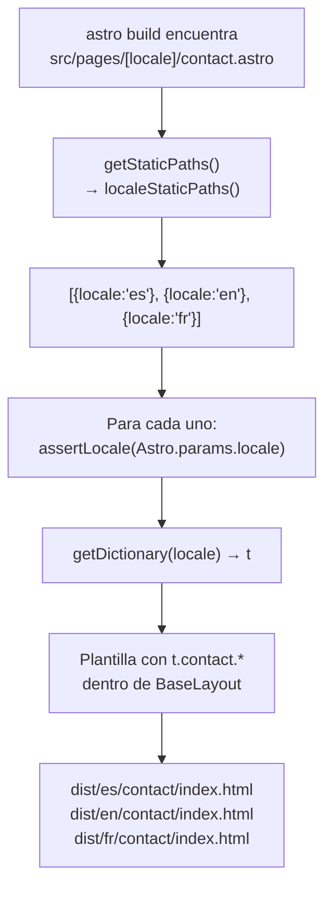

# Rutas e idiomas (i18n)

> Fecha: 2026-11-11 · Cambios cubiertos: estado del proyecto en `5edbb07` (commits `14cb2af` y `5edbb07`): `src/lib/routes.ts`, `src/i18n/`, `src/pages/` (`index.astro`, `404.astro`, `[locale]/*.astro`), `src/components/layout/LanguageSwitcher.astro`, `Header.astro`, `MobileNav.astro`, `src/lib/services.ts`, bloque `i18n` de `astro.config.mjs`

Requisito previo: [002 · Astro y el sitio estático](002-astro-y-el-sitio-estatico.md) (frontmatter, props, `src/pages/`).

## 1. ¿Qué se ha implementado?

La web existe en tres idiomas: español (por defecto), inglés y francés. Cada página tiene una URL por idioma (`/es/contact/`, `/en/contact/`, `/fr/contact/`), y los textos salen de tres **diccionarios** tipados. El sistema se diseñó para que:

- Un solo archivo de página genere las tres versiones.
- Olvidar una traducción sea un **error de compilación**, no un hueco en la web publicada.
- El selector de idioma lleve a la misma página en el otro idioma.
- La raíz `/` redirija a `/es/`, y las rutas desconocidas den una 404 en el idioma correcto.

A esto se le llama **i18n**, abreviatura de _internationalization_ (internacionalización): una «i», 18 letras y una «n».

## 2. Tecnologías y conceptos implicados

### 2.1. Rutas dinámicas y `getStaticPaths`

En la lección 002 vimos que un archivo en `src/pages/` es una URL. Si el nombre lleva corchetes, como `[locale]`, es un **parámetro**: un hueco que puede tomar varios valores.

En un servidor dinámico, el valor llegaría con cada visita. Pero este sitio es estático: Astro tiene que saber **antes de construir** qué valores existen, para generar un archivo por cada uno. Para eso, la página exporta una función `getStaticPaths()` que devuelve la lista:

```ts
[{ params: { locale: 'es' } }, { params: { locale: 'en' } }, { params: { locale: 'fr' } }];
```

Astro ejecuta la página una vez por elemento y deja el valor en `Astro.params.locale`. Analogía (solo como ayuda): `getStaticPaths` es la lista de copias que le pides a la imprenta; la página es el molde.

### 2.2. Tipos de TypeScript a partir de datos: `as const` y `typeof`

TypeScript puede **derivar tipos de valores** en lugar de que los escribas dos veces:

```ts
export const locales = ['es', 'en', 'fr'] as const;

export type Locale = (typeof locales)[number];
```

(`src/lib/routes.ts`, líneas 1-3.)

Paso a paso:

1. Sin `as const`, TypeScript diría que `locales` es `string[]`: una lista de textos cualesquiera.
2. Con `as const`, dice que es exactamente `readonly ['es', 'en', 'fr']`: una tupla de esos tres literales, que no se puede modificar.
3. `typeof locales` toma ese tipo, y `[number]` significa «el tipo de cualquier elemento accedido por índice». Resultado: `Locale = 'es' | 'en' | 'fr'`.

Ventaja: la lista de idiomas existe **una sola vez**. Si añades `'de'`, el tipo `Locale` lo incluye automáticamente, y TypeScript señalará cada sitio que lo necesite (por ejemplo, `localeNames`, declarado como `Record<Locale, string>`, exigirá un nombre para `de`).

### 2.3. Guardas de tipo (_type guards_)

Los datos que vienen de fuera (una URL, `Astro.params`) son `string`, no `Locale`. Hay que **comprobarlos** y convencer a TypeScript de que, tras la comprobación, el tipo es más preciso:

```ts
export function isLocale(value: string | null | undefined): value is Locale {
  return typeof value === 'string' && locales.includes(value as Locale);
}
```

El tipo de retorno `value is Locale` es una **guarda de tipo**: si la función devuelve `true`, TypeScript trata `value` como `Locale` a partir de ahí. Encima se construye:

```ts
export function assertLocale(value: string | null | undefined): Locale {
  if (!isLocale(value)) {
    throw new Error(`Unsupported locale: ${String(value)}`);
  }

  return value;
}
```

Si llegase un idioma no válido, la **construcción falla** con un mensaje claro, en lugar de generar una página rota.

### 2.4. `satisfies`: comprobar sin perder información

El operador `satisfies` de TypeScript dice «comprueba que este valor encaja con este tipo», pero sin cambiar el tipo que TypeScript deduce del valor. Se usa en los diccionarios (sección 3.3).

## 3. Entendiendo la implementación

### 3.1. La fuente única: `src/lib/routes.ts`

Además de `locales`, `Locale`, `isLocale` y `assertLocale`, este archivo contiene las funciones que fabrican URL. Todas son **funciones puras** (mismo resultado para la misma entrada, sin efectos secundarios), y por eso tienen pruebas unitarias en `tests/unit/routes.test.ts`.

```ts
export function normalizeRoute(path: string): string {
  const trimmed = path.replace(/^\/+|\/+$/g, '');
  return trimmed ? `/${trimmed}/` : '/';
}

export function localizedPath(locale: Locale, path: string): string {
  return `/${locale}${normalizeRoute(path)}`;
}
```

`normalizeRoute` quita todas las barras del principio y del final (la expresión regular `^\/+|\/+$` significa «una o más `/` al inicio, o una o más al final») y vuelve a poner exactamente una a cada lado. Así da igual cómo escribas la ruta: siempre sale con barra final, como exige `trailingSlash: 'always'`.

```ts
export function swapLocale(pathname: string, target: Locale): string {
  const current = getLocaleFromPath(pathname);

  if (!current) {
    return localizedPath(target, pathname);
  }

  const rest = pathname.replace(new RegExp(`^/${current}`), '');
  return localizedPath(target, rest || '/');
}
```

`swapLocale` es el corazón del selector de idioma: quita el prefijo del idioma actual y pone el nuevo. Funciona porque el proyecto usa **los mismos _slugs_ en todos los idiomas**: la página de contacto es `/contact/` también en español, y no `/contacto/`. Así el cambio es mecánico y no hace falta una tabla de equivalencias. Lo dice el plan: «Shared slugs are used in all locales. The language switcher replaces only the locale segment.»

```ts
export function localeStaticPaths(): Array<{ params: { locale: Locale } }> {
  return locales.map((locale) => ({ params: { locale } }));
}
```

Genera la lista que espera `getStaticPaths`, a partir de `locales`.

### 3.2. El patrón que repite cada página

Las cinco páginas de `src/pages/[locale]/` empiezan igual. Por ejemplo, `contact.astro`:

```astro
---
...
export function getStaticPaths() {
  return localeStaticPaths();
}

const locale = assertLocale(Astro.params.locale);
const t = getDictionary(locale);
...
---
```

1. `getStaticPaths` → «genera esta página para `es`, `en` y `fr`».
2. `assertLocale(Astro.params.locale)` → convierte el `string` del parámetro en un `Locale` comprobado.
3. `getDictionary(locale)` → obtiene los textos de ese idioma en `t`.

A partir de ahí la plantilla solo usa `t.contact.title`, `t.cta.call`, etc. **Ningún texto visible está escrito a mano en los componentes**; es una regla del proyecto (`CLAUDE.md`).

### 3.3. Los diccionarios: `src/i18n/`

`src/i18n/messages/es.ts` es un objeto grande y anidado:

```ts
export const es = {
  meta: {
    siteName: 'EA electricidad y multiservicios',
    home: {
      title: 'Electricista en Calpe | EA electricidad y multiservicios',
      ...
  nav: {
    home: 'Inicio',
    services: 'Servicios',
    ...
};

export type Dictionary = typeof es;
```

La última línea es la clave: **el tipo `Dictionary` se deduce del diccionario español**. Español es la «fuente de verdad». Inglés y francés se declaran así (`en.ts` y `fr.ts`):

```ts
import type { Dictionary } from './es';

export const en = {
  ...
} satisfies Dictionary;
```

Si en `en.ts` falta una clave, sobra una o tiene otro tipo, `satisfies Dictionary` produce un error de TypeScript, y `pnpm check` (que forma parte de `pnpm validate`) falla.

**¿Por qué `es` no lleva `as const`?** El plan lo explica (`specs/001-project-foundation/plan.md`, 6.3): con `as const`, el tipo de `nav.home` sería el literal `'Inicio'` y no `string`. Entonces `en.ts` fallaría, porque `'Home'` no es `'Inicio'`. Sin `as const`, `nav.home` es `string` y cualquier traducción encaja.

`src/i18n/index.ts` agrupa los tres diccionarios:

```ts
export const dictionaries: Record<Locale, Dictionary> = {
  es,
  en,
  fr,
};

export function getDictionary(locale: Locale): Dictionary {
  return dictionaries[locale];
}
```

`Record<Locale, Dictionary>` obliga a que haya exactamente una entrada por idioma: si añades `'de'` a `locales` y olvidas el diccionario, este archivo deja de compilar.

**Plantillas dentro de los textos.** Algunos textos tienen huecos como `{category}`, `{current}` o `{total}`:

```ts
imageAlt:
  'Trabajo de iluminación realizado por EA electricidad y multiservicios, foto {current} de {total}.',
```

El componente los rellena con `.replace('{current}', ...)` (lo verás en `WorkSlideshow.astro`, lección 006). Así cada idioma puede colocar el número donde su gramática lo pida.

### 3.4. Una red de seguridad extra: `tests/unit/i18n.test.ts`

El tipo ya protege las claves, pero la prueba añade comprobaciones que el tipo no puede hacer. Por ejemplo, que ningún texto esté vacío (`''` es un `string` válido para TypeScript):

```ts
it(`${locale} has no empty strings`, () => {
  for (const [key, value] of flattenStrings(dictionary)) {
    expect(value.trim(), `${locale}.${key} must not be empty`).not.toBe('');
  }
});
```

Y reglas de negocio, como no anunciar disponibilidad 24/7 en ningún idioma:

```ts
expect(value.toLowerCase()).not.toMatch(/24\s*\/\s*7|24\s*h|veinticuatro horas/);
```

### 3.5. Los cinco servicios: `src/lib/services.ts`

```ts
export const serviceKeys = [
  'newInstallations',
  'inspections',
  'repairs',
  'climate',
  'maintenance',
] as const;

export function getServiceItems(dictionary: Dictionary): Array<{
  key: ServiceKey;
  title: string;
  description: string;
}> {
  return serviceKeys.map((key) => ({ key, ...dictionary.services.items[key] }));
}
```

El **orden** y la **lista** de servicios viven en el código; los **textos**, en el diccionario. `services.astro` llama a `getServiceItems(t)` y numera cada tarjeta con `String(index + 1).padStart(2, '0')` (`01`, `02`…). Que haya exactamente cinco es una regla de negocio protegida por `tests/unit/site.test.ts`.

### 3.6. El selector de idioma

```astro
{locales.map((target) => (
  <li>
    <a
      href={swapLocale(currentPath, target)}
      hreflang={target}
      lang={target}
      aria-current={target === locale ? 'true' : undefined}
      ...
    >
      {localeNames[target]}
    </a>
  </li>
))}
```

(`src/components/layout/LanguageSwitcher.astro`.)

- Son **enlaces normales** (`<a>`), así que funcionan sin JavaScript, sin cookies y sin detectar el idioma del navegador (decisión del plan, 6.4).
- `hreflang` indica el idioma del destino y `lang` el idioma del texto del enlace («Français» se pronuncia en francés en un lector de pantalla).
- `currentPath` llega desde `BaseLayout` (`localizedPath(locale, path)`), pasando por `Header` y `MobileNav`.

### 3.7. La raíz y las páginas 404

**`/` → `/es/`.** `src/pages/index.astro` es solo esto:

```astro
---
return Astro.redirect('/es/', 301);
---
```

En un sitio estático no hay servidor que envíe una redirección HTTP real. Astro genera un HTML con una redirección del navegador; lo comprobé en `dist/index.html`:

```text
<meta http-equiv="refresh" content="0;url=/es/"><meta name="robots" content="noindex">
```

En producción, Caddy responde antes con una redirección HTTP `308` real (lección 005), así que este archivo es la red de seguridad para `astro preview` u otros servidores.

**`redirectToDefaultLocale: false`.** En `astro.config.mjs`:

```js
i18n: {
  defaultLocale: 'es',
  locales: ['es', 'en', 'fr'],
  routing: {
    prefixDefaultLocale: true,
    redirectToDefaultLocale: false,
  },
},
```

- `prefixDefaultLocale: true`: el español también lleva prefijo (`/es/`), igual que los demás.
- `redirectToDefaultLocale: false`: Astro no genera su propia redirección de `/`. Según el plan (6.1), si lo hiciera chocaría con `src/pages/index.astro` (dos páginas para la misma ruta).

Ojo: la lista de idiomas está **duplicada** aquí respecto a `routes.ts`. `CLAUDE.md` lo advierte: para añadir un idioma hay que cambiar los dos sitios y añadir un diccionario.

**404 por idioma.** Hay dos archivos:

- `src/pages/[locale]/404.astro` → `/es/404/`, `/en/404/`, `/fr/404/`.
- `src/pages/404.astro` → `dist/404.html`, con `const locale = 'es';` fijo, como respaldo general.

Las dos llevan `noindex`. Generar las páginas no basta: alguien tiene que **servirlas** con estado 404 cuando una URL no existe. Eso lo hace `Caddyfile.web` según el prefijo de la ruta (lección 005).

## 4. Flujo de ejecución

Construcción de `contact.astro` para los tres idiomas:



Cambio de idioma en el navegador, estando en `/en/services/`:

1. Al construir `/en/services/`, `LanguageSwitcher` calculó `swapLocale('/en/services/', 'fr')` = `/fr/services/` y lo escribió en el `href`.
2. Al pulsar «Français», el navegador navega a `/fr/services/`: un enlace normal, sin JavaScript.
3. Caddy sirve `dist/fr/services/index.html`, con `<html lang="fr">`.

La prueba e2e `preserves the page when switching language` (`tests/e2e/foundation.spec.ts`) comprueba exactamente este recorrido.

## 5. Decisiones técnicas importantes

- **Diccionarios en código, no un CMS ni archivos JSON.** El plan (sección 4) lo justifica: «compile-time key checking». La contrapartida es que traducir un texto exige tocar código y reconstruir.
- **Mismos slugs en todos los idiomas.** Simplifica `swapLocale`. La desventaja (_interpretación mía_): las URL en inglés o francés no tienen palabras traducidas, lo que en SEO es un detalle menor.
- **Prefijo también para el idioma por defecto.** Todas las URL tienen la misma forma, lo que simplifica el cambio de idioma, las 404 por idioma en Caddy y los `hreflang`.
- **Al modificar:**
  - Texto nuevo: añádelo **primero** a `es.ts`. TypeScript te obligará a añadirlo en `en.ts` y `fr.ts`.
  - Página nueva: créala en `src/pages/[locale]/` con el patrón `getStaticPaths` + `assertLocale` + `getDictionary`, y añádela a `navItems` en `Header.astro` **y** en `MobileNav.astro` si va en el menú.
  - Idioma nuevo: `routes.ts` (`locales`, `localeNames`), `astro.config.mjs` (`i18n` y `sitemap`), un diccionario nuevo, `src/i18n/index.ts`, el mapa `openGraphLocales` de `Seo.astro`, la expresión regular de `serialize` en `astro.config.mjs` y un bloque nuevo en `Caddyfile.web` para su 404.

## 6. Ejemplos prácticos

Valores reales, comprobados en `tests/unit/routes.test.ts`:

```ts
localizedPath('fr', 'contact'); // '/fr/contact/'
swapLocale('/en/services/', 'fr'); // '/fr/services/'
swapLocale('/es/404/', 'fr'); // '/fr/404/'
swapLocale('/unknown/', 'es'); // '/es/unknown/'  (sin idioma: lo añade)
getLocaleFromPath('/de/'); // null              ('de' no es un Locale)
normalizeRoute(''); // '/'
```

Traza de `swapLocale('/en/services/', 'fr')`:

1. `getLocaleFromPath('/en/services/')`: `split('/')` da `['', 'en', 'services', '']`; `filter(Boolean)` quita los vacíos y deja `['en', 'services']`. El primero, `'en'`, es un idioma válido → `current = 'en'`.
2. `rest = '/en/services/'.replace(/^\/en/, '')` → `'/services/'`.
3. `localizedPath('fr', '/services/')` → `'/fr/services/'`.

¿Y si añadieras `nav.blog` solo a `es.ts`? `pnpm check` fallaría en `en.ts` y `fr.ts` («Property 'blog' is missing…», mensaje aproximado: no lo he ejecutado).

## 7. ¿Qué debo recordar?

- `locales` en `routes.ts` es la fuente de la que se derivan el tipo `Locale`, las páginas generadas y el selector de idioma. La copia de `astro.config.mjs` hay que sincronizarla a mano.
- Toda página localizada sigue el patrón `getStaticPaths` → `assertLocale` → `getDictionary`.
- `es.ts` define el tipo `Dictionary`; `en` y `fr` usan `satisfies Dictionary`. Una clave olvidada es un error de compilación.
- Los textos nunca van en los componentes.
- Mismos slugs en todos los idiomas: cambiar de idioma consiste en sustituir el prefijo.
- Las 404 por idioma se **generan** con Astro, pero las **sirve** Caddy (lección 005).

## 8. Para seguir aprendiendo

- Astro, rutas dinámicas y `getStaticPaths`: <https://docs.astro.build/en/guides/routing/#dynamic-routes>
- Astro, enrutado de i18n: <https://docs.astro.build/en/guides/internationalization/>
- TypeScript, operador `satisfies`: <https://www.typescriptlang.org/docs/handbook/release-notes/typescript-4-9.html#the-satisfies-operator>
- TypeScript, guardas de tipo: <https://www.typescriptlang.org/docs/handbook/2/narrowing.html#using-type-predicates>
- Siguiente lección: [004 · Configuración, entorno y SEO](004-configuracion-entorno-y-seo.md).

## Limitaciones y puntos sin verificar

- No he ejecutado `pnpm check` para reproducir el error de una clave olvidada; el mensaje citado es aproximado.
- La lista de pasos para añadir un idioma sale de leer el código; no la he probado de principio a fin.
- `getLocaleFromPath` y la detección del idioma en `swapLocale` solo miran el primer segmento de la ruta. Es correcto con las rutas actuales; no hay otros casos que comprobar.
