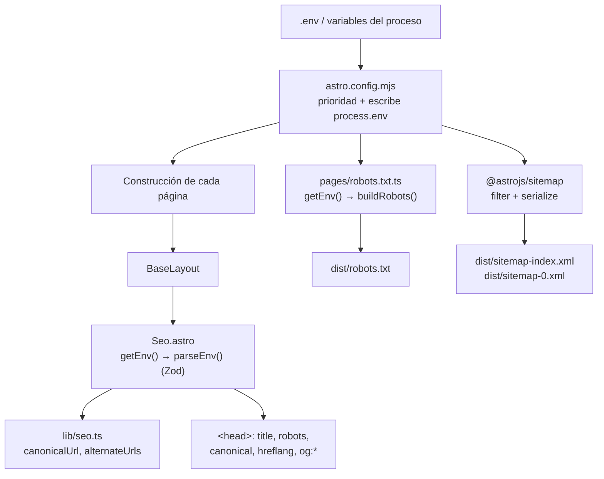

# Configuración, entorno y SEO

> Fecha: 2026-11-11 · Cambios cubiertos: estado del proyecto en `5edbb07` (commit `14cb2af`): `astro.config.mjs`, `src/config/env.ts`, `src/config/site.ts`, `src/env.d.ts`, `src/lib/seo.ts`, `src/lib/robots.ts`, `src/pages/robots.txt.ts`, `src/components/seo/Seo.astro`, `.env.example`

Requisitos previos: [002 · Astro](002-astro-y-el-sitio-estatico.md) y [003 · Rutas e idiomas](003-rutas-e-idiomas.md).

## 1. ¿Qué se ha implementado?

Tres cosas relacionadas:

1. **Configuración de entorno validada.** Dos variables, `SITE_URL` (la dirección pública) y `SITE_ENV` (`staging` o `production`), deciden cómo se construye la web. Si son incorrectas, la construcción **falla** con un mensaje claro.
2. **Datos del negocio en un solo sitio.** Teléfono, correo, horario y zona de servicio están en `src/config/site.ts`, junto con el generador de enlaces de WhatsApp.
3. **SEO** (_Search Engine Optimization_, optimización para buscadores). Cada página declara su URL canónica, sus versiones en otros idiomas, si debe indexarse y cómo debe verse al compartirse. Además se generan `robots.txt` y un mapa del sitio (_sitemap_).

La idea que conecta las tres: **una web en pruebas (_staging_) nunca debe aparecer en Google**, y una web en producción debe dar a los buscadores toda la información correcta. Una sola variable, `SITE_ENV`, cambia ese comportamiento.

## 2. Tecnologías y conceptos implicados

### 2.1. Variables de entorno y «momento de construcción»

Una **variable de entorno** es un valor que el sistema operativo entrega a un programa al arrancarlo (por ejemplo, `SITE_URL=https://ejemplo.com pnpm build`). Sirve para que el mismo código se comporte distinto según dónde se ejecute, sin editarlo.

En un sitio estático hay un matiz importante: las variables se leen **al construir**, no al visitar la web. Si construyes con `SITE_ENV=staging`, el HTML queda escrito con `noindex` para siempre. Para pasar a producción hay que **reconstruir**. Lo dice el plan (`specs/001-project-foundation/plan.md`, 3.2): «Changing the domain or indexing mode requires a new `web` image build».

El archivo `.env` (no versionado; ver la [lección 001](001-dotfiles-del-repositorio.md)) guarda tus valores locales. `.env.example` es la plantilla documentada.

### 2.2. Validar en la frontera: Zod

Los valores de entorno son texto sin garantías: pueden faltar, tener erratas (`SITE_ENV=produccion`) o no ser una URL. **Zod** es una librería que describe la forma esperada de unos datos (un **esquema**) y comprueba si un valor encaja. Si encaja, devuelve el valor ya limpio y tipado; si no, explica por qué.

Analogía (solo como ayuda): el control de seguridad de un aeropuerto. Todo lo que entra se revisa una vez en la puerta; dentro, todos pueden fiarse.

### 2.3. Los conceptos de SEO que usa el proyecto

- **URL canónica** (`<link rel="canonical">`): «esta es la dirección oficial de esta página». Evita que el buscador trate como duplicados `…/es/` y `…/es/?ref=x`.
- **`hreflang`** (`<link rel="alternate" hreflang="en" href="…">`): «esta misma página existe en inglés aquí». Así Google enseña a cada usuario la versión en su idioma.
- **`x-default`**: la versión para quien no encaja con ningún idioma listado. Aquí es la española.
- **`<meta name="robots">`**: `index, follow` (indéxame y sigue mis enlaces) o `noindex, nofollow` (no me indexes).
- **`robots.txt`**: un archivo en la raíz que los rastreadores leen **antes** de visitar nada. Puede prohibirles todo el sitio (`Disallow: /`).
- **Sitemap**: un XML con la lista de URL indexables y sus alternativas por idioma.
- **Open Graph y Twitter Cards** (`og:*`, `twitter:*`): título, descripción e imagen que usan WhatsApp, Facebook, X, etc., al compartir un enlace.

## 3. Entendiendo la implementación

### 3.1. De dónde salen `SITE_URL` y `SITE_ENV`: `astro.config.mjs`

```js
const mode = process.env.NODE_ENV === 'production' ? 'production' : 'development';
const loaded = loadEnv(mode, process.cwd(), '');
const site = process.env.SITE_URL || loaded.SITE_URL || 'http://localhost:4321';
const siteEnv = process.env.SITE_ENV || loaded.SITE_ENV || 'staging';

// Expose the build-time configuration to server-rendered Astro components.
process.env.SITE_URL = site;
process.env.SITE_ENV = siteEnv;
```

Orden de prioridad, de mayor a menor:

1. `process.env`: las variables reales del proceso. En Docker llegan desde `compose.yaml` → `ARG` → `ENV` (lección 005).
2. `loaded`: lo que `loadEnv` de Vite lee de los archivos `.env` de la carpeta actual. El tercer argumento `''` significa «todas las variables, sin filtrar por prefijo».
3. Un valor por defecto seguro: `localhost` y `staging`.

Después **escribe** el resultado en `process.env`, para que cualquier componente que se ejecute durante la construcción lo encuentre allí. Fíjate en que `staging` es el valor por defecto: si te olvidas de configurar nada, la web sale **no indexable**. Fallar hacia el lado seguro es una decisión deliberada.

`site` se pasa a `defineConfig({ site, … })`; la integración del sitemap lo usa para escribir URL absolutas.

### 3.2. El esquema: `src/config/env.ts`

```ts
const envSchema = z.object({
  SITE_URL: z
    .url('SITE_URL must be an absolute URL')
    .transform((value) => value.replace(/\/+$/, '')),
  SITE_ENV: z.enum(['staging', 'production']).default('staging'),
});

export type Env = z.infer<typeof envSchema>;
```

Línea a línea:

- `z.url(...)`: debe ser una URL absoluta válida; si no, se usa ese mensaje de error.
- `.transform(...)`: además de validar, **limpia**: quita las barras finales (`https://x.com///` → `https://x.com`), para no tener que preocuparse luego por dobles barras.
- `z.enum([...]).default('staging')`: solo admite esos dos valores; si falta, usa `staging`.
- `z.infer<typeof envSchema>`: deduce el tipo TypeScript del esquema (`{ SITE_URL: string; SITE_ENV: 'staging' | 'production' }`). El esquema es la única definición: el tipo sale de él, igual que `Locale` salía de `locales` en la lección 003.

```ts
export function parseEnv(input: Record<string, unknown>): Env {
  const result = envSchema.safeParse(input);

  if (!result.success) {
    const details = result.error.issues.map((issue) => `${issue.path.join('.')}: ${issue.message}`);
    throw new Error(`Invalid environment configuration:\n${details.join('\n')}`);
  }

  return result.data;
}
```

`safeParse` no lanza una excepción: devuelve `{ success: true, data }` o `{ success: false, error }`. El código convierte los errores en un mensaje legible y **entonces** lanza una excepción, lo que detiene la construcción.

¿Por qué `parseEnv` recibe un objeto en vez de leer `process.env` directamente? Para poder **probarla**: `tests/unit/env.test.ts` le pasa objetos inventados (`{ SITE_URL: 'not-a-url' }`) sin tocar el entorno real. Separar «leer» (`getEnv`) de «validar» (`parseEnv`) es lo que la hace testeable:

```ts
export function getEnv(): Env {
  return parseEnv({
    SITE_URL: process.env.SITE_URL ?? import.meta.env.SITE_URL ?? 'http://localhost:4321',
    SITE_ENV: process.env.SITE_ENV ?? import.meta.env.SITE_ENV ?? 'staging',
  });
}
```

`src/env.d.ts` declara `SITE_URL` y `SITE_ENV` en el tipo de `import.meta.env`, para que TypeScript las conozca.

### 3.3. Datos del negocio: `src/config/site.ts`

```ts
export const site = {
  name: 'EA electricidad y multiservicios',
  ...
  phone: {
    display: '+34 668 56 32 87',
    href: 'tel:+34668563287',
  },
  ...
  serviceArea: ['Calpe', 'Altea', 'Benidorm', 'Benissa', 'Teulada'],
  ...
} as const;

export function whatsappUrl(message: string): string {
  return `${site.whatsapp.href}?text=${encodeURIComponent(message)}`;
}
```

- Cada contacto tiene un `display` (cómo se lee) y un `href` (cómo se enlaza). `tel:` abre el marcador del móvil y `mailto:` el correo.
- `as const` hace el objeto de solo lectura y conserva los valores literales.
- `whatsappUrl` construye un enlace `wa.me` con un mensaje ya escrito. `encodeURIComponent` es imprescindible: convierte espacios, comas y acentos en secuencias seguras para una URL (`' '` → `%20`, `','` → `%2C`). Sin ella, el mensaje se cortaría en el primer carácter especial.

Estos datos son **hechos de negocio no negociables** (`AGENTS.md`). `tests/unit/site.test.ts` los fija: si alguien cambia el teléfono o añade una ciudad sin aprobación, la prueba falla.

### 3.4. Funciones de URL: `src/lib/seo.ts`

```ts
export function canonicalUrl(siteUrl: string, locale: Locale, path: string): string {
  return new URL(localizedPath(locale, path), `${siteUrl.replace(/\/+$/, '')}/`).href;
}

export function alternateUrls(
  siteUrl: string,
  path: string,
): Array<{ locale: Locale; href: string }> {
  return locales.map((locale) => ({
    locale,
    href: canonicalUrl(siteUrl, locale, path),
  }));
}
```

`new URL(relativa, base)` es la API estándar del navegador y de Node para **resolver** una dirección relativa contra una base, como hace el navegador con los enlaces. Es más seguro que concatenar textos, porque se ocupa de barras, codificación, etc. Reutiliza `localizedPath` de la lección 003: las reglas de URL están en un solo sitio.

### 3.5. Las etiquetas: `src/components/seo/Seo.astro`

`BaseLayout` lo incluye en el `<head>` de todas las páginas. Lo esencial:

```ts
const env = getEnv();
...
const canonical = canonicalUrl(env.SITE_URL, locale, path);
const alternates = alternateUrls(env.SITE_URL, path);
const defaultAlternate = alternates.find((alternate) => alternate.locale === 'es');
const image = absoluteAssetUrl(env.SITE_URL, '/logo.jpg');
const robots = env.SITE_ENV !== 'production' || noindex ? 'noindex, nofollow' : 'index, follow';
```

> Actualización 2026-11-21: la imagen para compartir es ahora `absoluteAssetUrl(env.SITE_URL, brandAssets.share.src)`, es decir, `/brand/share.png` (1200×630), declarada en `src/config/brand.ts`. Ver [009](009-logo-y-fila-de-categorias.md).

Fíjate en la condición de `robots`: la página es indexable **solo si** se cumplen las dos cosas, `SITE_ENV === 'production'` **y** que la página no pida `noindex`. Por eso `legal` y las 404 (que pasan `noindex` a `BaseLayout`) nunca se indexan, ni siquiera en producción.

```astro
<link rel="canonical" href={canonical} />
{alternates.map((alternate) => (
  <link rel="alternate" hreflang={alternate.locale} href={alternate.href} />
))}
<link rel="alternate" hreflang="x-default" href={defaultAlternate?.href ?? canonical} />
```

Así quedan en `dist/en/services/index.html`, construido con `SITE_URL=http://localhost`: un `canonical` hacia `/en/services/` y alternativas `es`, `en`, `fr` y `x-default` (esta apunta a `/es/services/`).

Open Graph usa otro formato de idioma (`es_ES`, `en_GB`, `fr_FR`), de ahí el mapa `openGraphLocales`. Las versiones en los otros idiomas se anuncian con `og:locale:alternate`. En `dist/fr/contact/index.html` se ve `og:locale` = `fr_FR` y dos `og:locale:alternate`: `es_ES` y `en_GB`.

### 3.6. `robots.txt` como página generada

`src/pages/robots.txt.ts` no es una página HTML: es un **endpoint**, un archivo `.ts` en `src/pages/` que exporta una función `GET` y devuelve una `Response`. En un sitio estático, Astro lo ejecuta al construir y guarda el resultado como `dist/robots.txt`:

```ts
export const prerender = true;

export const GET: APIRoute = () => {
  const env = getEnv();

  return new Response(buildRobots(env), {
    headers: {
      'Content-Type': 'text/plain; charset=utf-8',
    },
  });
};
```

La lógica está aparte, en `src/lib/robots.ts`, para poder probarla:

```ts
export function buildRobots(env: Env): string {
  if (env.SITE_ENV === 'production') {
    const sitemap = new URL('sitemap-index.xml', `${env.SITE_URL.replace(/\/+$/, '')}/`).href;
    return `User-agent: *\nAllow: /\n\nSitemap: ${sitemap}\n`;
  }

  return 'User-agent: *\nDisallow: /\n';
}
```

Es el mismo patrón que `parseEnv`/`getEnv`: **la lógica pura en `src/lib`, la conexión con Astro en un archivo fino**. `CLAUDE.md` lo establece: «Pure logic belongs in `src/lib`/`src/config`, which is what the unit tests cover».

### 3.7. El sitemap: `@astrojs/sitemap`

En `astro.config.mjs`, la integración recibe dos funciones:

```js
filter: (page) => {
  const path = new URL(page).pathname;
  return path !== '/' && !path.endsWith('/404/') && !path.endsWith('/legal/');
},
```

Deja fuera la raíz (solo es una redirección), las 404 y el aviso legal (no indexables). Resultado comprobado: `dist/sitemap-0.xml` contiene 9 URL, las de inicio, servicios y contacto en los tres idiomas.

```js
serialize: (item) => {
  const path = new URL(item.url).pathname;
  const defaultUrl = new URL(path.replace(/^\/(es|en|fr)\//, '/es/'), item.url).href;

  return {
    ...item,
    links: [...(item.links ?? []), { lang: 'x-default', url: defaultUrl }],
  };
},
```

La integración ya genera los `hreflang` por idioma (gracias al bloque `i18n` que recibe), pero no `x-default`. `serialize` lo añade a cada entrada, sustituyendo el prefijo de idioma por `/es/`. El resultado se ve en el XML: `hreflang="x-default" href="http://localhost/es/contact/"`.

## 4. Flujo de ejecución



Si `SITE_URL` fuese `no-es-una-url`, la construcción fallaría. Es probable que Astro lo rechace antes, al validar su propia opción `site`. Si llegase a renderizar páginas, `getEnv()` lanzaría `Invalid environment configuration:` seguido de `SITE_URL: SITE_URL must be an absolute URL`. No lo he ejecutado: el mensaje exacto y el punto donde se detiene son una deducción a partir del código.

## 5. Decisiones técnicas importantes

- **`staging` por defecto.** Una web en pruebas indexada por error es difícil de «desindexar». El plan (sección 2) fija que «Staging is `noindex`; production enables crawling».
- **Doble protección en staging:** `noindex` en cada página **y** `Disallow: /` en `robots.txt`.
- **Zod para el entorno.** El plan (sección 4): «Clear build failures for missing or malformed values». La alternativa, leer `process.env` directamente, dejaría pasar erratas en silencio.
- **Limitaciones conocidas** (`BACKLOG.md`, B7): las páginas 404, aunque llevan `noindex`, siguen emitiendo `canonical` y `hreflang`; y `twitter:card` es `summary_large_image` pero la imagen es el logo pequeño y cuadrado.
- **Al modificar:**
  - Una variable nueva de construcción: añádela al esquema de `env.ts`, a `env.d.ts`, a `.env.example`, a `astro.config.mjs` si hace falta, y a `compose.yaml` y al `Dockerfile` como `ARG` (lección 005).
  - Un dato de contacto: solo en `site.ts`, con aprobación del negocio, y actualizando `tests/unit/site.test.ts`.
  - Una página no indexable: pasa `noindex` a `BaseLayout` y exclúyela en el `filter` del sitemap.

## 6. Ejemplos prácticos

Valores comprobados en las pruebas unitarias (`tests/unit/env.test.ts`, `seo.test.ts`, `robots.test.ts`, `site.test.ts`):

```ts
parseEnv({ SITE_URL: 'https://example.com///' }).SITE_URL; // 'https://example.com'
parseEnv({ SITE_URL: 'https://example.com' }).SITE_ENV; // 'staging'
parseEnv({ SITE_URL: 'https://example.com', SITE_ENV: 'preview' }); // lanza error (SITE_ENV)
canonicalUrl('https://example.com/', 'fr', '/contact/'); // 'https://example.com/fr/contact/'
whatsappUrl('Hola, presupuesto'); // 'https://wa.me/34668563287?text=Hola%2C%20presupuesto'
```

`buildRobots` con `SITE_ENV: 'production'` y `SITE_URL: 'https://example.com'` devuelve:

```text
User-agent: *
Allow: /

Sitemap: https://example.com/sitemap-index.xml
```

Y la construcción actual (`staging`) produce el `dist/robots.txt` que hay en disco:

```text
User-agent: *
Disallow: /
```

## 7. ¿Qué debo recordar?

- `SITE_URL` y `SITE_ENV` se aplican **al construir**; cambiarlas exige reconstruir.
- Prioridad: variable del proceso → `.env` → valor por defecto seguro (`staging`).
- Zod valida en la frontera y deduce el tipo `Env`. `parseEnv` es pura y testeable; `getEnv` lee el entorno.
- Una página es indexable solo en `production` **y** sin `noindex`.
- Lógica pura en `src/lib` y `src/config`; los componentes y endpoints solo la conectan.
- Los datos del negocio viven en `site.ts` y están protegidos por pruebas.

## 8. Para seguir aprendiendo

- Zod (documentación oficial): <https://zod.dev/>
- Astro, endpoints: <https://docs.astro.build/en/guides/endpoints/>
- Astro, integración de sitemap: <https://docs.astro.build/en/guides/integrations-guide/sitemap/>
- Google, versiones localizadas y `hreflang`: <https://developers.google.com/search/docs/specialty/international/localized-versions>
- Protocolo Open Graph: <https://ogp.me/>
- Siguiente lección: [005 · Contenedores y servidor](005-contenedores-y-servidor.md).

## Limitaciones y puntos sin verificar

- Los ejemplos de HTML y XML salen de la construcción existente en `dist/` (con `SITE_URL=http://localhost` y `staging`). No he construido en modo `production`; lo que ocurre en ese modo lo deduzco del código y de las pruebas unitarias.
- El mensaje de error exacto de Zod 4 para una URL inválida no lo he reproducido fuera de las pruebas; las pruebas solo comprueban que contiene `SITE_URL`.
- En `Seo.astro`, `x-default` busca el idioma `'es'` escrito a mano en lugar de usar `defaultLocale` de `routes.ts`. Hoy coinciden; si cambiase el idioma por defecto, habría que actualizarlo también aquí y en `serialize`.
