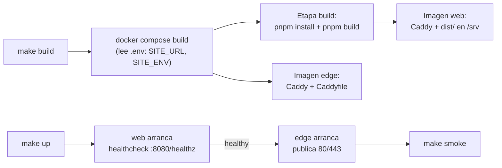
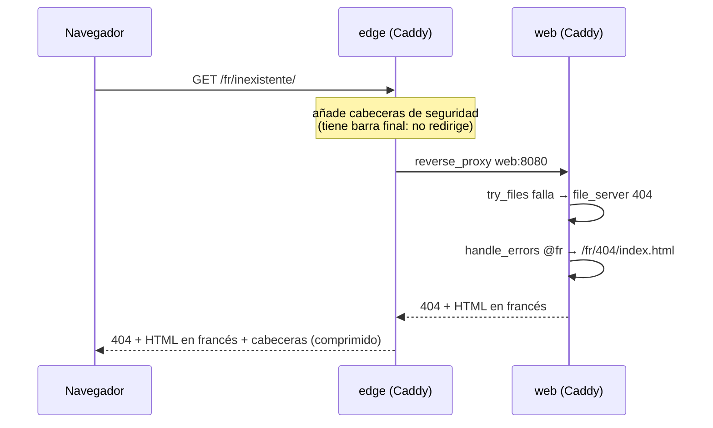

# Contenedores y servidor: Docker, Compose y Caddy

> Fecha: 2026-11-11 · Cambios cubiertos: estado del proyecto en `5edbb07` (commits `14cb2af` y `f5f2230`): `Dockerfile`, `compose.yaml`, `Caddyfile`, `Caddyfile.web`, `Makefile`, `scripts/smoke.sh`, y la parte de `astro.config.mjs` relacionada con la CSP

Requisitos previos: [001 · Dotfiles](001-dotfiles-del-repositorio.md) (`.dockerignore`), [002 · Astro](002-astro-y-el-sitio-estatico.md) (qué hay en `dist/`) y [004 · Configuración](004-configuracion-entorno-y-seo.md) (`SITE_URL`, `SITE_ENV`).

## 1. ¿Qué se ha implementado?

Hasta ahora, la web es una carpeta `dist/` con archivos. Esta lección explica **cómo se publica**: dentro de dos contenedores Docker que ejecutan el servidor web **Caddy**, coordinados con Docker Compose y manejados con un `Makefile`.

```text
Internet / tu navegador
        │  puertos 80 y 443 (los únicos publicados)
        ▼
  ┌───────────┐   red privada "app"   ┌───────────┐
  │   edge    │ ────────────────────► │    web    │
  │  (Caddy)  │      web:8080         │  (Caddy)  │
  └───────────┘                       └───────────┘
  TLS, cabeceras,                     sirve dist/ y
  redirecciones,                      las 404 por idioma
  compresión, logs
```

- **`edge`** («borde»): la puerta de entrada. Es el único contenedor accesible desde fuera. Gestiona HTTPS, añade cabeceras de seguridad, redirige y reenvía las peticiones a `web`.
- **`web`**: un servidor interno que solo sirve los archivos estáticos. Desde tu ordenador no se puede llegar a él directamente.
- **`/api/*`** está reservado para un futuro _backend_ (el formulario de presupuesto) que se añadiría a la misma red privada.

Además, el commit `f5f2230` («fixed boot log») separó `web` en su propio `Caddyfile.web` y corrigió el arranque. Según `MEMORY.md`, el arreglo definitivo del bucle de reinicios (las _capabilities_ de Caddy, sección 3.1) está pendiente de que el propietario lo verifique.

## 2. Tecnologías y conceptos implicados

### 2.1. Imagen y contenedor

- Una **imagen** Docker es una plantilla inmutable: un sistema de archivos mínimo con un programa y su configuración, como el «molde».
- Un **contenedor** es una imagen en ejecución: un proceso aislado del resto del sistema, como la «pieza» sacada del molde.

Las imágenes se construyen por **capas**: cada instrucción del `Dockerfile` añade una. Docker guarda en caché las capas que no han cambiado, así que una reconstrucción solo repite lo necesario.

### 2.2. Construcción en varias etapas (_multi-stage build_)

Para construir la web hace falta Node.js, pnpm y cientos de dependencias. Para **servirla**, solo Caddy y `dist/`. Un `Dockerfile` multietapa define varias etapas `FROM`: una pesada que construye y otras ligeras que **solo copian el resultado** de la primera. Las herramientas de construcción no acaban en la imagen final.

### 2.3. Docker Compose y redes

**Compose** describe varios contenedores en un solo archivo (`compose.yaml`): qué imagen usa cada uno, sus puertos, redes, volúmenes y comprobaciones de salud. En una **red definida por el usuario**, cada contenedor puede encontrar a los demás **por su nombre de servicio**: `edge` llega a `web` escribiendo `web:8080`, gracias al DNS interno de Docker.

### 2.4. Proxy inverso (_reverse proxy_)

Un **proxy inverso** recibe las peticiones de los clientes y las reenvía a uno o varios servidores internos. El cliente solo ve el proxy. Ventajas aquí: un único punto para HTTPS, cabeceras y redirecciones; el servidor interno queda oculto; y en el futuro basta con añadir una regla (`/api/*` → backend) para incorporar otro servicio.

### 2.5. Caddy

Caddy es un servidor web escrito en Go. Su rasgo más conocido es el **HTTPS automático**: si su dirección es un dominio real, solicita y renueva el certificado TLS con Let's Encrypt sin configuración adicional. Se configura con un **Caddyfile**, cuyos bloques tienen esta forma:

```text
dirección {
    directiva argumentos
}
```

Dos ideas de Caddy imprescindibles para leer este proyecto:

- **_Matchers_ con nombre** (`@nombre`): un filtro reutilizable que decide a qué peticiones se aplica una directiva. Por ejemplo, `@root path /` y luego `redir @root /es/ 308`.
- **Orden fijo de directivas.** Según la documentación oficial, Caddy **ordena** las directivas de un bloque según un orden predefinido, no según el orden en que las escribes. Entre las que usa el proyecto, el orden es: `header` → `redir` → `rewrite` → `try_files` → `encode` → `handle` → `respond` → `reverse_proxy` → `file_server`.

### 2.6. Cabeceras de seguridad y CSP

Las respuestas HTTP llevan **cabeceras** (_headers_), metadatos que el navegador obedece. La más potente es la **Content Security Policy (CSP)**: una lista de los orígenes desde los que la página puede cargar scripts, estilos, imágenes, etc. Si un atacante consiguiera inyectar `<script>…</script>` en la página, una CSP estricta impediría que se ejecutara.

## 3. Entendiendo la implementación

### 3.1. `Dockerfile`: tres etapas

**Etapa `build`** (Node.js):

```dockerfile
FROM node:24.16.0-bookworm-slim AS build

ENV PNPM_HOME=/pnpm
ENV PATH=$PNPM_HOME:$PATH
RUN corepack enable

WORKDIR /app

COPY package.json pnpm-lock.yaml ./
RUN pnpm install --frozen-lockfile

COPY . .
```

- `corepack enable` activa la versión de pnpm fijada en `package.json` (`"packageManager": "pnpm@12.16.1"`).
- Primero copia **solo** `package.json` y `pnpm-lock.yaml`, e instala. Esto aprovecha la caché de capas: si cambias un componente pero no las dependencias, Docker reutiliza la capa de `pnpm install` (la más lenta).
- `--frozen-lockfile` falla si el lockfile no coincide con `package.json`: instalación reproducible.
- `COPY . .` copia el resto, filtrado por `.dockerignore` (lección 001).

```dockerfile
ARG SITE_URL
ARG SITE_ENV=staging
RUN test -n "$SITE_URL" || (echo "SITE_URL build argument is required" >&2 && exit 1)
ENV SITE_URL=$SITE_URL
ENV SITE_ENV=$SITE_ENV

RUN pnpm build
```

- `ARG` declara un **argumento de construcción**, un valor que se pasa al construir la imagen. `ENV` lo convierte en variable de entorno para `pnpm build`, que es donde `astro.config.mjs` lo lee (lección 004).
- `test -n "$SITE_URL" || …`: si `SITE_URL` está vacío, la construcción se detiene. El comentario del archivo lo justifica: es mejor fallar que publicar una URL canónica equivocada.

**Etapa `web`** (Caddy con la web):

```dockerfile
FROM caddy:2-alpine AS web

RUN if getcap /usr/bin/caddy | grep -q .; then setcap -r /usr/bin/caddy; fi

COPY Caddyfile.web /etc/caddy/Caddyfile
COPY --from=build /app/dist /srv

ENV SITE_ADDRESS=:8080

EXPOSE 8080
```

`COPY --from=build` es lo que hace multietapa al `Dockerfile`: copia `dist/` desde la etapa anterior. La imagen `web` contiene Caddy, su configuración y la web; **ni Node, ni pnpm, ni código fuente**.

**Etapa `edge`** (Caddy sin web): solo copia `Caddyfile`. No contiene ningún archivo del sitio.

**La línea `setcap -r` merece explicación.** En Linux, las **_capabilities_** dividen los poderes de `root` en permisos pequeños; por ejemplo, `NET_BIND_SERVICE` permite escuchar en puertos menores de 1024 (80 y 443). La imagen oficial de Caddy marca el ejecutable con esa capability. Pero `compose.yaml` endurece los contenedores con `cap_drop: ALL` (quitar todas). Según el comentario del `Dockerfile` y `MEMORY.md`, esa combinación hace que Linux se niegue a ejecutar Caddy (`operation not permitted`, código de salida 255), y el contenedor entra en un bucle de reinicios. La solución: quitar la marca del ejecutable al construir (`setcap -r`). `edge` sigue pudiendo usar los puertos 80 y 443 porque Compose le devuelve solo esa capability (`cap_add: NET_BIND_SERVICE`). `web` no la necesita, porque escucha en el 8080.

### 3.2. `compose.yaml`: dos servicios y una red

```yaml
edge:
  image: ea-electricidad-edge:local
  build:
    context: .
    target: edge
  restart: unless-stopped
  depends_on:
    web:
      condition: service_healthy
  ports:
    - '80:80'
    - '443:443'
    - '443:443/udp'
  environment:
    SITE_ADDRESS: ${SITE_ADDRESS:-:80}
```

- `build.target: edge` → construye la etapa `edge` del `Dockerfile`.
- `ports` **publica** puertos: `'80:80'` significa «el puerto 80 del ordenador → el 80 del contenedor». `443/udp` es para HTTP/3.
- `depends_on … service_healthy`: `edge` no arranca hasta que la comprobación de salud de `web` diga que está sano.
- `${SITE_ADDRESS:-:80}`: interpolación de Compose, que lee tu `.env` del ordenador anfitrión. `:-` significa «si no existe o está vacía, usa `:80`».

```yaml
web:
  image: ea-electricidad-web:local
  build:
    context: .
    target: web
    args:
      SITE_URL: ${SITE_URL:?SITE_URL is required (see .env.example)}
      SITE_ENV: ${SITE_ENV:-staging}
  restart: unless-stopped
  expose:
    - '8080'
```

- `args` pasa los `ARG` del `Dockerfile`. `${SITE_URL:?mensaje}` hace que Compose **se niegue a continuar** con ese mensaje si `SITE_URL` no está definida.
- `expose` en lugar de `ports`: la documentación de Compose dice que son puertos accesibles para los otros servicios y que «should not be published to the host machine». Lo que de verdad aísla a `web` es que **no tiene `ports`**; `expose` documenta el puerto interno.

Los dos servicios comparten además:

```yaml
healthcheck:
  test: ['CMD', 'wget', '-qO-', 'http://127.0.0.1:8080/healthz']
...
networks:
  - app
...
security_opt:
  - no-new-privileges:true
cap_drop:
  - ALL
```

- **`healthcheck`**: cada 30 s, Docker ejecuta `wget` dentro del contenedor contra `/healthz`. Si falla 3 veces seguidas, lo marca como _unhealthy_.
- **`networks: app`**: la red privada (`driver: bridge`) donde `web` es accesible como `web`.
- **`no-new-privileges`** y **`cap_drop: ALL`**: endurecimiento. Aunque alguien consiguiera ejecutar algo dentro, tendría el mínimo de permisos.
- **`volumes`** (solo en `edge`): `caddy_data` guarda los certificados TLS entre reinicios. Por eso `MEMORY.md` advierte que nunca se debe usar `docker compose down -v`, que borraría los certificados.

### 3.3. `Caddyfile`: el `edge`

```text
{
	admin off
}
```

Bloque global: desactiva la API de administración de Caddy, que no se usa y así no queda expuesta.

```text
(security_headers) {
	header {
		X-Content-Type-Options "nosniff"
		X-Frame-Options "DENY"
		Referrer-Policy "strict-origin-when-cross-origin"
		Permissions-Policy "camera=(), microphone=(), geolocation=()"
		Strict-Transport-Security "max-age=31536000; includeSubDomains"
		Content-Security-Policy "default-src 'self'; base-uri 'self'; form-action 'self'; frame-ancestors 'none'; img-src 'self' data:; font-src 'self'; style-src 'self'; script-src 'self'; connect-src 'self'; object-src 'none'"
		-Server
	}
}
```

Un bloque entre paréntesis es un **_snippet_** (fragmento reutilizable) que se inserta con `import security_headers`. Qué hace cada cabecera:

- `nosniff`: el navegador no «adivina» el tipo de un archivo; respeta el `Content-Type`.
- `X-Frame-Options DENY` y `frame-ancestors 'none'`: nadie puede meter la web en un `<iframe>`. Esto protege contra el _clickjacking_.
- `Permissions-Policy`: la página no puede pedir cámara, micrófono ni ubicación.
- `Strict-Transport-Security` (HSTS): «durante un año, conéctate a este dominio solo por HTTPS».
- `-Server`: elimina la cabecera que anuncia «Caddy», para no regalar información.
- **CSP**: `script-src 'self'` y `style-src 'self'` solo permiten scripts y estilos **cargados como archivos del mismo origen**. Cualquier `<script>` o `<style>` escrito dentro del HTML queda **bloqueado**, porque no lleva `'unsafe-inline'`.

**Aquí se cierra un círculo de la lección 002.** Astro, por defecto, incrusta en el HTML los scripts y estilos pequeños. Con esta CSP, el navegador los bloquearía y la web se rompería en silencio. Por eso `astro.config.mjs` fija:

```js
vite: {
  build: {
    assetsInlineLimit: 0,
  },
  ...
},
build: {
  inlineStylesheets: 'never',
},
```

Y por eso `CLAUDE.md` prohíbe añadir `<script>` o `<style>` en línea. Son dos piezas de un mismo diseño: **la configuración de Astro hace posible la CSP estricta**.

```text
http://:8081 {
	respond /healthz "ok" 200
	respond 404
}
```

Un segundo «sitio» en el puerto 8081, solo para la comprobación de salud de Docker. Como no aparece en `ports`, no es accesible desde fuera.

El sitio principal:

```text
{$SITE_ADDRESS} {
	encode zstd gzip

	import security_headers

	@health path /healthz
	respond @health "ok" 200

	@root path /
	redir @root /es/ 308

	@missingSlash {
		not path */
		not path *.*
		not path /healthz
		not path /api
		not path /api/*
	}
	redir @missingSlash {path}/ 308

	@immutable path /_astro/*
	header @immutable Cache-Control "public, max-age=31536000, immutable"

	reverse_proxy web:8080
	...
	handle_errors {
		import security_headers
		respond "{err.status_code} {err.status_text}" {err.status_code}
	}
}
```

(`Caddyfile`, con el comentario sobre el futuro backend y el bloque `log` omitidos.)

- `{$SITE_ADDRESS}` se sustituye por la variable de entorno al cargar la configuración. Con `:80` sirve HTTP simple en local; con `https://midominio.com`, Caddy obtiene automáticamente el certificado.
- `encode zstd gzip`: comprime las respuestas si el navegador lo admite.
- `redir @root /es/ 308`: la redirección real de `/` (la de `dist/index.html` era solo la red de seguridad; lección 003). `308` es una redirección permanente que conserva el método HTTP.
- `@missingSlash`: añade la barra final a las rutas que no la tienen (`/es` → `/es/`), salvo las que parecen archivos (`*.*`, como `logo.jpg`), la de salud y la API. Esto mantiene la regla `trailingSlash: 'always'` de Astro.
  - _Interpretación mía:_ la exclusión de `/healthz` es necesaria precisamente por el orden fijo de Caddy. `redir` se evalúa **antes** que `respond`, así que sin ella `/healthz` se redirigiría a `/healthz/`.
- `@immutable`: los archivos de `/_astro/` llevan un _hash_ en el nombre (`BaseLayout.BalgWydj.css`) que cambia cuando cambia el contenido. Por eso se pueden cachear un año como `immutable`: una versión nueva tendrá otro nombre.
- `reverse_proxy web:8080`: todo lo demás se reenvía a `web` por la red privada.
- `handle_errors`: según la documentación de Caddy, se ejecuta cuando un manejador **del propio edge** produce un error, por ejemplo si `web` está caído (502). Un 404 que **devuelve** `web` no es un error para el edge: el `reverse_proxy` lo pasa tal cual, con su cuerpo localizado. `MEMORY.md` recoge este matiz como trampa conocida.

### 3.4. `Caddyfile.web`: el servidor interno

```text
{
	admin off
	auto_https off
}

:8080 {
	root * /srv

	@health path /healthz
	respond @health "ok" 200

	try_files {path} {path}/ {path}/index.html
	file_server

	handle_errors {
		@es path /es/*
		handle @es {
			rewrite * /es/404/index.html
			file_server
		}
		...
		handle {
			rewrite * /es/404/index.html
			file_server
		}
	}
}
```

- `auto_https off`: es un servidor interno; el HTTPS lo pone el edge.
- `root * /srv`: los archivos están en `/srv` (donde el `Dockerfile` copió `dist/`).
- `try_files`: prueba la ruta tal cual, como directorio y con `index.html` añadido. Así `/es/services/` se resuelve a `/srv/es/services/index.html`.
- `file_server`: entrega el archivo. Si no existe, produce un **error 404**, que activa `handle_errors`.
- En `handle_errors`, cada `handle` es excluyente: se ejecuta el primero que coincide. Una ruta bajo `/es/` recibe la 404 española, `/en/` la inglesa, `/fr/` la francesa, y cualquier otra (`/de/`, `/xyz`) la española. La documentación de Caddy confirma que `file_server` dentro de `handle_errors` **conserva el código de estado del error**. El navegador recibe un 404 de verdad con una página bonita, no un 200 que engañaría a los buscadores.

### 3.5. `Makefile` y `scripts/smoke.sh`

El `Makefile` da nombres cortos a comandos de Compose:

```makefile
COMPOSE ?= docker compose
...
build: ## Build all service images from the current source
	$(COMPOSE) build

up: ## Start the stack and wait for health
	$(COMPOSE) up -d --wait
```

`--wait` hace que `make up` no termine hasta que los contenedores estén sanos. Los comentarios `## …` alimentan `make help`, que los lista.

`scripts/smoke.sh` es una **prueba de humo**: una batería rápida que comprueba que lo esencial funciona en la pila real. Tiene dos partes:

- **Topología** (solo contra `127.0.0.1` o `localhost`): los dos servicios están sanos; `web` **no** publica puertos; `edge` publica el 80 y el 443; `edge` llega a `web` por la red privada (`docker compose exec -T edge wget -qO- http://web:8080/healthz`); y ninguna imagen contiene Node.js.
- **HTTP**: códigos de estado, redirecciones, 404 localizadas, `robots.txt` en staging, cabeceras de seguridad, la caché `immutable` de un CSS real y la compresión gzip.

Por ejemplo:

```bash
assert_status /es/missing-page/ 404
assert_status /de/ 404
...
assert_redirect /es "$BASE_URL/es/"
...
assert_contains /fr/missing-page/ 'Page introuvable'
```

Cada línea es una afirmación sobre el comportamiento descrito en las secciones 3.3 y 3.4. Leer `smoke.sh` es una buena forma de repasar qué promete el servidor.

## 4. Flujo de ejecución

Despliegue local:



Petición de una página que no existe:



## 5. Decisiones técnicas importantes

Del plan (`specs/001-project-foundation/plan.md`, secciones 2, 3 y 4):

- **Dos contenedores Caddy** en lugar de uno. Separa responsabilidades: el edge no contiene la web y la web no publica puertos. Además prepara el terreno para el backend: añadir un servicio a la red y una regla `handle /api/*` en el edge (el bloque comentado del `Caddyfile` muestra cómo).
- **Sin Node.js en producción**, comprobado por `smoke.sh`.
- **Sin registro de imágenes ni CI**: cada máquina construye desde el código (`make build && make up`), para que el despliegue sea portable a cualquier host con Docker.
- **Endurecimiento** (`cap_drop: ALL`, `no-new-privileges`) a costa del arreglo de capabilities del `Dockerfile`.
- **Limitación conocida** (`BACKLOG.md`, B6): `FROM caddy:2-alpine` es una etiqueta flotante, así que una reconstrucción puede traer otra versión de Caddy sin avisar.
- **Al modificar:**
  - No añadas `ports` a `web`.
  - No añadas scripts ni estilos en línea; si alguna vez fuera imprescindible, habría que cambiar la CSP (con _nonces_ o _hashes_) de forma consciente.
  - Si añades un idioma, añade su bloque en `handle_errors` de `Caddyfile.web`.
  - Tras cambiar el `Caddyfile` o el `Dockerfile`: `make build && make up && make smoke`.

## 6. Ejemplos prácticos

Recorrido de peticiones según el `Caddyfile` (lo que `smoke.sh` comprueba):

- `GET /` → `308` a `/es/`, del edge, sin llegar a `web`.
- `GET /es` → `308` a `/es/` (`@missingSlash`).
- `GET /logo.jpg` → no redirige (contiene `.`); `web` lo sirve.
- `GET /es/services/` → `200`; HTML de `dist/es/services/index.html` con todas las cabeceras.
- `GET /_astro/BaseLayout.BalgWydj.css` → `200` con `Cache-Control: public, max-age=31536000, immutable`.
- `GET /de/` → `404` con la página en español (rama `handle` por defecto).
- Con `web` parado, cualquier página → `502`, cuerpo `502 Bad Gateway` del `handle_errors` del edge. _Deducido de la configuración; no verificado._

Configuración de dominio real (según los comentarios de `.env.example`):

```text
SITE_URL=https://example.com
SITE_ADDRESS=https://example.com
SITE_ENV=production
```

Con `SITE_ADDRESS` como dominio, Caddy solicitaría el certificado automáticamente (requiere DNS apuntando al servidor y los puertos 80 y 443 libres).

## 7. ¿Qué debo recordar?

- `edge` = puerta pública (TLS, cabeceras, redirecciones, proxy). `web` = servidor interno de archivos. Solo `edge` tiene `ports`.
- El `Dockerfile` construye con Node en una etapa y copia solo `dist/` a una imagen Caddy.
- `SITE_URL` y `SITE_ENV` viajan así: `.env` → Compose `args` → `ARG` → `ENV` → `pnpm build`.
- Caddy ordena las directivas por un orden fijo, no por cómo las escribes.
- La CSP estricta exige que Astro nunca incruste scripts ni estilos (`assetsInlineLimit: 0`, `inlineStylesheets: 'never'`).
- Las 404 por idioma las elige `Caddyfile.web` por el prefijo de la ruta, y conservan el estado 404.
- `smoke.sh` es la especificación ejecutable del servidor.

## 8. Para seguir aprendiendo

- Docker, construcciones multietapa: <https://docs.docker.com/build/building/multi-stage/>
- Docker Compose, referencia de servicios: <https://docs.docker.com/reference/compose-file/services/>
- Caddy, conceptos del Caddyfile: <https://caddyserver.com/docs/caddyfile/concepts>
- Caddy, orden de las directivas: <https://caddyserver.com/docs/caddyfile/directives#directive-order>
- MDN, Content Security Policy: <https://developer.mozilla.org/es/docs/Web/HTTP/CSP>
- Siguiente lección: [006 · La portada](006-la-portada.md).

## Limitaciones y puntos sin verificar

- No tengo acceso a Docker: **no he ejecutado** `make build`, `make up` ni `make smoke`. Todo el comportamiento en ejecución se deduce de la configuración, de la documentación oficial de Caddy y Docker Compose, y de `MEMORY.md`.
- `MEMORY.md` indica que el arreglo de capabilities está pendiente de que el propietario reconstruya y verifique la pila.
- La cabecera HSTS se envía también cuando el sitio se sirve por HTTP simple en local. Los navegadores la ignoran sobre HTTP, así que no tiene efecto ahí; es un detalle, no un fallo.
