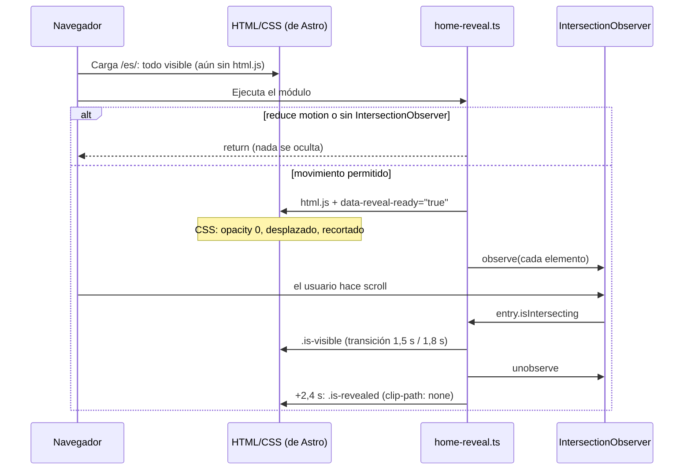

# La portada (spec 002)

> Fecha: 2026-11-11 · Cambios cubiertos: commit `5edbb07` (spec `specs/002-homepage/`): `src/pages/[locale]/index.astro`, `src/components/home/*.astro`, `src/lib/home-work.ts`, `src/scripts/home-reveal.ts`, las partes de hero y _reveal_ de `src/styles/global.css`, y los cambios de `ButtonLink.astro`, `Footer.astro` e iconos

Requisitos previos: [002 · Astro](002-astro-y-el-sitio-estatico.md) y [003 · Rutas e idiomas](003-rutas-e-idiomas.md). El funcionamiento interno del slideshow tiene su propia lección: [007 · El slideshow en profundidad](007-el-slideshow.md).

## 1. ¿Qué se ha implementado?

La página de inicio, de arriba abajo:

1. **Hero**: una foto panorámica del Peñón de Calpe a todo lo ancho, con un velo azul translúcido y un panel con el título, el texto y dos botones («Solicitar presupuesto» y «Ver servicios»).
2. **Franja de credenciales**: tres datos (experiencia, autorización y seguro) en una franja azul.
3. **Tres categorías de trabajo**: Iluminación, Electricidad y Climatización. Cada una tiene un **slideshow** de fotos reales y cuatro viñetas, y alternan la posición de la foto (izquierda, derecha, izquierda).
4. **Cierre**: una banda azul con botones de llamada y WhatsApp, seguida del pie.

Además, los bloques **aparecen suavemente** al entrar en pantalla (_reveal on scroll_), siempre que el usuario no haya pedido reducir el movimiento.

Un matiz de negocio importante: las tres categorías son **agrupaciones de fotos para la portada**, no servicios nuevos. Los cinco servicios oficiales siguen en `/services/` (comentario de `src/lib/home-work.ts` y riesgos de `specs/002-homepage/plan.md`).

## 2. Tecnologías y conceptos implicados

### 2.1. Separar datos y presentación

La portada aplica una idea sencilla: **qué** se muestra (lista de fotos, orden, lado de la foto) está en un archivo de datos TypeScript; **cómo** se muestra está en los componentes. Para cambiar el orden de las fotos no hay que tocar ningún HTML.

### 2.2. Atributos `data-*`: un contrato entre HTML y JavaScript

HTML permite inventar atributos que empiecen por `data-` (`data-reveal="left"`, `data-slideshow`, `data-interval="8000"`). No tienen efecto por sí mismos, pero:

- CSS puede seleccionarlos: `[data-reveal='left'] { … }`.
- JavaScript puede buscarlos (`querySelectorAll('[data-reveal]')`) y leerlos (`element.dataset.interval`).

En este proyecto son la **interfaz** entre los componentes Astro, que se ejecutan al construir, y los scripts, que se ejecutan en el navegador. El componente marca qué elementos deben animarse; el script no necesita saber nada más.

### 2.3. `IntersectionObserver`

Para saber si un elemento está en pantalla, la forma antigua era escuchar cada evento `scroll` y medir posiciones: costoso y propenso a tirones. `IntersectionObserver` es una API del navegador que **te avisa** cuando un elemento entra o sale del área visible, sin que tengas que medir nada. Le das:

- una función que se llama con las «entradas» que han cambiado;
- opciones como `threshold` (qué fracción del elemento debe verse) y `rootMargin` (agrandar o encoger la zona considerada visible).

### 2.4. Transiciones CSS y propiedades personalizadas

Una **transición** CSS anima el cambio de una propiedad: si un elemento pasa de `opacity: 0` a `opacity: 1` y tiene `transition: opacity 1500ms`, el cambio dura 1,5 s. Basta con **cambiar una clase**: el navegador hace la animación.

Las **propiedades personalizadas** (`--reveal-x: -1rem`) son variables de CSS. Se definen en un selector y se leen con `var(--reveal-x)`. Permiten una sola regla de animación con distintos «parámetros» por elemento.

### 2.5. `prefers-reduced-motion`

Es una preferencia del sistema operativo («Reducir movimiento» en macOS, iOS, Android o Windows) que la web puede consultar. Las animaciones pueden marear a personas con trastornos vestibulares. Respetarla es un requisito de accesibilidad y una regla del proyecto (`CLAUDE.md`). Se consulta en CSS con `@media (prefers-reduced-motion: reduce)` y en JavaScript con `window.matchMedia('(prefers-reduced-motion: reduce)')`.

### 2.6. Mejora progresiva (repaso)

Ya la vimos con el menú móvil (lección 002): la página debe funcionar **sin JavaScript**, y el JavaScript solo añade. En la portada esto tiene una consecuencia delicada: si el CSS ocultase los bloques para luego «revelarlos», y el JavaScript no llegase a ejecutarse, **la página quedaría en blanco**. La sección 3.5 muestra cómo se evita.

## 3. Entendiendo la implementación

### 3.1. La página: `src/pages/[locale]/index.astro`

```astro
<BaseLayout
  locale={locale}
  title={t.meta.home.title}
  description={t.meta.home.description}
  path="/"
>
  <Hero locale={locale} />
  <WorkCategories locale={locale} />

  <section class="on-dark border-t-4 border-accent bg-brand text-white">...</section>

  <script>
    import '@/scripts/home-reveal';
    import '@/scripts/home-slideshow';
  </script>
</BaseLayout>
```

La página solo **compone**: hero, categorías y cierre. El `<script>` importa los dos módulos del navegador. Astro los empaqueta en un único archivo externo (en la construcción actual, `/_astro/index.astro_astro_type_script_index_0_lang.DvKYdJ-X.js`) que solo se carga en la portada.

### 3.2. El hero: `src/components/home/Hero.astro`

```astro
<section class="on-dark relative isolate overflow-hidden bg-brand text-white" data-testid="hero">
  
  <div class="hero-scrim absolute inset-0 -z-10" aria-hidden="true"></div>
```

Tres capas apiladas:

1. **La foto**, posicionada en absoluto y llenando la sección (`absolute inset-0 h-full w-full`), al fondo (`-z-20`).
   - `object-cover` recorta la imagen para llenar el hueco sin deformarla.
   - `object-[50%_50%]` y `lg:object-[50%_45%]` eligen qué parte se conserva al recortar: en escritorio, un poco más arriba.
2. **El velo** (_scrim_) `.hero-scrim`, encima (`-z-10`). Es un degradado azul definido en `global.css`: de abajo arriba en móvil, donde el panel está abajo, y de izquierda a derecha desde `64rem` (`lg`), donde el panel está a la izquierda. Asegura que el texto blanco se lea sobre cualquier zona de la foto. `aria-hidden="true"` lo oculta a los lectores de pantalla, porque es decorativo.
3. **El panel de texto** (`hero-copy`), con `bg-brand/80` (azul al 80 % de opacidad).

`isolate` crea un nuevo contexto de apilamiento, para que los `z-index` negativos de la foto y el velo no se escapen por detrás de la sección.

Atributos de rendimiento de la imagen:

- `loading="eager"` y `fetchpriority="high"`: es lo primero que ve el usuario, así que se pide de inmediato y con prioridad. Es la imagen que marca el **LCP** (_Largest Contentful Paint_), la métrica de cuánto tarda en verse el contenido principal.
- `width` y `height`: el navegador reserva el hueco antes de descargarla, y la página no «salta».

**Problema conocido** (`BACKLOG.md`, B1): `hero.jpg` pesa 2,0 MB a 4898×3265, y en móvil retrasa ese primer pintado. El arreglo propuesto es exportarla a unos 1920 px en WebP (≤ 300 KB).

Debajo, la **franja de credenciales** recorre `facts` con `.map` y pinta tres `<li>`. `divide-y` (móvil) y `sm:divide-x sm:divide-y-0` (desde `sm`) dibujan los separadores: horizontales cuando están apiladas y verticales cuando van en fila.

> Actualización 2026-11-21: la franja ya no vive en `Hero.astro`: se trasladó sin cambios a `src/components/home/CredentialRail.astro`, y entre el hero y la franja hay ahora una fila de pictogramas. El hero incorpora además el logo nuevo. Ver [009 · El logo nuevo y la fila de categorías](009-logo-y-fila-de-categorias.md).

### 3.3. Los datos: `src/lib/home-work.ts`

```ts
export type WorkCategoryKey = 'ilumination' | 'electricity' | 'climatization';

export interface WorkImage {
  src: string;
  width: number;
  height: number;
}

export interface WorkCategory {
  key: WorkCategoryKey;
  tone: 'light' | 'muted';
  stageSide: 'left' | 'right';
  images: readonly WorkImage[];
}
```

Y la lista (abreviada):

```ts
export const workCategories: readonly WorkCategory[] = [
  {
    key: 'ilumination',
    tone: 'light',
    stageSide: 'left',
    images: [
      // The first slide pair is fixed: skyscraper1 opens the one-up mobile stage,
      // and skyscraper1 + skyscraper2 open the two-up desktop stage.
      { src: '/homepage/ilumination/skyscraper1.jpg', width: 1536, height: 2048 },
      { src: '/homepage/ilumination/skyscraper2.jpg', width: 1536, height: 2048 },
      ...
    ],
  },
  { key: 'electricity', tone: 'muted', stageSide: 'right', images: [ ... ] },
  { key: 'climatization', tone: 'light', stageSide: 'left', images: [ ... ] },
];
```

- `key` conecta cada categoría con sus textos: `t.home.work.categories[category.key]`.
- `tone` y `stageSide` producen la alternancia visual: fondos blanco, gris y blanco, y foto a la izquierda, derecha e izquierda.
- **El orden del array es el orden del slideshow.** Para que Iluminación abra con `skyscraper1` y `skyscraper2`, basta con ponerlas primero; no hay ningún caso especial en el código (`specs/002-homepage/plan.md`, 4.3).
- Las rutas empiezan por `/homepage/…` porque los archivos están en `public/homepage/`. Todo lo que hay en `public/` se copia tal cual a `dist/`, sin procesar.
- Cantidades: 6 fotos en Iluminación, 4 en Electricidad y 5 en Climatización.

### 3.4. Categoría y slideshow: `WorkCategory.astro` y `WorkSlideshow.astro`

`WorkCategories.astro` solo recorre la lista: `workCategories.map((category) => <WorkCategory … />)`.

`WorkCategory.astro` traduce los datos en decisiones de diseño:

```ts
const stageFirst = category.stageSide === 'left';
const revealDirection = stageFirst ? 'left' : 'right';
const stageOrder = stageFirst ? 'md:order-1' : 'md:order-2';
const copyOrder = stageFirst ? 'md:order-2' : 'md:order-1';
const toneClass = category.tone === 'muted' ? 'bg-surface-muted' : 'bg-white';
```

- Desde `md`, una rejilla de 12 columnas: el escenario de fotos ocupa 7 columnas (8 en `lg`) y el texto 5 (4 en `lg`).
- La clase `order` cambia la posición **visual** sin cambiar el orden en el HTML. En móvil, sin rejilla, la foto siempre va primero.
- `revealDirection`: la foto «entra» desde su lado (`data-reveal="left"` o `"right"`).
- `aria-labelledby={`work-${category.key}`}` asocia la `<section>` a su `<h2>`, para que los lectores de pantalla la anuncien por su título.

`WorkSlideshow.astro` genera el HTML del slideshow:

```astro
<div
  class="work-slideshow"
  data-slideshow
  data-interval="8000"
  data-odd={hasOddSlideCount ? 'true' : undefined}
  data-testid={`slideshow-${categoryKey}`}
>
  <div
    class="work-slideshow-track"
    data-slideshow-track
    tabindex="0"
    role="group"
    aria-label={stageLabel}
  >
    {images.map((image, index) => (
      <figure class="work-slide" data-slideshow-slide>
        
      </figure>
    ))}
  </div>
</div>
```

- Los atributos `data-slideshow`, `data-slideshow-track` y `data-slideshow-slide` son el contrato con `home-slideshow.ts` (lección 007).
- `data-odd` solo aparece si el número de fotos es impar (Climatización: 5). Si el valor es `undefined`, Astro **no escribe** el atributo, y el CSS usa su presencia (lección 007).
- `tabindex="0"` hace el carrusel enfocable con el teclado. `role="group"` y `aria-label` lo describen; el texto incluye las instrucciones («Pulse o use la barra espaciadora para pausar o reanudar»), porque no hay botones visibles.
- `alt` sale de una plantilla del diccionario: `'…, foto {current} de {total}.'` → «…, foto 3 de 6.». Según `AGENTS.md` y `MEMORY.md`, las descripciones concretas de cada foto están **pendientes** del propietario; mientras, se usa este texto neutro, sin inventar detalles.
- `loading="lazy"`: las fotos del carrusel no se descargan hasta que se acercan a la pantalla, al contrario que el hero.

**Sin JavaScript**, esto ya es un carrusel funcional: `global.css` convierte `.work-slideshow-track` en una fila con desplazamiento horizontal nativo y _scroll snap_. Se puede deslizar con el dedo o con la barra de desplazamiento. El script solo añade el avance automático y el fundido.

### 3.5. La aparición al hacer scroll: `home-reveal.ts` + CSS

**Paso 1, el marcado.** Los componentes ponen `data-reveal` en lo que debe animarse: la foto (`"left"` o `"right"`), el bloque de título (`"up"`), cada viñeta (`"up"`) y el texto del cierre (`"up"`).

**Paso 2, los parámetros por dirección** (`global.css`):

```css
[data-reveal] {
  --reveal-x: 0rem;
  --reveal-y: 1.5rem;
  --reveal-delay: 0ms;
  --reveal-clip: inset(0 0 8% 0);
}

[data-reveal='left'] {
  --reveal-x: -1rem;
  --reveal-y: 0rem;
  --reveal-clip: inset(0 8% 0 0);
}
```

Esto **no oculta nada**: solo define variables. Las viñetas reciben un retraso escalonado con `.reveal-stagger > :nth-child(2) { --reveal-delay: 90ms; }`, y así hasta el quinto hijo, para que aparezcan una tras otra.

**Paso 3, el estado oculto, solo si JavaScript lo pide:**

```css
@media (prefers-reduced-motion: no-preference) {
  html.js [data-reveal-ready='true'] {
    opacity: 0;
    translate: var(--reveal-x) var(--reveal-y);
    clip-path: var(--reveal-clip);
    transition:
      opacity 1500ms cubic-bezier(0.4, 0, 0.2, 1) var(--reveal-delay),
      translate 1500ms cubic-bezier(0.4, 0, 0.2, 1) var(--reveal-delay),
      clip-path 1800ms cubic-bezier(0.4, 0, 0.2, 1) var(--reveal-delay);
  }

  html.js [data-reveal-ready='true'].is-visible {
    opacity: 1;
    translate: 0 0;
    clip-path: inset(0);
  }
```

Este es el truco de la mejora progresiva. Un elemento solo se oculta si se cumplen **tres** condiciones a la vez:

1. El usuario no pidió reducir el movimiento (`no-preference`).
2. `<html>` tiene la clase `js`, que solo el script añade.
3. El elemento tiene `data-reveal-ready="true"`, que también pone el script.

Si el script no se ejecuta, por error o por JavaScript desactivado, ninguna condición de JS se cumple y **todo se ve normalmente**.

- `clip-path: inset(0 8% 0 0)` recorta un 8 % por un lado; al pasar a `inset(0)`, el recorte se «abre» y da la sensación de que el bloque se despliega.
- `cubic-bezier(...)` define la curva de aceleración de la animación.

**Paso 4, el script** (`src/scripts/home-reveal.ts`, completo salvo las constantes):

```ts
function initHomeReveal(): void {
  const prefersReducedMotion = window.matchMedia('(prefers-reduced-motion: reduce)').matches;

  if (prefersReducedMotion || !('IntersectionObserver' in window)) {
    return;
  }

  const elements = Array.from(document.querySelectorAll<HTMLElement>(REVEAL_SELECTOR));

  if (elements.length === 0) {
    return;
  }

  document.documentElement.classList.add('js');

  const observer = new IntersectionObserver(
    (entries) => {
      for (const entry of entries) {
        if (!entry.isIntersecting) {
          continue;
        }

        const element = entry.target as HTMLElement;

        element.classList.add('is-visible');
        observer.unobserve(element);

        // Remove the clip mask once the transition is over so focus rings are never clipped.
        window.setTimeout(() => element.classList.add('is-revealed'), REVEAL_TIMEOUT_MS);
      }
    },
    { threshold: 0.15, rootMargin: '0px 0px -10% 0px' },
  );

  for (const element of elements) {
    element.dataset.revealReady = 'true';
    observer.observe(element);
  }
}
```

Paso a paso:

1. **Salidas tempranas.** Con movimiento reducido, o en un navegador sin `IntersectionObserver`, no hace nada, y por tanto nada se oculta.
2. Añade `js` a `<html>` y marca cada elemento con `data-reveal-ready="true"`. Desde este momento el CSS los oculta.
3. Observa cada elemento. Cuando al menos un 15 % (`threshold: 0.15`) entra en la zona visible, encogida un 10 % por abajo (`rootMargin: '0px 0px -10% 0px'`), así que la animación empieza algo después de asomar:
   - añade `is-visible`, y el CSS hace la transición;
   - deja de observarlo (`unobserve`): la animación ocurre **una sola vez**;
   - a los 2400 ms añade `is-revealed`, que pone `clip-path: none`. El comentario explica por qué: un `clip-path` residual podría recortar el contorno de foco de un botón o enlace.

`MEMORY.md` destaca que el efecto **no secuestra el scroll** (_no scroll hijack_): la página se desplaza normalmente y las animaciones solo reaccionan. La prueba e2e `reveals content on scroll without hijacking the page` lo comprueba.

**Paso 5, la red de seguridad del movimiento reducido** (`global.css`):

```css
@media (prefers-reduced-motion: reduce) {
  *,
  *::before,
  *::after {
    animation-duration: 0.01ms !important;
    ...
    transition-duration: 0.01ms !important;
    ...
  }
  ...
  [data-reveal] {
    opacity: 1 !important;
    translate: none !important;
    clip-path: none !important;
    transition: none !important;
  }
```

Aunque algo escapase a la comprobación del script, el CSS fuerza que todo esté visible y sin transiciones.

**La animación de entrada del hero** (`hero-image-in` y `hero-copy-in`) usa `@keyframes` y solo se aplica bajo `html.js` y sin movimiento reducido. Ojo: la clase `js` la añade `home-reveal.ts`, así que el hero solo se anima si ese script se ejecutó.

### 3.6. Acciones de contacto y pie

El commit `5edbb07` añadió a `ButtonLink` la variante `whatsapp` (verde, tokens `--color-whatsapp*` en `@theme`) y la prop `icon`, con los SVG `IconWhatsApp.astro` e `IconPhone.astro`. Los iconos llevan `aria-hidden="true"` y `focusable="false"`: el texto del botón ya dice lo que hace, y el icono es decorativo. El pie pasó a tres columnas (contacto, horario y zona), con los datos de `site.ts` y los textos del diccionario.

## 4. Flujo de ejecución



¿Se llega a ver un parpadeo, con los elementos visibles un instante y luego ocultos? El script es un módulo (`type="module"`), y los módulos se ejecutan tras analizar el HTML. En teoría podría haber un instante visible antes de que el script los oculte. En la práctica los elementos que lo usan están más abajo del hero, fuera de la primera pantalla. _No lo he medido._

## 5. Decisiones técnicas importantes

Registradas en `specs/002-homepage/plan.md` y `MEMORY.md`:

- **Sin dependencias nuevas ni sistema de optimización de imágenes** (plan, «Confirmed decisions»): las fotos se sirven tal cual desde `public/`. Por eso existe el problema B1 del hero; usar `srcset` o el componente `<Image>` de Astro sería cambiar esa decisión.
- **Animaciones lentas y suaves** (1,5 s y 1,8 s), tras la revisión del propietario. Siguen pendientes de su aprobación visual.
- **Sin controles visibles en el slideshow**: la pausa es por clic o teclado y está explicada en la etiqueta accesible (lección 007).
- **Tres agrupaciones, no servicios**: evita contradecir la regla de los cinco servicios.
- **Al modificar:**
  - Para añadir o reordenar fotos, edita solo `home-work.ts`, con `width` y `height` reales. Si cambia de par a impar, `data-odd` se ajusta solo.
  - Para hacer aparecer un bloque nuevo, añade `data-reveal="up"` (o `left`/`right`). No hace falta tocar el script.
  - No ocultes nada con CSS que no dependa de `html.js`: romperías la página sin JavaScript.
  - Comprueba siempre con «Reducir movimiento» activado.

## 6. Ejemplos prácticos

- **Electricidad** (`stageSide: 'right'`, `tone: 'muted'`): fondo `bg-surface-muted`, foto con `md:order-2` (a la derecha desde `md`) y `data-reveal="right"`, así que entra desde la derecha (`--reveal-x: 1rem`).
- **Climatización** (5 fotos): `hasOddSlideCount = 5 % 2 === 1` → `true` → el `div` lleva `data-odd="true"`. Electricidad (4) no lo lleva.
- `imageAlt(2)` en Iluminación (6 fotos), en español: «Trabajo de iluminación realizado por EA electricidad y multiservicios, foto 3 de 6.».
- La tercera viñeta de una categoría: `.reveal-stagger > :nth-child(3)` → `--reveal-delay: 180ms`, así que empieza 180 ms después de la primera.
- Con «Reducir movimiento» activado: no hay clase `js` en `<html>`, todo es visible desde el principio y el slideshow arranca en pausa. La prueba e2e `shows all content immediately with reduced motion and starts paused` lo comprueba.

## 7. ¿Qué debo recordar?

- La portada compone tres piezas: `Hero`, `WorkCategories` y la banda de cierre. Los datos de las fotos viven en `home-work.ts`.
- `stageSide` y `tone` producen la alternancia; `order` mueve visualmente sin cambiar el HTML.
- Los atributos `data-*` son el contrato entre los componentes, el CSS y los scripts.
- Un elemento solo se oculta para animarlo si hay movimiento permitido, `html.js` y `data-reveal-ready`. Sin JavaScript, todo es visible.
- `IntersectionObserver` dispara cada animación una sola vez; `is-revealed` quita el recorte al final.
- El hero se carga con prioridad; las fotos del carrusel, en diferido.

## 8. Para seguir aprendiendo

- MDN, Intersection Observer API: <https://developer.mozilla.org/es/docs/Web/API/Intersection_Observer_API>
- MDN, `prefers-reduced-motion`: <https://developer.mozilla.org/es/docs/Web/CSS/@media/prefers-reduced-motion>
- MDN, transiciones CSS: <https://developer.mozilla.org/es/docs/Web/CSS/CSS_transitions/Using_CSS_transitions>
- web.dev, Largest Contentful Paint: <https://web.dev/articles/lcp>
- Siguiente lección: [007 · El slideshow en profundidad](007-el-slideshow.md).

## Limitaciones y puntos sin verificar

- No he podido ver las imágenes ni la página renderizada. Las descripciones visuales (recortes, colores del velo) salen del código y de `MEMORY.md`. Según `MEMORY.md`, la aprobación visual del propietario está **pendiente**.
- No he ejecutado las pruebas e2e. `MEMORY.md` registra 43/43 en verde el 2026-11-06.
- `public/homepage/hero.webp` existe pero no se usa (B1). `public/worker1.jpg` tampoco se usa y se copia a `dist/` (B2).
- El posible parpadeo inicial de los elementos animados no lo he medido.
