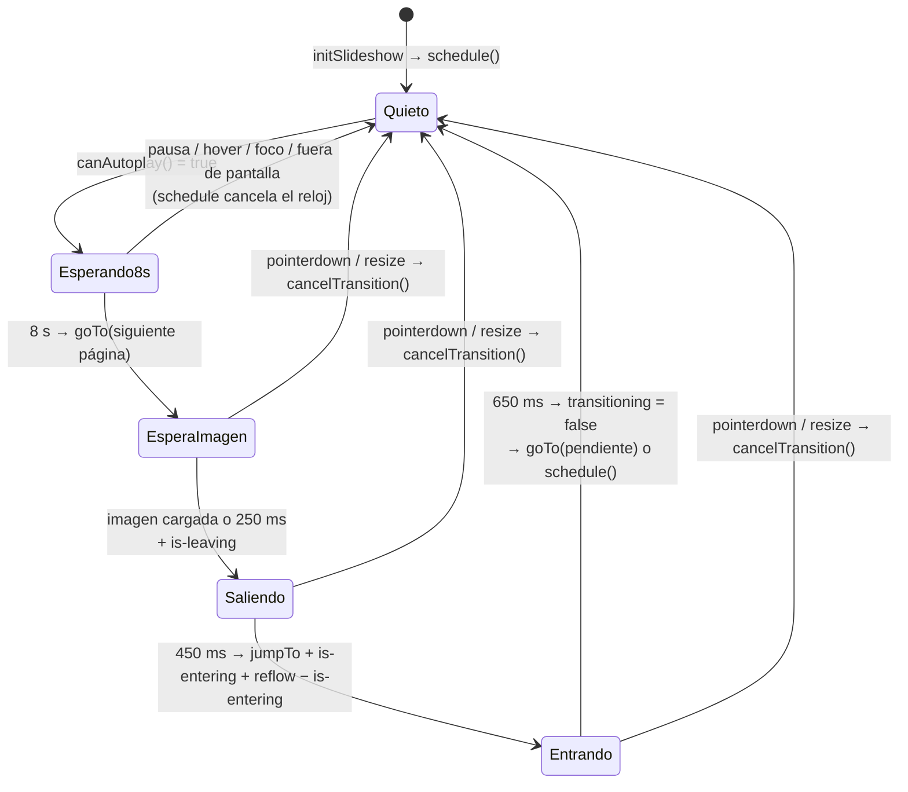

# El slideshow en profundidad

> Fecha: 2026-11-11 · Cambios cubiertos: commit `5edbb07`: `src/scripts/home-slideshow.ts`, la sección «Work slideshow» de `src/styles/global.css` y `src/components/home/WorkSlideshow.astro`

Requisito previo: [006 · La portada](006-la-portada.md), sobre todo la sección 3.4 (el HTML del slideshow) y el concepto de mejora progresiva.

## 1. ¿Qué se ha implementado?

Cada categoría de la portada tiene un carrusel de fotos que:

- **avanza solo cada 8 segundos**, una «página» cada vez: dos fotos en escritorio (`lg`) y una en móvil, para que en escritorio una pareja nunca repita una foto de la anterior;
- cambia con un **fundido de derecha a izquierda**: la imagen actual se desvanece hacia la izquierda (450 ms), salta de forma invisible y la nueva aparece desde la derecha (650 ms);
- **se pausa** con el ratón encima, con el foco del teclado dentro, si no está en pantalla o si la pestaña está oculta;
- **alterna pausa y reproducción** con clic o toque, o con Espacio o Intro;
- se maneja con el **teclado**: flechas (página anterior o siguiente), `Home` (inicio) y `End` (final);
- con **movimiento reducido**, arranca en pausa y cambia sin animación;
- **sin JavaScript**, sigue siendo un carrusel nativo que se desliza.

No tiene botones, contador ni barra de progreso visibles. Fue una decisión del propietario (`MEMORY.md`), y la prueba e2e `shows no visible controls or counter` lo comprueba.

Todo esto ocupa 448 líneas de TypeScript sin librerías. Es el código más complejo del proyecto; esta lección lo desmonta por partes.

## 2. Tecnologías y conceptos implicados

### 2.1. El carrusel nativo: `overflow-x` y _scroll snap_

La base no es JavaScript, sino CSS (`global.css`):

```css
.work-slideshow-track {
  display: flex;
  gap: var(--slideshow-gap);
  overflow-x: auto;
  overscroll-behavior-x: contain;
  scroll-snap-type: x mandatory;
  scrollbar-width: none;
  ...
}

.work-slide {
  flex: 0 0 100%;
  aspect-ratio: 3 / 4;
  ...
  scroll-snap-align: start;
}

@media (min-width: 64rem) {
  .work-slide {
    flex-basis: calc(50% - (var(--slideshow-gap) / 2));
  }
```

- Las diapositivas van en fila (`flex`). Cada una mide el 100 % del ancho en móvil y la mitad menos medio hueco desde `64rem` (`lg`): **dos por pantalla**.
- `overflow-x: auto`: lo que no cabe se desplaza en horizontal.
- `scroll-snap-type: x mandatory` + `scroll-snap-align: start`: al soltar el dedo, el carrusel «encaja» con el inicio de una diapositiva, como un imán. No se queda a medias.
- `overscroll-behavior-x: contain`: llegar al final del carrusel no desplaza la página entera.

El script **mueve este mismo desplazamiento** (`scrollLeft`). No reemplaza el carrusel, lo conduce.

### 2.2. Clausuras (_closures_): un estado por carrusel

Hay tres carruseles en la página y cada uno necesita su propio estado (índice, pausa, temporizadores). El script no usa clases: usa **clausuras**. `initSlideshow(root)` crea un objeto `slideshow` y define dentro funciones (`goTo`, `schedule`…) que lo usan. Cada llamada a `initSlideshow` crea un juego nuevo de funciones que «recuerdan» **su** objeto.

Analogía (solo como ayuda): tres mandos a distancia idénticos, cada uno emparejado con su televisor. Mismo diseño, conexión distinta.

### 2.3. Temporizadores: `setTimeout` encadenado

Para «cada 8 segundos» se podría usar `setInterval`, pero el avance depende de muchas condiciones que cambian (pausa, visibilidad, una transición en curso). El script usa `setTimeout` de **un solo disparo**, y lo vuelve a programar al terminar cada avance (`schedule()`). Cada vez que algo cambia, `schedule()` cancela el temporizador pendiente y decide si programar otro. Así nunca hay dos relojes compitiendo.

### 2.4. Promesas para «esperar a que cargue la imagen»

Una `Promise` representa un resultado futuro. `waitForImage` devuelve una promesa que se cumple cuando la imagen termina de cargar, o tras 250 ms como máximo. `.then(...)` ejecuta el fundido cuando eso ocurre. Así se evita fundir hacia una imagen que aún está en blanco (las fotos usan `loading="lazy"`).

### 2.5. Una pequeña máquina de estados

El carrusel siempre está en uno de dos modos: **quieto** o **en transición** (`transitioning`). Muchas funciones empiezan preguntando «¿estoy en transición?» para decidir qué hacer. Si llega una orden durante una transición, no se ejecuta en ese momento: se **apunta** (`pendingIndex`) y se atiende al terminar.

## 3. Entendiendo la implementación

### 3.1. El estado

```ts
interface SlideshowState {
  root: HTMLElement;
  track: HTMLElement;
  slides: HTMLElement[];
  index: number;
  paused: boolean;
  hovered: boolean;
  inView: boolean;
  reducedMotion: boolean;
  interval: number;
  timer: number | null;
  transitionTimer: number | null;
  transitioning: boolean;
  pendingIndex: number | null;
  programmaticUntil: number;
  resizeTimer: number | null;
  scrollTimer: number | null;
}
```

Agrupado por propósito:

- **Elementos del DOM**: `root` (`[data-slideshow]`), `track` (la fila que se desplaza) y `slides`.
- **Posición**: `index`, el número de la primera diapositiva visible.
- **¿Puede avanzar solo?**: `paused` (pausa del usuario), `hovered` (ratón o foco dentro), `inView` (en pantalla) y `reducedMotion`.
- **Temporizadores**: `timer` (el de 8 s), `transitionTimer` (las fases del fundido), `resizeTimer` y `scrollTimer`. Guardar sus identificadores permite cancelarlos.
- **Transición**: `transitioning` y `pendingIndex`.
- `programmaticUntil`: hasta qué instante hay que ignorar los eventos `scroll` porque los provocó el propio script (sección 3.6).

`readState` lo inicializa leyendo el HTML:

```ts
const interval = Number(root.dataset.interval ?? 8000);
...
paused: reducedMotionQuery.matches,
...
interval: Number.isFinite(interval) && interval > 1000 ? interval : 8000,
```

- `root.dataset.interval` lee `data-interval="8000"` del componente. El script valida el valor y, si no es un número mayor que 1000, usa 8000.
- `paused` empieza en `true` si el usuario tiene activado «Reducir movimiento».

### 3.2. Medir sin suponer: `getStep` y `getVisibleCount`

```ts
function getStep(): number {
  if (slides.length < 2) {
    return track.clientWidth;
  }

  return slides[1].offsetLeft - slides[0].offsetLeft;
}

function getVisibleCount(): number {
  const step = getStep();

  if (step <= 0) {
    return 1;
  }

  return Math.max(1, Math.round(track.clientWidth / step));
}
```

En lugar de copiar en JavaScript los puntos de ruptura del CSS, el script **mide** el resultado:

- El **paso** es la distancia entre el inicio de la diapositiva 0 y el de la 1, es decir, ancho de diapositiva + hueco.
- Las **diapositivas visibles** son el ancho del carril dividido por el paso, redondeado.

Con números aproximados: en escritorio, si el carril mide 800 px y el hueco 12 px, cada diapositiva mide 394 px y el paso 406 px. 800 / 406 ≈ 1,97 → **2**. En móvil, si el carril mide 335 px, la diapositiva también mide 335 y el paso 347: 335 / 347 ≈ 0,97 → **1**.

Ventaja: si mañana el CSS mostrase tres por pantalla, el script se adaptaría solo.

### 3.3. La aritmética de páginas

Aquí está la regla «una pareja nunca repite una foto». Las páginas empiezan en múltiplos de `visible`:

```ts
function getLastPageStart(): number {
  const visible = getVisibleCount();

  return Math.floor((slides.length - 1) / visible) * visible;
}
```

```ts
function getNextPageStart(index: number): number {
  const visible = getVisibleCount();
  const last = getLastPageStart();
  const threshold = index + visible;

  // Skip past any page that would repeat a currently visible image. This only
  // matters after a manual swipe settles between two canonical pages.
  for (let start = 0; start <= last; start += visible) {
    if (start >= threshold) {
      return start;
    }
  }

  return 0;
}
```

`getNextPageStart` busca la primera página que empiece **después** de la última foto visible (`index + visible`). Si no hay ninguna, vuelve al principio (0). `getPreviousPageStart` hace lo simétrico hacia atrás y, si no hay ninguna, va a la última.

**Traza con Iluminación (6 fotos, escritorio, `visible = 2`):**

- `last = floor(5 / 2) × 2 = 4`. Páginas: **0** (fotos 0-1), **2** (fotos 2-3), **4** (fotos 4-5).
- Desde 0: `threshold = 2` → la primera página ≥ 2 es **2**.
- Desde 4: `threshold = 6` → ninguna página ≥ 6 → vuelve a **0**.

**Traza tras un deslizamiento manual que deja `index = 1`** (se ven las fotos 1 y 2):

- `threshold = 3`. La página 2 empezaría con la foto 2, que **ya está a la vista**, así que se salta: la siguiente es **4**. Esto es lo que dice el comentario del código.

**Climatización (5 fotos, escritorio):**

- `last = floor(4 / 2) × 2 = 4`. Páginas: 0 (0-1), 2 (2-3) y **4** (la foto 4 sola).
- Para que el carril pueda desplazarse hasta dejar la foto 4 alineada a la izquierda, necesita espacio detrás. Lo aporta el CSS:

```css
.work-slideshow[data-odd] .work-slideshow-track::after {
  content: '';
  flex: 0 0 calc(50% - (var(--slideshow-gap) / 2));
}
```

Un pseudoelemento vacío del ancho de una diapositiva, solo cuando hay `data-odd` y solo en `lg`. Sin él, el desplazamiento máximo dejaría ver las fotos 3 y 4, repitiendo la 3. Por eso `MEMORY.md` habla de «un hueco al final» en Climatización.

**En móvil (`visible = 1`)** todo se simplifica: las páginas son 0, 1, 2… y `last = slides.length - 1`.

### 3.4. Programar el avance: `canAutoplay` y `schedule`

```ts
function canAutoplay(): boolean {
  return (
    !slideshow.paused &&
    !slideshow.hovered &&
    slideshow.inView &&
    !document.hidden &&
    slides.length > getVisibleCount()
  );
}

function schedule(): void {
  clearTimer();

  if (!canAutoplay()) {
    return;
  }

  slideshow.timer = window.setTimeout(() => {
    slideshow.timer = null;
    goTo(getNextPageStart(slideshow.index));
  }, slideshow.interval);
}
```

`canAutoplay` reúne **todas** las condiciones en un solo sitio:

- no está en pausa;
- no hay ratón ni foco dentro;
- está en pantalla;
- la pestaña está visible (`document.hidden` es `true` cuando cambias de pestaña);
- hay más fotos de las que caben (si caben todas, no hay nada que pasar).

`schedule` es **idempotente**: llamarla dos veces seguidas deja el mismo resultado que una, porque siempre empieza cancelando. Por eso todos los manejadores de eventos pueden llamarla sin miedo. La regla del archivo es «cambia el estado y llama a `schedule()`».

### 3.5. El fundido: `goTo`

Es la función central. Primero, la versión **simplificada** (ilustrativa, no es código real):

```text
goTo(destino):
  ajustar destino (por debajo de 0 → última página; por encima → 0)
  si estoy en transición → apuntar destino como pendiente y salir
  si ya estoy ahí → reprogramar y salir
  index = destino; parar el reloj
  si reducedMotion → saltar sin animación, reprogramar y salir
  transitioning = true
  esperar la imagen (máx. 250 ms)
    → añadir is-leaving              (450 ms: se desvanece hacia la izquierda)
    → saltar scrollLeft al destino   (invisible: opacity 0)
    → poner is-entering y quitarlo   (650 ms: aparece desde la derecha)
    → transitioning = false
    → si hay pendiente → goTo(pendiente); si no → reprogramar
```

El código real de la parte animada:

```ts
slideshow.transitioning = true;

void waitForImage(nextIndex).then(() => {
  if (!slideshow.transitioning) {
    return;
  }

  track.classList.add('is-leaving');

  slideshow.transitionTimer = window.setTimeout(() => {
    slideshow.transitionTimer = null;

    if (!slideshow.transitioning) {
      return;
    }

    jumpTo(slideshow.index);
    track.classList.remove('is-leaving');
    track.classList.add('is-entering');

    // Force a reflow so the entering position is committed before it settles.
    void track.offsetWidth;
    track.classList.remove('is-entering');

    slideshow.transitionTimer = window.setTimeout(() => {
      slideshow.transitionTimer = null;
      slideshow.transitioning = false;

      const pending = slideshow.pendingIndex;
      slideshow.pendingIndex = null;

      if (pending !== null) {
        goTo(pending);
      } else {
        schedule();
      }
    }, FADE_IN_MS);
  }, FADE_OUT_MS);
});
```

Las clases y sus reglas CSS:

```css
.work-slideshow-track.is-leaving {
  opacity: 0;
  translate: -1.5% 0;
  transition:
    opacity 450ms cubic-bezier(0.55, 0, 0.55, 0.2),
    translate 450ms cubic-bezier(0.55, 0, 0.55, 0.2);
}

.work-slideshow-track.is-entering {
  opacity: 0;
  translate: 1.5% 0;
  transition: none;
}
```

Detalles que conviene entender:

- **Las comprobaciones `if (!slideshow.transitioning) return;`** aparecen en cada fase. Si mientras tanto el usuario tocó el carrusel, `cancelTransition()` puso `transitioning = false`, y las fases pendientes se abandonan sin hacer nada.
- **El truco del _reflow_** (`void track.offsetWidth`). El navegador agrupa los cambios de estilo y los aplica juntos. Si añades `is-entering` y lo quitas en la misma línea, el navegador «no se entera» de que estuvo, y no hay animación de entrada. Leer `offsetWidth` obliga al navegador a calcular el diseño **en ese momento**, con `is-entering` puesto: opacidad 0, desplazado a la derecha y `transition: none`, así que el cambio es instantáneo. Al quitar la clase, vuelve la transición base de 650 ms hacia opacidad 1 y posición 0. `void` solo indica «leo esto por su efecto, no por su valor».
- **`jumpTo` usa `behavior: 'auto'`**, un salto instantáneo. Ocurre cuando el carril es invisible, así que el usuario no ve el desplazamiento: solo el fundido.

`waitForImage` garantiza que la promesa se resuelva **una sola vez**, venga lo que venga primero: `load`, `error` o el tiempo límite:

```ts
return new Promise((resolve) => {
  let settled = false;

  const finish = (): void => {
    if (settled) {
      return;
    }

    settled = true;
    resolve();
  };

  image.addEventListener('load', finish, { once: true });
  image.addEventListener('error', finish, { once: true });
  window.setTimeout(finish, DECODE_WAIT_MS);
});
```

### 3.6. Sincronizarse con el desplazamiento manual

El usuario puede deslizar el carrusel con el dedo. El script tiene que actualizar `index` para que el siguiente avance automático parta del sitio correcto:

```ts
track.addEventListener(
  'scroll',
  () => {
    if (slideshow.scrollTimer !== null) {
      window.clearTimeout(slideshow.scrollTimer);
    }

    slideshow.scrollTimer = window.setTimeout(syncFromScroll, 120);
  },
  { passive: true },
);
```

- **_Debounce_** («esperar a que se calme»): `scroll` se dispara decenas de veces por segundo. Cada evento reinicia un temporizador de 120 ms, y `syncFromScroll` solo se ejecuta cuando han pasado 120 ms sin desplazamiento.
- `{ passive: true }` promete al navegador que el manejador no llamará a `preventDefault()`, lo que le permite desplazar con fluidez.

`syncFromScroll` ignora los desplazamientos **provocados por el propio script**:

```ts
if (slideshow.transitioning) {
  return;
}

if (window.performance.now() < slideshow.programmaticUntil) {
  return;
}
```

`jumpTo` fija `programmaticUntil = performance.now() + 200`. El evento `scroll` que provoca `jumpTo` llega, espera 120 ms y, como 120 < 200, se descarta. Sin esto, el script reaccionaría a su propio movimiento.

### 3.7. Los eventos del usuario

Cada evento modifica el estado y llama a `schedule()`, `goTo()` o `togglePause()`:

- **`pointerdown`** en el carril: anota la posición X y cancela una transición en curso (el usuario quiere tomar el control).
- **`pointermove`**: si el puntero se ha movido más de 8 px (`DRAG_THRESHOLD_PX`), marca `pointerMoved`.
- **`click`**: si hubo arrastre, lo ignora (era un deslizamiento, no un toque); si no, alterna la pausa.
- **`pointerenter` / `pointerleave`** en `root`: `hovered = true/false`.
- **`focusin` / `focusout`**: igual, con el foco del teclado. `focusout` comprueba `event.relatedTarget` para no reanudar si el foco solo se movió **dentro** del carrusel.
- **`keydown`** en el carril:
  - flechas → `goTo` a la página anterior o siguiente;
  - `Home` → `goTo(0)`; `End` → `goTo(getLastPageStart())`;
  - `' '`, `'Spacebar'` o `'Enter'` → alternar la pausa.
  - Todas llaman a `preventDefault()`, para que la flecha no desplace el carril de forma nativa ni el Espacio baje la página. `'Spacebar'` cubre navegadores antiguos que usaban ese nombre.
- **`resize`** de la ventana (con _debounce_ de 150 ms): cancela la transición, ajusta `index` por si ahora caben más fotos, recoloca y reprograma.
- **`visibilitychange`**: `schedule()`, que gracias a `document.hidden` para o reanuda.
- **`reducedMotionQuery` `change`**: si el usuario activa «Reducir movimiento» con la página abierta, pausa y cancela. Si lo desactiva, `reducedMotion` vuelve a `false` pero `paused` **sigue** en `true`: hay que reanudar a mano (clic o Espacio).
- **`IntersectionObserver`** con `threshold: 0.25`: `inView` es `true` cuando al menos el 25 % del carrusel es visible. Sin soporte, se asume visible.

Por último:

```ts
root.classList.add('slideshow-ready');
updateState();
schedule();
```

`slideshow-ready` es la señal para el CSS. Sin ella (sin JavaScript), esta regla mantiene visible la barra de desplazamiento, que entonces es el único control:

```css
.work-slideshow:not(.slideshow-ready) .work-slideshow-track {
  padding-bottom: 0.5rem;
  scrollbar-width: thin;
}
```

`updateState` refleja la pausa en el HTML (`data-paused="true|false"` y la clase `is-paused`), que usan las pruebas e2e.

## 4. Flujo de ejecución

Ciclo de un avance automático:



Con movimiento reducido, `goTo` salta directamente de `Quieto` a `Quieto`: `jumpTo` instantáneo y `schedule()`. Como además arranca en pausa, solo avanza con el teclado.

## 5. Decisiones técnicas importantes

Del plan (`specs/002-homepage/plan.md`, 4.3 y 10):

- **Avanzar por páginas completas** para que en escritorio no se repitan fotos. Fue una petición del propietario en la primera revisión (`MEMORY.md`).
- **Fundido en lugar de deslizamiento**: el salto real del desplazamiento ocurre con el carril invisible.
- **Carrusel nativo como base**: sin JavaScript, todas las imágenes están en el documento y se pueden deslizar.
- **8 s, pausa por hover o foco, parada fuera de pantalla y pausa por defecto con movimiento reducido**: mitigaciones contra la distracción, recogidas como riesgo en el plan.
- **Sin dependencias**: no se usa ninguna librería de carruseles.

**Problemas conocidos** (`BACKLOG.md`, pendientes de que el propietario autorice su arreglo):

- **B3**: `hovered` sirve a la vez para el ratón y para el foco. Si el foco está en el carril y el ratón entra y sale, `pointerleave` pone `hovered = false` y el carrusel se reanuda aunque el foco siga dentro. Arreglo propuesto: dos banderas separadas.
- **B4**: en Safari móvil, `resize` se dispara al ocultarse la barra de herramientas durante el scroll vertical. El manejador cancela el fundido y recoloca sin necesidad. Arreglo propuesto: actuar solo si cambia `track.clientWidth`, o usar `ResizeObserver`.
- **B5**: si una transición se cancela y empieza otra durante los 250 ms de espera de la imagen, la promesa **antigua** encuentra `transitioning === true` (lo puso la nueva) y ejecuta también su fundido. Arreglo propuesto: un identificador de transición que invalide las promesas antiguas.

**Al modificar:**

- Cualquier cambio de estado debe terminar en `schedule()`; si no, el reloj puede quedarse parado o duplicado.
- Si cambias las duraciones de `.is-leaving` o de la transición base en CSS, cambia también `FADE_OUT_MS` y `FADE_IN_MS`. Están duplicadas en CSS y TypeScript.
- Ejecuta `tests/e2e/homepage.spec.ts` (`-g "slideshow"`): cubre la apertura, las parejas sin repetir, el final impar, el fundido y la pausa.

## 6. Ejemplos prácticos

**Escritorio, Iluminación, sin tocar nada:**

```text
t=0     se ven fotos 0-1 (skyscraper1, skyscraper2)
t=8 s   goTo(2): espera imagen 2 → is-leaving (450 ms) → salto → entrada (650 ms) → fotos 2-3
t≈17 s  goTo(4) → fotos 4-5
t≈26 s  getNextPageStart(4) = 0 → vuelve a fotos 0-1
```

Los tiempos posteriores al primero son aproximados: cada ciclo añade la espera de la imagen y unos 1,1 s de fundido antes de reprogramar los 8 s.

**Escritorio, Climatización, tecla `End`:** `getLastPageStart() = 4` → `goTo(4)` → solo se ve la foto 4, a la izquierda, con el hueco del `::after` a la derecha.

**Móvil, flecha izquierda en la foto 0:** `getPreviousPageStart(0)`: `limit = -1`, ninguna página ≤ -1 → devuelve `last` (4 en Climatización, 5 en Iluminación) → salta a la última.

**Pulsar Espacio dos veces con el foco en el carril:** `data-paused` pasa a `"true"` y luego a `"false"`. Es exactamente lo que comprueba la prueba `toggles pause without visible controls on click and Space`.

## 7. ¿Qué debo recordar?

- La base es un carrusel CSS nativo (`overflow-x` + _scroll snap_); el script solo mueve su `scrollLeft`.
- Cada carrusel tiene su estado gracias a una clausura en `initSlideshow`.
- El script **mide** cuántas fotos se ven (`getStep`, `getVisibleCount`) en vez de duplicar los puntos de ruptura.
- Las páginas empiezan en múltiplos de `visible`. `getNextPageStart` salta cualquier página que repetiría una foto visible.
- `canAutoplay` reúne todas las condiciones; `schedule` siempre cancela y decide, y todos los eventos acaban llamándola.
- `goTo` es una máquina de estados (espera de la imagen → salida → salto → entrada) con órdenes pendientes y cancelación.
- El _reflow_ forzado hace posible la animación de entrada.
- `programmaticUntil` evita que el script reaccione a sus propios desplazamientos.
- Hay tres fallos conocidos (B3, B4 y B5) documentados en `BACKLOG.md`.

## 8. Para seguir aprendiendo

- MDN, CSS scroll snap: <https://developer.mozilla.org/es/docs/Web/CSS/CSS_scroll_snap>
- MDN, clausuras: <https://developer.mozilla.org/es/docs/Web/JavaScript/Closures>
- MDN, `Promise`: <https://developer.mozilla.org/es/docs/Web/JavaScript/Reference/Global_Objects/Promise>
- MDN, Page Visibility API: <https://developer.mozilla.org/es/docs/Web/API/Page_Visibility_API>
- W3C WAI, patrón de carrusel accesible: <https://www.w3.org/WAI/ARIA/apg/patterns/carousel/>
- Siguiente lección: [008 · Pruebas](008-pruebas.md).

## Limitaciones y puntos sin verificar

- Las medidas en píxeles de la sección 3.2 y los tiempos de la sección 6 son ilustrativos: calculados a partir del CSS, no medidos en un navegador.
- No he ejecutado las pruebas e2e del slideshow. `MEMORY.md` registra que pasaron el 2026-11-06.
- Comparación con el plan: `plan.md` describe el paso como «ancho de la primera diapositiva + hueco» y las visibles como «2 en `lg`». El código mide ambas cosas a partir del diseño real. El resultado es equivalente, pero el código no tiene el 2 fijo.
- Al desactivar «Reducir movimiento» con la página abierta, el carrusel sigue en pausa hasta que el usuario lo reanude. Es una consecuencia del código, no una decisión que haya encontrado documentada.
