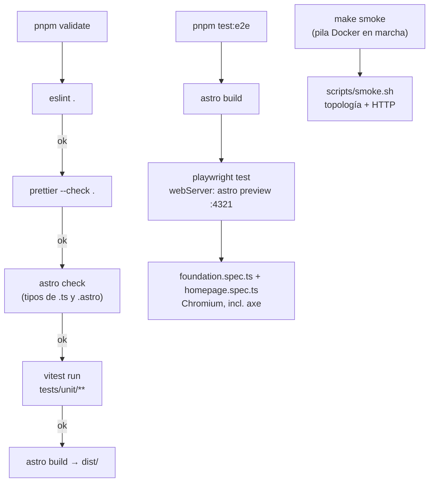

# Pruebas: Vitest, Playwright, axe y la prueba de humo

> Fecha: 2026-11-11 · Cambios cubiertos: estado del proyecto en `5edbb07` (commits `14cb2af` y `5edbb07`): `vitest.config.ts`, `playwright.config.ts`, `tests/unit/*.test.ts`, `tests/e2e/foundation.spec.ts`, `tests/e2e/homepage.spec.ts`, los scripts `test`, `test:e2e` y `validate` de `package.json`, y el papel de `scripts/smoke.sh`

Esta lección se apoya en todas las anteriores: cada prueba comprueba algo explicado en las lecciones [002](002-astro-y-el-sitio-estatico.md) a [007](007-el-slideshow.md).

## 1. ¿Qué se ha implementado?

El proyecto tiene **cuatro capas de verificación**, de la más rápida a la más completa:

1. **Comprobaciones estáticas**: ESLint (`pnpm lint`), Prettier (`pnpm format:check`) y el comprobador de tipos de Astro (`pnpm check`). No ejecutan nada: leen el código.
2. **Pruebas unitarias** con Vitest (`pnpm test`): 6 archivos y 32 pruebas sobre la lógica pura de `src/lib` y `src/config`.
3. **Pruebas de extremo a extremo (e2e)** con Playwright (`pnpm test:e2e`): un navegador Chromium real visita la web construida, hace clic y pulsa teclas. Incluye auditorías de accesibilidad con axe.
4. **Prueba de humo** (`make smoke`): comprueba la pila Docker real (explicada en la [lección 005](005-contenedores-y-servidor.md)).

`pnpm validate` encadena las capas 1 y 2 más la construcción:

```json
"validate": "pnpm lint && pnpm format:check && pnpm check && pnpm test && pnpm build"
```

`&&` significa «ejecuta lo siguiente solo si lo anterior tuvo éxito», así que el primer fallo detiene la cadena. `CLAUDE.md` lo llama «the main gate».

## 2. Tecnologías y conceptos implicados

### 2.1. Por qué varias capas

Cada tipo de prueba responde a una pregunta distinta:

- **Unitaria**: «¿esta función devuelve lo correcto?». Se ejecuta en milisegundos y señala el fallo con precisión, pero no sabe nada del navegador.
- **E2E**: «¿un usuario real consigue hacer esto?». Es lenta (construye el sitio y abre un navegador) y, cuando falla, cuesta más encontrar la causa, pero prueba el sistema completo.
- **Humo**: «¿la infraestructura de producción se comporta como prometemos?».

Lo habitual es tener **muchas unitarias y menos e2e**. Este proyecto lo facilita con una regla de arquitectura: **la lógica pura vive en `src/lib` y `src/config`**, separada de Astro (`CLAUDE.md`). Gracias a eso, funciones como `swapLocale` o `parseEnv` se prueban sin navegador.

### 2.2. La anatomía de una prueba

Vitest y Playwright comparten un vocabulario:

```ts
describe('grupo', () => {
  it('hace algo concreto', () => {
    expect(valorReal).toBe(valorEsperado);
  });
});
```

(Ejemplo genérico.)

- `describe` agrupa; `it` o `test` define una prueba con un nombre que la describe como una frase.
- `expect(x)` seguido de un _matcher_ (`toBe`, `toEqual`, `toThrow`, `toContain`…) es la **afirmación**. Si no se cumple, la prueba falla con un mensaje que compara lo esperado con lo recibido.
- `toBe` compara identidad (para textos y números); `toEqual` compara el contenido de objetos y listas.

### 2.3. Localizadores y aserciones que esperan (Playwright)

En una página real las cosas tardan: una navegación, una animación, un temporizador. Playwright lo resuelve con dos ideas:

- **Localizadores** (`page.getByRole('heading', { level: 1 })`, `page.locator('[data-testid="hero"]')`): describen **cómo encontrar** un elemento, no el elemento en sí. Se resuelven cada vez que se usan.
- **Aserciones que reintentan** (_web-first assertions_): `await expect(locator).toHaveAttribute(...)` vuelve a comprobar repetidamente hasta que se cumple o se agota el tiempo. No hace falta escribir esperas manuales.

`getByRole` busca por el **rol accesible** (encabezado, enlace, botón) y su nombre, igual que lo haría un lector de pantalla. Si la prueba encuentra el elemento así, es una pista de que la página es accesible.

### 2.4. axe: auditoría automática de accesibilidad

**axe-core** es un motor que analiza una página y detecta problemas de accesibilidad: contraste insuficiente, imágenes sin `alt`, roles ARIA incorrectos… `@axe-core/playwright` lo ejecuta dentro de una prueba de Playwright. No sustituye a una revisión humana, pero detecta los errores mecánicos.

## 3. Entendiendo la implementación

### 3.1. Vitest: `vitest.config.ts`

```ts
export default defineConfig({
  resolve: {
    alias: {
      '@': fileURLToPath(new URL('./src', import.meta.url)),
    },
  },
  test: {
    environment: 'node',
    include: ['tests/unit/**/*.test.ts'],
  },
});
```

- El alias `@` se repite aquí (lección 002): Vitest no lee `astro.config.mjs`.
- `environment: 'node'`: las pruebas no simulan un navegador. No hace falta, porque solo prueban funciones puras.
- `include`: solo `tests/unit/`. Las e2e son de Playwright y Vitest no debe intentar ejecutarlas.

### 3.2. Qué protegen las pruebas unitarias

Los seis archivos y lo que vigilan:

- **`routes.test.ts`**: las funciones de URL (`localizedPath`, `swapLocale`…; lección 003).
- **`env.test.ts`**: la validación de entorno con Zod (lección 004).
- **`seo.test.ts`** y **`robots.test.ts`**: URL canónicas y `robots.txt` según el entorno (lección 004).
- **`site.test.ts`**: los **hechos del negocio** (teléfono, horario, zona, cinco servicios).
- **`i18n.test.ts`**: la coherencia de los diccionarios y reglas de contenido.

Tres patrones que merece la pena reconocer:

**1. Probar que algo falla.** En `env.test.ts`:

```ts
it('rejects a missing or invalid site URL', () => {
  expect(() => parseEnv({})).toThrow(/SITE_URL/);
  expect(() => parseEnv({ SITE_URL: 'not-a-url' })).toThrow(/SITE_URL/);
});
```

Hay que pasar una **función** (`() => parseEnv({})`), no el resultado de llamarla. Si escribieras `expect(parseEnv({}))`, la excepción saltaría antes de que `expect` pudiera capturarla. `/SITE_URL/` es una expresión regular: basta con que el mensaje contenga ese texto.

**2. Generar pruebas en un bucle.** En `i18n.test.ts`:

```ts
for (const [locale, dictionary] of Object.entries(dictionaries)) {
  it(`${locale} has the same keys as Spanish`, () => {
    expect([...flattenStrings(dictionary).keys()].sort()).toEqual(sourceKeys);
  });
  ...
}
```

Se crean pruebas separadas para `es`, `en` y `fr`, cada una con su nombre. Si falla el francés, el informe dice exactamente cuál. `flattenStrings` convierte el diccionario anidado en un `Map` de rutas planas (`'nav.home' → 'Inicio'`) para poder compararlo.

**3. Reglas de negocio como pruebas.** En `site.test.ts`:

```ts
it('lists only the confirmed service area', () => {
  expect(site.serviceArea).toEqual(['Calpe', 'Altea', 'Benidorm', 'Benissa', 'Teulada']);
});
```

Esta prueba no busca errores de programación: impide que alguien, persona o agente de IA, amplíe la zona de servicio sin aprobación. Igual con la regla «nunca anunciar 24/7» de `i18n.test.ts`. Las pruebas funcionan aquí como **documentación ejecutable de las reglas de `AGENTS.md`**.

### 3.3. Playwright: `playwright.config.ts`

```ts
const baseURL = process.env.BASE_URL ?? 'http://127.0.0.1:4321';

export default defineConfig({
  testDir: './tests/e2e',
  fullyParallel: true,
  ...
  use: {
    baseURL,
    trace: 'on-first-retry',
    screenshot: 'only-on-failure',
  },
  projects: [
    {
      name: 'chromium',
      use: { ...devices['Desktop Chrome'] },
    },
  ],
  webServer: process.env.BASE_URL
    ? undefined
    : {
        command: 'pnpm preview --host 127.0.0.1 --port 4321',
        url: 'http://127.0.0.1:4321/es/',
        reuseExistingServer: !process.env.CI,
        timeout: 120_000,
      },
});
```

- `baseURL`: permite escribir `page.goto('/es/')` en vez de la URL completa.
- `webServer`: si no se indica `BASE_URL`, Playwright arranca **él mismo** `astro preview`, que sirve `dist/`, y espera a que `/es/` responda. Por eso `test:e2e` es `pnpm build && playwright test`: primero hay que construir.
- Con `BASE_URL` definida no arranca nada: prueba contra el servidor que le indiques.
- `projects`: solo Chromium de escritorio. El tamaño móvil se simula en cada prueba con `setViewportSize`.
- Las opciones que dependen de `CI` (reintentos, reportero `github`, `forbidOnly`) no tienen efecto en este proyecto: no hay CI (`AGENTS.md`), así que `process.env.CI` no está definida al ejecutar en local.

**Trampa conocida** (`CLAUDE.md` y `MEMORY.md`): en Astro 7, `astro preview` se queda en segundo plano (_daemonizes_), y Playwright puede creer que el servidor terminó antes de tiempo. La solución documentada:

```bash
pnpm preview --host 127.0.0.1 --port 4321
BASE_URL=http://127.0.0.1:4321 pnpm exec playwright test
pnpm exec astro preview stop
```

### 3.4. Pruebas e2e: técnicas que usa el proyecto

**Navegación e idioma** (`foundation.spec.ts`):

```ts
test('preserves the page when switching language', async ({ page }) => {
  await page.goto('/en/services/');
  await page.getByRole('link', { name: 'Français' }).click();

  await expect(page).toHaveURL(/\/fr\/services\/$/);
  await expect(page.locator('html')).toHaveAttribute('lang', 'fr');
});
```

Es el recorrido de la lección 003, hecho por un navegador. Las dos aserciones reintentan hasta que la navegación termina.

**Sin JavaScript y con movimiento reducido.** Playwright puede crear un **contexto** de navegador con condiciones especiales:

```ts
const context = await browser.newContext({
  javaScriptEnabled: false,
  baseURL: fallbackBaseURL,
  viewport: { width: 375, height: 812 },
});
```

```ts
const context = await browser.newContext({
  reducedMotion: 'reduce',
  baseURL: fallbackBaseURL,
});
```

Así se verifica la **mejora progresiva**: el menú móvil y el selector de idioma funcionan sin JavaScript (`foundation.spec.ts`), y con movimiento reducido no aparece la clase `js`, todo se ve y el slideshow arranca en pausa (`homepage.spec.ts`).

**Ejecutar código dentro de la página.** `page.evaluate(fn)` ejecuta `fn` **en el navegador** y devuelve el resultado a la prueba. Por ejemplo, para detectar desbordamiento horizontal:

```ts
const overflow = await page.evaluate(() => {
  const element = document.documentElement;
  return element.scrollWidth - element.clientWidth;
});

expect(overflow, `horizontal overflow in ${locale} at ${width}px`).toBeLessThanOrEqual(1);
```

El segundo argumento de `expect` es un mensaje personalizado que aparece si falla.

**Capturar algo fugaz: el fundido del slideshow.** Las clases `is-leaving` e `is-entering` duran milisegundos (lección 007): una comprobación normal podría no verlas nunca. `homepage.spec.ts` instala un `MutationObserver` (una API del navegador que avisa de cada cambio en el DOM) que **graba** cada cambio de clase del carril en una lista global:

```ts
new MutationObserver((mutations) => {
  for (const mutation of mutations) {
    recorded.push({ current: track.className, previous: mutation.oldValue ?? '' });
  }
}).observe(track, { attributes: true, attributeFilter: ['class'], attributeOldValue: true });
```

Después, la prueba pulsa la flecha derecha y comprueba en la grabación que alguna vez existió `is-leaving` y que alguna vez se quitó `is-entering`:

```text
await expect
  .poll(
    async () =>
      (await recordedClasses(page)).some((entry) => entry.current.includes('is-leaving')),
    {
      timeout: 4000,
    },
  )
  .toBe(true);
```

`expect.poll(fn)` reintenta una **función** hasta que su resultado cumpla la afirmación. Es la versión de las aserciones que reintentan para valores calculados, no para localizadores.

**Medir lo que se ve.** La función auxiliar `visibleSlideSources` replica dentro del navegador el cálculo de `getStep`/`getVisibleCount` del slideshow y devuelve las rutas de las fotos visibles. Así, `advances a full desktop page so consecutive pairs never repeat` comprueba que cada página nueva no comparte ninguna foto con la anterior, y que la tercera es exactamente `skyscraper3` + `skyscraper4`.

**Pruebas de regresión de diseño.** `homepage.spec.ts` define una lista de selectores de controles que **se eliminaron** (`'[data-slideshow-prev]'`, `'[data-slideshow-counter]'`…), y una prueba comprueba que no existen. Si alguien los reintrodujera, la prueba fallaría. Es otra decisión del propietario convertida en prueba.

### 3.5. Accesibilidad con axe

```ts
for (const locale of locales) {
  test(`has no serious axe violations in ${locale}`, async ({ page }) => {
    for (const path of ['/', '/contact/', '/404/']) {
      await page.goto(`/${locale}${path}`);
      await waitForMotion(page);
      const results = await new AxeBuilder({ page }).analyze();
      const serious = results.violations
        .filter((violation) => violation.impact === 'serious' || violation.impact === 'critical')
        .map((violation) => `${violation.id}: ${violation.help}`);

      expect(serious, `serious accessibility issues on ${locale}${path}`).toEqual([]);
    }
  });
}
```

- Se auditan inicio, contacto y 404 en los tres idiomas.
- Solo fallan las violaciones `serious` o `critical`; las menores no bloquean.
- Comparar con `[]` hace que, si falla, el mensaje liste cada problema con su identificador y su explicación.

> Actualización 2026-11-21: `waitForMotion` se trasladó sin cambios a `tests/support/motion.ts`, junto a `waitForFonts`, y `foundation.spec.ts` ahora lo importa. Ver [009](009-logo-y-fila-de-categorias.md).

**¿Por qué `waitForMotion`?** El comentario lo explica: si axe mide el contraste de un texto **a mitad de un fundido**, ve colores mezclados y da un falso positivo de contraste.

```ts
async function waitForMotion(page: Page): Promise<void> {
  await page.evaluate(async () => {
    await new Promise((resolve) =>
      requestAnimationFrame(() => requestAnimationFrame(() => resolve(undefined))),
    );

    await Promise.race([
      Promise.all(
        document.getAnimations().map((animation) => animation.finished.catch(() => undefined)),
      ),
      new Promise((resolve) => setTimeout(resolve, 3000)),
    ]);
  });
}
```

1. **Dos `requestAnimationFrame` seguidos**: esperan a que el navegador pinte un par de fotogramas, para que las transiciones recién provocadas por las clases ya **existan**.
2. `document.getAnimations()` devuelve las animaciones y transiciones en curso; `animation.finished` es una promesa que se cumple cuando cada una termina. `.catch(() => undefined)` evita que una animación cancelada rompa la espera.
3. `Promise.race` con un temporizador de 3 s: si algo no terminase nunca, la prueba sigue de todos modos.

## 4. Flujo de ejecución



## 5. Decisiones técnicas importantes

- **Lógica pura separada para poder probarla**: es la razón de que existan `src/lib/robots.ts` junto a `src/pages/robots.txt.ts`, o `parseEnv` junto a `getEnv` (lección 004).
- **Las reglas de negocio se convierten en pruebas**: teléfono, zona, horario, cinco servicios, sin 24/7 y sin controles visibles en el slideshow.
- **Sin CI** (`AGENTS.md`): todas las comprobaciones se ejecutan en local antes de desplegar. La responsabilidad de ejecutarlas es de quien cambia el código.
- **Un solo navegador** (Chromium) en e2e: más rápido, pero no detecta fallos propios de Safari o Firefox. El problema B4 de `BACKLOG.md`, específico de Safari móvil, es un ejemplo de lo que se escapa.
- **Al modificar:**
  - Lógica nueva en `src/lib` o `src/config` → prueba unitaria en `tests/unit/`.
  - Comportamiento visible nuevo → prueba e2e. Usa `getByRole` siempre que puedas y `data-testid` cuando no haya un rol claro.
  - Una animación nueva puede romper la auditoría de axe: confirma que `waitForMotion` la espera.
  - Ejecuta solo un archivo o un nombre mientras trabajas (`pnpm exec vitest run tests/unit/routes.test.ts`, `pnpm exec playwright test -g "slideshow"`) y `pnpm validate` antes de entregar.

## 6. Ejemplos prácticos

Lo que ejecuté para esta lección (en modo solo lectura):

```text
$ ./node_modules/.bin/vitest run
 Test Files  6 passed (6)
      Tests  32 passed (32)
```

Ojo: la terminal usaba Node `v22.22.3`, no la `24.16.0` de `.nvmrc` (lección 001). Las pruebas unitarias pasaron igualmente, pero lo correcto es ejecutar `nvm use` antes.

Cómo se lee un fallo típico: si alguien añadiera `'Jávea'` a `site.serviceArea`, `lists only the confirmed service area` fallaría mostrando la diferencia entre la lista esperada y la recibida, con `'Jávea'` marcado como sobrante. _Ilustrativo: no lo he provocado._

Recuento de pruebas e2e en el código: 13 llamadas a `test(` en `foundation.spec.ts` y 15 en `homepage.spec.ts`. Varias están dentro de bucles por idioma o por ancho de pantalla, así que el número real de pruebas es mayor. `MEMORY.md` registra 43 pruebas e2e en verde el 2026-11-06.

## 7. ¿Qué debo recordar?

- Cuatro capas: estáticas → unitarias → e2e → humo. `pnpm validate` cubre las dos primeras y la construcción.
- Las unitarias prueban funciones puras de `src/lib` y `src/config`, en Node y sin navegador.
- Las e2e usan un Chromium real contra `astro preview`; primero hay que construir.
- En Playwright, las aserciones y `expect.poll` reintentan: no escribas esperas fijas.
- Los contextos `javaScriptEnabled: false` y `reducedMotion: 'reduce'` verifican la mejora progresiva y la accesibilidad del movimiento.
- axe audita en los tres idiomas, después de que terminen las animaciones.
- Las reglas del negocio y las decisiones del propietario están protegidas por pruebas.

## 8. Para seguir aprendiendo

- Vitest, guía: <https://vitest.dev/guide/>
- Playwright, localizadores: <https://playwright.dev/docs/locators>
- Playwright, aserciones: <https://playwright.dev/docs/test-assertions>
- Playwright, pruebas de accesibilidad con axe: <https://playwright.dev/docs/accessibility-testing>
- Índice de lecciones: [README](README.md).

## Limitaciones y puntos sin verificar

- Solo he ejecutado las pruebas unitarias (32/32, con Node 22). **No** he ejecutado `pnpm validate`, `pnpm check`, `pnpm lint` ni las pruebas e2e. Los resultados e2e citados salen de `MEMORY.md`.
- No he ejecutado `make smoke`: no tengo acceso a Docker.
- La comparación de tipos (`flattenStrings`) solo compara las rutas de las claves y que los textos no estén vacíos. No comprueba que los textos estén bien traducidos; eso sigue siendo revisión humana (`AGENTS.md`: nunca traducir automáticamente contenido legal sin revisión).
