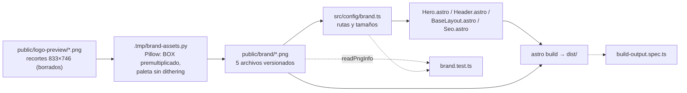
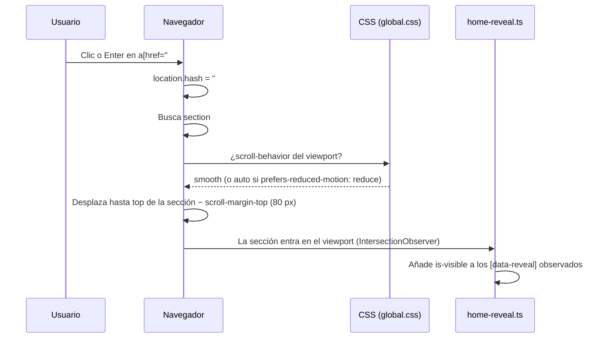

# El logo nuevo, la fila de categorías y los textos de credencial y urgencias (spec 002, cambio 2026-11-21)

> Fecha: 2026-11-21 · Cambios cubiertos: cambios sin confirmar sobre `HEAD` `5edbb07` en la rama `feat/002-homepage`, correspondientes a la petición de cambio 2026-11-21 de `specs/002-homepage/` (R60–R78, `plan.md` §14, `tasks.md` fase 10, tareas T3001–T3010): `src/config/brand.ts`, `src/lib/home-work.ts`, `src/components/home/{Hero,CredentialRail,CategoryRow,CategoryPictogram,WorkCategory}.astro`, `src/components/layout/Header.astro`, `src/layouts/BaseLayout.astro`, `src/components/seo/Seo.astro`, `src/pages/[locale]/index.astro`, `src/i18n/messages/{es,en,fr}.ts`, `public/brand/*.png`, `tests/support/*`, `tests/unit/{brand,home-work,test-support,i18n,seo}.test.ts` y `tests/e2e/{homepage,site-brand,build-output,foundation}.spec.ts`. No cubre el prototipo anterior (`logoVariant`), ni `.agents/`, `.opencode/`, `BACKLOG.md`, `CLAUDE.md`, `public/homepage/hero.webp` o los dotfiles preparados.

Requisitos previos: [002 · Astro](002-astro-y-el-sitio-estatico.md), [003 · Rutas e idiomas](003-rutas-e-idiomas.md), [005 · Contenedores y servidor](005-contenedores-y-servidor.md) (para la CSP), [006 · La portada](006-la-portada.md) (hero, _reveal_ y `prefers-reduced-motion`) y [008 · Pruebas](008-pruebas.md) (Vitest y Playwright).

## 1. ¿Qué se ha implementado?

El dueño pidió cuatro cambios, y esta lección explica los cuatro:

1. **Logo nuevo en todo el sitio.** Hay cinco PNG nuevos en `public/brand/`, preparados una sola vez con un script de Python que no se guarda en el repositorio:
   - dos **variantes de visualización**: azul (362×324) y blanca (833×746);
   - un icono de 32×32 y un _apple-touch icon_ de 180×180, sobre fondo blanco opaco;
   - una imagen para compartir en redes de 1200×630.

   Sus rutas y tamaños están declarados en un único archivo, `src/config/brand.ts`. El hero muestra el logo blanco a la derecha del panel desde 1024 px y el azul encima del panel por debajo de ese ancho. La cabecera usa el azul, el `<head>` enlaza los iconos nuevos y `og:image` apunta a `/brand/share.png`.
2. **Una fila de pictogramas** entre el hero y la franja de credenciales. Contiene tres enlaces (Electricidad, Iluminación, Climatización), cada uno con un dibujo SVG amarillo y su nombre. Cada enlace salta a su sección de la portada. Son las tres agrupaciones de fotos que ya existían, **no** servicios nuevos: los cinco servicios oficiales siguen en `/services/`.
3. **La franja de credenciales** sale de `Hero.astro` y pasa a su propio componente, `CredentialRail.astro`. El texto de la credencial cambia de «IBTB básica» a «Instalador autorizado de baja tensión (RBET)».
4. **Los textos de urgencias**: `contact.hoursNote` ya no menciona el horario y `contact.lead` deja de pedir que se llame «dentro del horario». En ningún caso se insinúa un servicio 24/7.

Además se añadieron muchas pruebas, algunas de un tipo nuevo en el proyecto: medir la imagen visible de un logo, leer la cabecera de un PNG byte a byte y auditar el HTML de `dist/`.

## 2. Tecnologías y conceptos implicados

Los conceptos van en orden: cada uno se apoya en los anteriores.

### 2.1. Flujo normal, posicionamiento absoluto y la altura de una fila de _grid_

**El problema.** El dueño quería el logo blanco «tan alto como el panel de texto». Parece fácil, pero esconde una trampa circular: si el logo intenta medir lo mismo que el panel y el panel mide lo que mida la fila, ¿quién decide la altura de la fila?

**El flujo normal (_normal flow_).** Por defecto, cada elemento ocupa espacio y empuja a los demás. En CSS Grid, la altura de una fila sale del **contenido** de sus celdas: la fila mide lo que necesite su celda más alta.

**El posicionamiento absoluto.** Un elemento con `position: absolute` **sale del flujo**: no ocupa espacio ni empuja a nadie, y su padre se comporta como si no existiera. Se coloca respecto a su **bloque contenedor** (_containing block_), que es el antepasado más cercano con `position` distinta de `static`. En Tailwind, ese antepasado suele llevar la clase `relative`.

> Analogía (solo como ayuda): el panel es un mueble que apoyas en el suelo y decide la altura de la estantería. El logo absoluto es un cuadro colgado en la pared de al lado: lo puedes estirar hasta la altura de la estantería, pero no la empuja.

**El estiramiento (_stretch_).** En una fila de grid, una celda sin contenido en flujo mide 0 de alto **por su contenido**, pero se estira hasta la altura de la fila, porque esa es la alineación por defecto de los elementos de grid. El resultado es lo que buscábamos: el panel fija la altura de la fila, la celda del logo se estira hasta esa altura, y el `` absoluto con `inset-0` rellena la celda.

### 2.2. `object-fit: contain` y la «imagen visible»

Un `` tiene dos rectángulos distintos:

- **la caja del elemento**, que fija el CSS (`width`, `height`, `inset`…);
- **la imagen dibujada** dentro de esa caja, que depende de `object-fit`.

Con `object-fit: contain`, el navegador escala la imagen **sin deformarla** hasta que toca uno de los bordes de la caja, y la **centra** en el otro eje. Lo que sobra queda transparente. La escala es:

```
scale = min(anchoCaja / anchoNatural, altoCaja / altoNatural)
```

Si la caja es más «apaisada» que la imagen, manda la altura (el logo queda limitado por la altura). Si es más «estrecha», manda el ancho y el logo se centra en vertical.

**Por qué importa aquí.** `getBoundingClientRect()` solo devuelve la caja del elemento. Para el logo blanco esa caja es toda la columna, así que no sirve para saber cuánto mide el logo que el usuario ve. La spec lo dice de forma explícita (R61, DECISIONS D-35): los tamaños se miden sobre la **imagen visible**. Por eso existe el ayudante `containRect` (§3.9).

### 2.3. Un PNG por dentro: firma, _chunks_ e IHDR

Un archivo PNG no es un bloque opaco de píxeles. Es una secuencia ordenada de bytes:

1. **La firma** (_signature_): 8 bytes fijos, `89 50 4E 47 0D 0A 1A 0A`. Los bytes 2 a 4 son `PNG` en ASCII. Si la firma no coincide, no es un PNG.
2. **Una lista de _chunks_** («trozos»). Cada uno tiene la misma estructura:

   | Bytes | Contenido |
   |---|---|
   | 4 | longitud de los datos (entero sin signo, **big-endian**) |
   | 4 | tipo, cuatro letras ASCII (`IHDR`, `PLTE`, `tRNS`, `IDAT`, `IEND`…) |
   | longitud | datos |
   | 4 | CRC (suma de comprobación) |

   Así que cada chunk ocupa `12 + longitud` bytes.
3. **IHDR** (_image header_) es siempre el primer chunk. Sus 13 bytes de datos son: ancho (4), alto (4), profundidad de bits (1), **tipo de color** (1), compresión (1), filtro (1) y entrelazado (1).
4. **IEND** marca el final.

Tipos de color que aparecen en este proyecto:

| Tipo | Significado | ¿Puede tener transparencia? |
|---|---|---|
| 2 | _truecolour_: RGB, sin canal alfa | Solo con un chunk `tRNS`, que declara **un** color como transparente |
| 3 | indexado (_indexed_): cada píxel es un índice a una paleta `PLTE` de hasta 256 colores | Sí, mediante un chunk `tRNS` con un alfa por entrada de la paleta |

**_Big-endian_** significa que el byte más significativo va primero: `00 00 01 6A` es 0x16A = 362. PNG usa siempre este orden (también llamado «orden de red»).

**La idea clave:** para saber el tamaño, el tipo de color y si hay transparencia, **no hace falta descomprimir los píxeles** (los chunks `IDAT`). Basta con leer IHDR y la lista de tipos de chunk. Es rápido, determinista y no necesita ninguna dependencia.

### 2.4. Reducir una imagen con transparencia: alfa premultiplicado, filtro BOX y paleta

Este apartado explica las decisiones del script de recursos (§3.2).

**Remuestreo** (_resampling_). Reducir 833 px a 362 px significa que cada píxel nuevo resume unos 833/362 ≈ 2,3 píxeles de origen por eje. El **filtro** decide cómo se hace ese resumen:

- **BOX** promedia solo los píxeles de origen que caen dentro de la «huella» (_footprint_) del píxel nuevo. No mira más allá ni produce valores fuera de rango.
- **Lanczos** usa una ventana más ancha, con pesos negativos. Da más nitidez, pero produce **_ringing_**: halos claros u oscuros junto a los bordes de alto contraste. Además puede llevar un poco de alfa hasta píxeles que deberían ser transparentes. El plan lo descartó por eso («observed», P-6).

**Alfa premultiplicado.** Un píxel transparente sigue teniendo valores RGB, aunque no se vean (a menudo negro). Si promedias RGB y alfa por separado, el color oculto de los píxeles transparentes **se cuela** en el borde y aparece un halo oscuro. En modo premultiplicado, cada canal de color se multiplica antes por su alfa, de modo que un píxel transparente aporta color 0 con peso 0. En Pillow, ese modo se llama `'RGBa'` (con la «a» minúscula).

**Cuantización a paleta** (_quantization_). Un PNG RGBA guarda 4 bytes por píxel. Uno indexado guarda 1 byte por píxel más una paleta de hasta 256 colores. Eso reduce mucho el tamaño (el logo blanco pasó de 150.503 B a 28.806 B), a cambio de un posible escalonado (_banding_) en los degradados. **Sin _dithering_** (sin ruido que disimule ese escalonado), el resultado es determinista y no aparece ruido en el marco transparente.

### 2.5. SVG en línea, `currentColor` y la CSP estricta

**SVG en línea** (_inline SVG_) significa escribir el `<svg>` directamente dentro del HTML, en lugar de cargarlo como archivo con ``. Sus figuras (`<rect>`, `<circle>`, `<path>`) se dibujan con **atributos de presentación** (_presentation attributes_) como `fill="none"` o `stroke="currentColor"`.

**`currentColor`** es una palabra clave de CSS que significa «el valor actual de la propiedad `color`». Si el SVG tiene `stroke="currentColor"` y la clase `text-accent` pone `color: #fad951`, el trazo sale amarillo. Para cambiar el color basta con cambiar una clase.

**La CSP del proyecto** (lección [005](005-contenedores-y-servidor.md)) incluye `style-src 'self'; script-src 'self'` en el `Caddyfile`. Según MDN, `style-src` sin `'unsafe-inline'` bloquea los elementos `<style>` y los atributos `style="…"`, y `script-src 'self'` bloquea los `<script>` en línea. Los atributos de presentación del SVG no son ninguna de esas tres cosas: son atributos normales del elemento, como `width` en un ``. Y el SVG en línea forma parte del propio documento, no se descarga aparte, así que `img-src` tampoco interviene.

Por eso los pictogramas no necesitan ninguna excepción en la CSP, siempre que **nunca** lleven `style=`, `<style>` ni `<script>`. Las clases de Tailwind (`h-8`, `text-accent`) son seguras: sus reglas viven en la hoja de estilos externa, que `'self'` permite.

### 2.6. Enlaces de fragmento, `scroll-margin-top` y movimiento reducido

**Un enlace de fragmento** (_fragment link_) es un `<a href="#algo">`. Al activarlo, el navegador no recarga la página:

1. cambia el `hash` de la URL (`…/es/#work-section-electricity`);
2. busca el elemento con ese `id`;
3. desplaza la página hasta que el borde superior de ese elemento queda arriba de la ventana.

Todo esto es nativo del navegador: funciona **sin JavaScript**.

**El problema de la cabecera fija.** La cabecera del sitio es `sticky top-0`: se queda pegada arriba y tapa los primeros 65 px de la ventana (`h-16`, es decir 64 px, más 1 px de borde). Sin corrección, el comienzo de la sección acabaría debajo de la cabecera.

**`scroll-margin-top`** añade un margen que **solo** se tiene en cuenta al desplazarse hasta el elemento: «cuando me lleves hasta mí, déjame 80 px de aire por arriba». No mueve nada en el diseño normal. `scroll-mt-20` en Tailwind equivale a `scroll-margin-top: 5rem` (80 px), más que los 65 px de la cabecera.

**`scroll-behavior`** decide si ese desplazamiento es instantáneo (`auto`) o animado (`smooth`). El proyecto ya tenía `html { scroll-behavior: smooth }` en `src/styles/global.css`. También tenía, dentro de `@media (prefers-reduced-motion: reduce)`, la regla `* { scroll-behavior: auto !important }`. `*` también selecciona `<html>`, de modo que quien pide menos movimiento obtiene un salto instantáneo. Este cambio no añade CSS: reutiliza esas dos reglas.

### 2.7. Rojo primero (_red-first_)

La fase 10 de `tasks.md` dice: «Tests marked "first" are written and run red before the code they cover». El ciclo es:

1. **Rojo**: escribes la prueba y la ejecutas **antes** de que exista el código. Tiene que fallar.
2. **Verde**: escribes el código mínimo y la prueba pasa.
3. (Opcional) **Refactorizar** con la red de seguridad puesta.

**¿Por qué tiene que fallar primero?** Una prueba que nunca has visto fallar puede no estar comprobando nada: un selector que no encuentra ningún elemento, un bucle que recorre una lista vacía o una aserción mal escrita pasan siempre. Verla en rojo demuestra que **detecta la ausencia** de lo que pide. En §3.10 verás los recuentos de rojo reales y dos excepciones aceptadas.

## 3. Entendiendo la implementación

### 3.1. Una sola fuente de verdad: `src/config/brand.ts`

```ts
/** Size of the supplied logo cut-outs; every derived mark keeps this ratio. */
export const logoCutout = { width: 833, height: 746 } as const;

/** Height of the logo for a given width, rounded to whole pixels. */
export function logoHeightForWidth(width: number): number {
  return Math.round((width * logoCutout.height) / logoCutout.width);
}

/** A file is undistorted when its height is the rounded ratio height, within 1 px. */
export function isUndistortedFile(width: number, height: number): boolean {
  return Math.abs(height - logoHeightForWidth(width)) <= 1;
}

/** A rendered logo is undistorted when its height is within 1 CSS px of the exact ratio height. */
export function isUndistortedRender(width: number, height: number): boolean {
  return Math.abs(height - (width * logoCutout.height) / logoCutout.width) <= 1;
}
```

Qué hay que entender:

- **833×746 es la proporción de referencia**: la de los recortes aprobados (DECISIONS D-30), no la de `logo2.jpeg`.
- **Dos formas de decir «sin deformar»** (D-53):
  - un **archivo** tiene píxeles enteros, así que se compara con la altura **redondeada**, `round(ancho × 746/833)`, con ±1 px de margen;
  - un logo **renderizado** mide fracciones de píxel CSS (por ejemplo, 160,9 px), así que se compara con la altura **exacta**, también con ±1.

  ¿Por qué hace falta tolerancia? Porque 833 y 746 no tienen divisores comunes (D-38), así que casi ningún ancho entero da una altura entera exacta.

Después viene `brandAssets`, la tabla de los cinco archivos:

```ts
export const brandAssets = {
  logoBlue: { src: '/brand/logo-blue.svg', width: 362, height: 324 },
  logoWhite: { src: '/brand/logo-white.svg', width: 833, height: 746 },
  icon32: {
    src: '/brand/icon-32.png',
    width: 32,
    height: 32,
    mark: { x: 1, y: 2, width: 30, height: 27 },
  },
  // appleTouchIcon: 180×180, mark 160×143 at (10, 18)
  // share: 1200×630, mark 560×502 at (320, 64)
} as const;
```

(Fragmento recortado: las dos últimas entradas están resumidas en los comentarios.)

- `mark` (`PlacedMark`) es el rectángulo donde se pegó el logo dentro de un lienzo más grande (D-54). Sirve para comprobar que el logo no se deformó ni se amplió.
- `as const` congela los valores como tipos literales: TypeScript sabe que `brandAssets.logoBlue.width` es exactamente `362`.
- **¿Por qué un archivo de configuración?** `Hero.astro`, `Header.astro`, `BaseLayout.astro`, `Seo.astro` y las pruebas importan los mismos valores. Si algún día cambia un PNG, hay un solo sitio que actualizar, y `brand.test.ts` avisa si el archivo real y la tabla no coinciden.

### 3.2. El script de una sola vez: `.tmp/brand-assets.py`

El script existe en `.tmp/`, una carpeta ignorada por Git (`.gitignore:27`), y **no forma parte del repositorio** (P-5). Se ejecutó una vez con el Python del sistema y Pillow 12.1.1. Sus parámetros quedan registrados en `plan.md` §14.4 y en `brand.ts`. Las piezas principales son:

```python
def mark_h(w):
    return round(w * 746 / 833)

def resize(im_rgba, w):
    return im_rgba.convert('RGBa').resize((w, mark_h(w)), Image.Resampling.BOX).convert('RGBA')

def to_palette(im_rgba):
    return im_rgba.quantize(colors=256, method=Image.Quantize.FASTOCTREE, dither=Image.Dither.NONE)
```

- `resize` aplica lo de §2.4: pasa a premultiplicado (`'RGBa'`), reduce con BOX y vuelve a RGBA normal.
- `to_palette` cuantiza a 256 colores sin _dithering_.
- `frame_ok` (no mostrado) recorre las filas 0 y `h-1` y las columnas 0 y `w-1`, y exige alfa 0 en todas. Es la regla de transparencia de R60 (D-40).

**El argumento de que el marco queda transparente.** El paso 0 mide el margen transparente de los recortes (salió 6 px, V-T3002) y comprueba `833 / 362 <= m`. Como BOX solo promedia la huella de cada píxel nuevo (2,3 px), un píxel del borde del archivo nuevo solo puede «ver» los primeros 2,3 px del original, que son todos transparentes. La transparencia del marco queda **garantizada por construcción**, y además se comprueba.

Los pasos:

1. Azul: `to_palette(resize(CUT_BLUE, 362))` y se guarda `logo-blue.svg`.
2. Blanco: `to_palette(CUT_WHITE)` **sin reducir**, porque 833×746 es el tope (P-7, §3.3).
3. Iconos, a partir del azul ya guardado: se reduce a 30 px o 160 px de ancho y se pega sobre un lienzo `Image.new('RGB', …, (255, 255, 255))`. Un lienzo RGB no tiene canal alfa, así que el icono es opaco por construcción.
4. Imagen para compartir: se reduce el recorte azul a 560×502, se pega en (320, 64) sobre un blanco de 1200×630 y se cuantiza.
5. Se releen los cinco archivos y se comprueban tamaño, modo, presencia o ausencia de `tRNS`, marco transparente y que cada variante pese menos que su recorte. La regla del paso 6 dice: si algo falla, parar. **Nunca** se limpia ni se retoca el borde para que una comprobación pase.

Un detalle fino del plan: «no value used here ends in .5, so Python and JS rounding agree». El `round` de Python redondea los .5 al par (`round(0.5) == 0`), mientras que `Math.round` de JavaScript los redondea hacia arriba. Como ningún ancho usado da una altura que termine en ,5, `mark_h` y `logoHeightForWidth` coinciden.

Los recortes de origen (`public/logo-preview/`) se borraron al final (T3009), después de que la prueba e2e de tamaño del logo blanco confirmara que 833×746 era el tamaño correcto. Hoy ya no se puede volver a ejecutar el script.

### 3.3. El hero: `src/components/home/Hero.astro`

La estructura nueva, simplificada (no es el código literal):

```
section.hero
└─ Container
   └─ div.flex (min-h, padding)
      └─ div[hero-grid]           ← grid solo desde lg
         ├─ div[hero-logo-compact] (lg:hidden)   → logo azul, en flujo
         ├─ div[hero-panel]                       → texto y botones
         └─ div[hero-logo] (hidden lg:block, relative)
            └─ img absolute inset-0 object-contain → logo blanco
```

El código real de la rejilla y del logo grande (`Hero.astro:34-37` y `76-86`):

```astro
<div
  class="w-full lg:grid lg:grid-cols-[minmax(0,1.4fr)_minmax(0,1fr)] lg:gap-10"
  data-testid="hero-grid"
>
```

```astro
<div class="hero-copy relative hidden lg:block" aria-hidden="true" data-testid="hero-logo">
  
</div>
```

**Por qué la columna del logo no puede fijar la altura del hero (R10).** Aplica §2.1:

1. Desde `lg`, el logo compacto tiene `display: none` (`lg:hidden`), así que la rejilla solo tiene dos elementos: el panel (columna 1) y la celda del logo (columna 2).
2. El único hijo de la celda es un `` `absolute`. Para el cálculo de la altura, la celda está **vacía**: aporta 0 px a la fila.
3. La fila mide, por tanto, lo que mide el panel. La celda se estira hasta esa altura y, como es `relative`, es el bloque contenedor del ``.
4. `inset-0 h-full w-full` hace que la caja del `` sea exactamente la celda: ancho de columna × alto del panel.
5. `object-contain` dibuja el logo lo más grande posible dentro de esa caja, sin deformarlo y centrado. Si el panel es bajo, el logo queda limitado por la altura. Si es alto, queda limitado por el ancho y centrado en vertical, que es justo lo que pide R62.

**¿Y si el `` estuviera en flujo?** (Interpretación mía; no se probó.) Su tamaño contaría para la altura de la fila. Un logo de 437 px de ancho con proporción 833:746 pide unos 391 px de alto, y en cuanto eso superara al panel (un texto más corto en otro idioma, otro ancho de pantalla), el hero crecería por culpa del logo, que es lo que R10 prohíbe. Hay una prueba que comprueba justo esto: quita el `` y verifica que la altura del hero no cambia más de 2 px (§3.10).

**`minmax(0, 1.4fr)`**: por defecto, una pista `fr` no puede ser más estrecha que el contenido mínimo de su celda. El `0` como mínimo permite que la proporción 1,4 : 1 se cumpla aunque haya palabras largas. La prueba mide la proporción real de las pistas (de 1,3 a 1,5).

**Sobre la decisión del mecanismo.** El dueño había sugerido unidades de _container query_ (`cqh`/`cqw`). El plan eligió el `` absoluto con `object-contain` porque logra el mismo resultado con menos CSS (P-10, aceptado en D-56).

**El logo compacto (por debajo de 1024 px):**

```astro
<div
  class="hero-copy mb-4 flex lg:hidden"
  aria-hidden="true"
  data-testid="hero-logo-compact"
>
  
</div>
```

- `h-28` son 112 px y `sm:h-36`, 144 px. `w-auto`, junto con los atributos `width`/`height`, deja que el navegador calcule el ancho manteniendo la proporción. Aquí la caja del elemento **coincide** con la imagen visible.
- Este logo sí está en flujo, así que el hero móvil crece. R10 limita ese crecimiento a «alto del logo + hueco + 1 px». Medido: de 528 a 645,3 px a 375 px de ancho, un crecimiento de 117,3 px frente a un tope de 129 (VERIFICATION.md). Crece menos que 112 + 16 porque el `min-h` absorbía parte del espacio.

**Accesibilidad y movimiento (R64).**

- Ambos logos tienen `alt=""` y un envoltorio `aria-hidden="true"`: son decorativos, porque la cabecera ya nombra el negocio.
- Ambos envoltorios reutilizan la clase `hero-copy`, así que entran con la misma animación que el panel y no hay movimiento nuevo. Con `prefers-reduced-motion: reduce`, la regla existente `html.js .hero-copy { animation: none !important }` los deja quietos.
- `loading="eager"` en los dos (P-11): pesan 39 KB entre ambos, frente a los 2 MB de la foto, y una carga diferida podría llegar después de la animación de entrada.

### 3.4. Cabecera, iconos e imagen para compartir

**`Header.astro`:**

```astro
<a href={localizedPath(locale, '/')} class="flex min-w-0 items-center gap-1.5 no-underline">
  
<link
  rel="apple-touch-icon"
  href={brandAssets.appleTouchIcon.src}
  sizes={`${brandAssets.appleTouchIcon.width}x${brandAssets.appleTouchIcon.height}`}
/>
```

Los iconos tienen margen dentro del cuadrado (por ejemplo, el logo mide 160×143 dentro de 180×180) porque iOS redondea las esquinas del _apple-touch icon_ y recortaría un logo pegado al borde (P-8).

**`Seo.astro`** cambia una línea:

```ts
const image = absoluteAssetUrl(env.SITE_URL, brandAssets.share.src);
```

La cabecera ya declaraba `twitter:card` `summary_large_image`, que espera una imagen de proporción cercana a 1,91 : 1. 1200×630 la cumple, y un logo cuadrado se recortaría (P-1). `public/logo.jpg` sigue existiendo y se publica en `dist/`, pero ya no lo usa ninguna página: si se borra o no lo decide el dueño (R69).

### 3.5. La fila de pictogramas: `CategoryRow.astro` y `CategoryPictogram.astro`

```astro
<div class="on-dark border-t border-white/15 bg-brand text-white" data-testid="category-row">
  <Container>
    <ul class="grid grid-cols-1 gap-x-2 py-2 min-[22.5rem]:grid-cols-3 sm:gap-x-6 sm:py-3">
      {categoryRowOrder.map((key) => (
        <li>
          <a
            href={`#${workSectionId(key)}`}
            data-category={key}
            class="group flex min-h-11 items-center gap-3 rounded-panel py-2 text-white no-underline min-[22.5rem]:flex-col min-[22.5rem]:items-start min-[22.5rem]:gap-2 sm:flex-row sm:items-center sm:gap-3"
          >
            <CategoryPictogram category={key} />
            <span class="block text-sm font-semibold leading-tight group-hover:underline sm:text-base">
              {t.home.work.categories[key].title}
            </span>
          </a>
        </li>
      ))}
    </ul>
  </Container>
</div>
```

Qué decide cada parte:

- **Tres estados de diseño** (P-3):
  - por debajo de 360 px, una columna con el dibujo al lado del texto;
  - de 360 a 639 px, tres columnas con el dibujo encima;
  - desde 640 px (`sm`), tres columnas con el dibujo al lado.

  `min-[22.5rem]:` es una variante de Tailwind con un punto de corte arbitrario (22,5rem = 360 px). El motivo: a 320 px cada columna mediría unos 88 px y «Climatización» necesita entre 80 y 95 px, demasiado justo.
- **Las etiquetas reutilizan los títulos de las secciones** (`t.home.work.categories[key].title`). No hay claves nuevas en los diccionarios (P-15), así que la etiqueta y el `h2` de la sección son iguales por construcción.
- **`min-h-11`** (44 px) garantiza un objetivo táctil suficiente.
- **El foco** usa la regla global `.on-dark :focus-visible`: un contorno amarillo de 3 px.
- **Sin `data-reveal` ni script** (P-14): la fila está a la vista al cargar, y un _reveal_ la ocultaría hasta que entrara en pantalla, además de confundir a axe con colores a medio fundir.

**`CategoryPictogram.astro`** reúne los atributos comunes en un objeto y los aplica con la sintaxis de propagación de Astro, `{...attributes}`:

```ts
const attributes = {
  viewBox: '0 0 24 24',
  fill: 'none',
  stroke: 'currentColor',
  'stroke-width': '2',
  'stroke-linecap': 'round',
  'stroke-linejoin': 'round',
  'aria-hidden': 'true',
  focusable: 'false',
  class: 'h-8 w-8 shrink-0 text-accent',
  'data-pictogram': category,
} as const;
```

```astro
{category === 'electricity' && (
  // Wall socket: rounded plate, inner ring and two pin holes.
  <svg {...attributes}>
    <rect x="3" y="3" width="18" height="18" rx="4" />
    <circle cx="12" cy="12" r="5" />
    <path d="M10 11v2" />
    <path d="M14 11v2" />
  </svg>
)}
```

- `{condición && (<svg…>)}` es renderizado condicional: solo se emite el SVG de la categoría recibida.
- `viewBox="0 0 24 24"` define un sistema de coordenadas de 24×24, y la clase `h-8 w-8` lo escala a 32×32 px.
- `aria-hidden="true"`: el texto del enlace ya da el nombre, y el dibujo es decorativo. `focusable="false"` es una precaución heredada de Internet Explorer y del Edge antiguo, que podían poner el foco en los SVG.
- Todo son atributos de presentación: ni `style=` ni `<style>`. Por eso pasa la CSP sin excepciones (§2.5).

### 3.6. Los destinos: `home-work.ts` y `WorkCategory.astro`

```ts
/** Order of the category pictogram row (R70, D-11): the owner's wording, not the band order. */
export const categoryRowOrder: readonly WorkCategoryKey[] = [
  'electricity',
  'ilumination',
  'climatization',
];

/** Id of a category `<section>` (R75). The heading ids stay `work-${key}`. */
export function workSectionId(key: WorkCategoryKey): string {
  return `work-section-${key}`;
}
```

- **El orden de la fila no coincide con el de las bandas** (Iluminación va primero en la página). Sigue las palabras literales del dueño (D-11).
- **El destino es la sección, no el encabezado.** En móvil, la foto va antes que el título. Si el salto llevara al `h2`, el usuario se saltaría las fotos (D-39). Por eso hay un `id` nuevo, distinto del `work-{key}` que ya usaba `aria-labelledby`, y la prueba unitaria exige que no coincidan.

En `WorkCategory.astro`:

```astro
<section
  id={workSectionId(category.key)}
  class:list={['scroll-mt-20 py-14 sm:py-20', toneClass]}
  aria-labelledby={`work-${category.key}`}
```

Aquí se aplica `scroll-margin-top` (§2.6): 80 px frente a 65 px de cabecera.

### 3.7. La franja de credenciales y el orden de la página

`CredentialRail.astro` contiene exactamente el marcado que antes estaba al final de `Hero.astro` (compara el diff: es la misma lista `facts` y el mismo `<ul data-testid="credential-rail">`). `index.astro` muestra ahora el orden de R7 de un vistazo:

```astro
<Hero locale={locale} />
<CategoryRow locale={locale} />
<CredentialRail locale={locale} />
<WorkCategories locale={locale} />
```

Sacarla del hero fue necesario para meter la fila entre ambos sin convertir `Hero.astro` en una mezcla de secciones (P-13).

### 3.8. Los textos

Cambian tres valores por idioma y ninguna clave (R43):

| Clave | es |
|---|---|
| `home.facts.authorization` | Instalador autorizado de baja tensión (RBET) |
| `contact.hoursNote` | Las urgencias sin cita previa pueden tener un recargo. |
| `contact.lead` | Puede contactar por teléfono, WhatsApp o correo electrónico. |

En `en.ts` y `fr.ts` cada valor lleva el comentario `// PENDING owner review (R13/R76/R77)`. Es texto regulatorio y la regla del proyecto prohíbe publicar una traducción sin revisión humana. La redacción de `hoursNote` es conservadora a propósito (D-10): no menciona el horario ni insinúa disponibilidad fuera de él, porque el dueño aún no ha confirmado si trabaja fuera de horario (D-33).

### 3.9. Los ayudantes de prueba: `tests/support/`

Están en `tests/` y no en `src/` porque no tienen uso en producción (P-19). Tienen pruebas propias porque las aserciones del logo dependen de ellos: si `containRect` calculara mal, todas las pruebas de geometría mentirían.

**`containRect`** (`tests/support/visible-image.ts`) implementa la fórmula de §2.2:

```ts
export function containRect(box: Box, natural: NaturalSize): Box {
  const scale = Math.min(box.width / natural.width, box.height / natural.height);
  const width = natural.width * scale;
  const height = natural.height * scale;

  return {
    x: box.x + (box.width - width) / 2,
    y: box.y + (box.height - height) / 2,
    width,
    height,
  };
}
```

Recibe la caja del elemento (de `getBoundingClientRect()`) y el tamaño natural (`naturalWidth`/`naturalHeight`), y devuelve el rectángulo que de verdad ocupa el logo. El centrado sale de repartir el sobrante, `(box - tamaño) / 2`, a cada lado.

**`readPngInfo`** (`tests/support/png.ts`) implementa §2.3:

```ts
const view = new DataView(bytes.buffer, bytes.byteOffset, bytes.byteLength);
// ...
while (offset + 8 <= bytes.length) {
  const length = view.getUint32(offset);
  const type = String.fromCharCode(...bytes.subarray(offset + 4, offset + 8));
  chunks.push(type);

  if (type === 'IHDR') {
    width = view.getUint32(offset + 8);
    height = view.getUint32(offset + 12);
    colorType = view.getUint8(offset + 17);
  }

  if (type === 'IEND') {
    break;
  }

  offset += 12 + length;
}
```

(Fragmento: antes va la comprobación de la firma, y después, la de que el primer chunk sea `IHDR`.)

- `DataView` permite leer enteros de varios bytes en un `ArrayBuffer`. `getUint32` lee en **big-endian por defecto**, que es justo el orden de PNG.
- Se pasa `bytes.byteOffset` y `bytes.byteLength` porque un `Uint8Array` puede ser una «ventana» sobre un buffer más grande. Sin esos dos argumentos se leerían bytes ajenos.
- Los desplazamientos salen de la tabla de §2.3: `offset` apunta al campo de longitud, `+4` al tipo y `+8` al inicio de los datos de IHDR (el ancho). `+12` es el alto, `+16` la profundidad de bits y `+17` el tipo de color.
- `offset += 12 + length` salta al siguiente chunk: 4 de longitud, 4 de tipo, los datos y 4 de CRC.
- **No comprueba el CRC ni descomprime nada.** Basta para las preguntas que hacen las pruebas: tamaño, tipo de color y si existe un chunk `tRNS`.

**`motion.ts`** contiene `waitForMotion`, trasladado sin cambios desde `foundation.spec.ts` (lección [008](008-pruebas.md)), y `waitForFonts`, que espera a `document.fonts.ready`. Medir antes de que cargue la fuente web o durante la animación `hero-copy` (que desplaza logo y panel) daría números inestables.

### 3.10. Qué comprueban las pruebas nuevas

**Unitarias (Vitest):**

- `brand.test.ts`:
  - las funciones de proporción en sus bordes de ±1;
  - cada PNG existe y su IHDR coincide con `brandAssets`;
  - las variantes son tipo de color 3 y pesan menos que sus recortes (constantes 151.058 y 150.503, porque los recortes ya no existen);
  - los iconos son tipo 2 **sin** `tRNS`, es decir, opacos según el propio formato;
  - cada `mark` está dentro de su lienzo y nunca supera 833×746.
- `home-work.test.ts`: el orden de la fila, que sea una permutación de las tres claves y los `id` únicos y distintos de `work-{key}`.
- `i18n.test.ts`:
  - los textos exactos en los tres idiomas;
  - ningún texto contiene «IBTB»;
  - `hoursNote` no contiene dígitos ni nombres de días (así no puede reaparecer un horario).
- `test-support.test.ts` fabrica un PNG mínimo byte a byte con sus funciones `uint32` y `chunk`, y comprueba que `readPngInfo` lo lee y que rechaza una firma rota.

**E2E (Playwright):**

- **Geometría del hero** (`homepage.spec.ts`): `openHero` espera fuentes, decodificación de imágenes y animaciones; `measureHero` toma cajas y tamaños naturales; `visibleOf` aplica `containRect`. La prueba clave de R10:

  ```ts
  const before = (await measureHero(page)).hero.height;
  await page.evaluate(() => {
    document.querySelector('[data-testid="hero-logo"] img')?.remove();
  });
  await twoFrames(page);
  const after = (await measureHero(page)).hero.height;

  expect(Math.abs(before - after)).toBeLessThanOrEqual(2);
  ```

  Es un **experimento controlado**: mismo ancho, mismo idioma, y solo cambia la presencia del logo. `twoFrames` espera dos `requestAnimationFrame` para que el navegador recalcule el diseño. El resultado medido fue 0 px en todos los casos (V-T3006).
- **«Alto O ancho»**: la prueba de R62 acepta que el logo llene la altura del panel **o** el ancho de la columna (centrado). VERIFICATION.md explica por qué el «o» es imprescindible: a 1024 px el logo está limitado por el ancho (343,3 px de alto frente a un panel de 346,2).
- **La fila**:
  - orden, etiquetas iguales a los `h2` y atributos de los SVG;
  - ausencia de desbordamiento a varios anchos;
  - integridad de las etiquetas: un `Range` sobre cada palabra debe devolver **un solo** rectángulo, porque una palabra partida por la mitad devolvería dos.
- **Navegación por teclado**: desde el botón «Ver servicios», `Tab` llega a los tres enlaces en orden con contorno amarillo de al menos 2 px. `Enter` cambia el `hash`, y `settledScrollY` espera a que `scrollY` se estabilice (dos lecturas iguales separadas 100 ms). Después se comprueba que la sección empieza debajo de la cabecera y que su escenario recibe `is-visible`.
- **Movimiento reducido**: comprueba que `html` tiene `scroll-behavior: auto` y que el `scrollY` leído un fotograma después de `Enter` ya es el definitivo, es decir, que no hubo animación.
- **Sin JavaScript**: la fila es visible y los clics llevan a cada sección.
- `site-brand.spec.ts`:
  - el logo de la cabecera en todas las páginas e idiomas;
  - un **lienzo** (`canvas`) que dibuja cada variante y lee el alfa de las esquinas y del marco con `getImageData`;
  - los iconos con alfa 255 en todos sus píxeles;
  - el tipo MIME de los archivos;
  - 404 en la antigua página de vista previa;
  - todas las peticiones de la portada al mismo origen.
- `build-output.spec.ts` lee el HTML de `dist/` y busca con expresiones regulares:
  - `<script>` sin `src`, `<style>` y atributos `style=`;
  - «IBTB» y JSON-LD;
  - los enlaces de icono de cada página y el conjunto exacto de URL del _sitemap_.

  Es la red de seguridad de la CSP: si alguien añade un `style=` a un SVG, esta prueba falla antes del despliegue. La ruta de la vista previa se busca con el patrón `/logo[-_]preview/` y nunca como texto literal, para que el `grep` de limpieza del repositorio siga vacío (P-20).

**El rojo primero, en la práctica** (registros V-T de `DECISIONS.md`):

| Tarea | Rojo | Verde |
|---|---|---|
| T3001 ayudantes | «no tests», import sin resolver | 8/8 |
| T3002 `brand.test.ts` | primero falló el import; luego 12 de 21 fallaron | 21/21 |
| T3003 `home-work.test.ts` | 4/4 fallan | 4/4 |
| T3004 `i18n.test.ts` | 4 fallan | 16/16 |
| T3005 logo del hero (e2e) | 14 fallan, 1 pasa | 37/37 |
| T3007 fila (e2e) | 40 fallan | 98/98 |
| T3008 cabecera e iconos (e2e) | 16 fallan | 154/154 |
| T3009 auditoría de `dist/` | 1 fallo esperado (archivos de vista previa todavía publicados) | 66/66 |

Fíjate en T3002: hubo **dos rojos distintos**. «El import falla» solo dice que el archivo no existe. «12 aserciones fallan» dice que las pruebas comprueban de verdad los valores. El segundo es el rojo que da confianza.

Hubo dos excepciones aceptadas:

- **T3006** no tuvo fase roja: mide un diseño que ya existía tras T3005, así que pasó a la primera.
- **T3004** solo exigía rojo para la parte unitaria, no para la e2e.

## 4. Flujo de ejecución

Este cambio tiene dos momentos: una preparación única de los recursos (fuera del repositorio) y la vida normal del sitio estático.



Y lo que ocurre cuando un usuario pulsa un pictograma (todo nativo, sin JavaScript del proyecto, salvo el _reveal_ ya existente):



En el diagrama, `home-reveal.ts` solo actúa si hay JavaScript y no se pide movimiento reducido. En los demás casos, el CSS ya deja el contenido visible (lección [006](006-la-portada.md)).

## 5. Decisiones técnicas importantes

| Decisión | Por qué | Alternativa descartada |
|---|---|---|
| Logo grande absoluto con `object-contain` (P-10, D-56) | El panel fija la altura y el logo nunca la cambia | Unidades `cqh`/`cqw`: mismo resultado con más CSS |
| BOX premultiplicado + paleta sin _dithering_ (P-6) | Sin halos, marco transparente por construcción, determinista, archivos de ~10–29 KB | Lanczos (halo, fuga de alfa); _dithering_ (ruido y más bytes) |
| Blanco exactamente 833×746 (P-7, D-51) | El doble de su tamaño máximo visible (436,7 px) supera 833: el tope gana y nunca se amplía | Un archivo por superficie: R60 exige un archivo por variante |
| Script fuera del repositorio (P-5) | No añade dependencias (D-46); los recursos se generan una vez | Script versionado (dependería de Python sin declarar); `sharp` (dependencia transitiva no declarada) |
| Fila de enlaces a la **sección** (P-4, D-39) | Una fila de iconos con nombre parece pulsable; funciona sin JS | Etiquetas sin enlace (interfaz muerta); enlaces al `h2` (se salta las fotos en móvil) |
| Tres columnas desde 360 px (P-3) | A 320 px «Climatización» no cabe con garantías | Tres columnas siempre (frágil); apilar hasta 640 px (triplica la altura en los móviles más comunes) |
| Sin claves nuevas en los diccionarios (P-15) | Etiquetas = títulos por construcción; nada nuevo que traducir | Un `nav` con etiqueta propia |
| `gap-1.5` en la cabecera (P-12) | El nombre conserva al menos el espacio que tenía | Mantener `gap-3` (el nombre pierde 5,2 px) |

**Qué vigilar al modificar:**

- Si cambias un PNG, actualiza `brandAssets` y vuelve a ejecutar `brand.test.ts`. Recuerda que los recortes de origen ya no existen: para regenerar hace falta un nuevo original.
- Si añades contenido **en flujo** a la celda del logo grande, el hero podrá crecer por culpa del logo, y la prueba de la diferencia de altura fallará.
- Si cambias la altura de la cabecera, revisa `scroll-mt-20`: tiene que seguir siendo mayor que la cabecera.
- No pongas `style=` en ningún SVG ni elemento: rompería la CSP en producción y `build-output.spec.ts` lo detectará.

## 6. Ejemplos prácticos

**`containRect` con valores reales** (1280 px, francés; caja medida por el revisor en VERIFICATION.md):

- caja de la columna: 436,7 de ancho × 409,5 de alto (el alto del panel en `fr`);
- natural: 833 × 746;
- escala = min(436,7 / 833, 409,5 / 746) = min(0,5243, 0,5489) = **0,5243**, así que manda el ancho;
- visible: 436,7 × 391,1, desplazado (409,5 − 391,1) / 2 ≈ 9,2 px hacia abajo: centrado en vertical.

¿De dónde salen esos 436,7 px? `Container` tiene un ancho máximo de `max-w-6xl` (72rem = 1152 px) con `lg:px-8` (32 px por lado): 1152 − 64 = 1088 px útiles. Al restar el hueco de 40 px quedan 1048, que se reparten en 1,4 + 1 = 2,4 partes, así que 1fr = 1048 / 2,4 ≈ 436,7. A 1024 px quedan 960 px útiles, y 1fr = (960 − 40) / 2,4 ≈ 383,3, lo que da un logo de 383,3 × 746/833 ≈ 343,3 px de alto: el valor que cita VERIFICATION.md.

**Leer IHDR a mano** (`xxd -l 40 public/brand/logo-blue.svg`):

```
00000000: 8950 4e47 0d0a 1a0a 0000 000d 4948 4452  .PNG........IHDR
00000010: 0000 016a 0000 0144 0803 0000 0039 a084  ...j...D.....9..
```

- `89 50 4e 47 0d 0a 1a 0a`: la firma.
- `00 00 00 0d`: longitud 13, la de IHDR.
- `49 48 44 52`: «IHDR».
- `00 00 01 6a` = 362 de ancho y `00 00 01 44` = 324 de alto.
- `08`: 8 bits por canal.
- `03`: **indexado**. En `icon-32.png` el mismo byte es `02` (RGB, opaco).

**El ancho del logo de la cabecera**: altura 44 px × 362/324 = 49,16 px de ancho. Con `gap-1.5` suma 55,16 px, por debajo de los 56 de antes.

**Un salto con movimiento reducido**: con `reducedMotion: 'reduce'`, la prueba pulsa `Enter` en «Electricidad» y lee `scrollY` en el fotograma siguiente. Como `scroll-behavior` es `auto`, ese valor ya es el final y `oneFrameLater === settled`. Con movimiento normal, el primer valor sería intermedio.

## 7. ¿Qué debo recordar?

- **Un elemento `absolute` no aporta altura a su padre.** Es lo que permite que el logo «siga» al panel sin poder empujar el hero.
- **Caja del elemento ≠ imagen visible** con `object-fit: contain`. Mide siempre la imagen visible con `containRect`.
- **Un PNG se puede inspeccionar sin decodificarlo**: firma, chunks de 12 + n bytes, IHDR con ancho, alto y tipo de color, todo en big-endian.
- **Transparencia y reducción**: premultiplicar evita halos; BOX con una huella menor que el margen transparente mantiene el marco limpio.
- **La CSP prohíbe `<style>`, `style=` y `<script>` en línea**, no los atributos de presentación del SVG. Por eso los pictogramas usan `fill`, `stroke` y `currentColor` más clases.
- **Enlaces de fragmento + `scroll-margin-top` + la regla global de movimiento reducido**: navegación accesible, instantánea para quien la pide, y sin una sola línea de JavaScript.
- **`brand.ts` es la fuente de verdad** de los recursos de marca, y `brand.test.ts` comprueba que coincide con los archivos reales.
- **Rojo primero**: una prueba solo da confianza si la has visto fallar por la razón correcta.

## 8. Para seguir aprendiendo

- MDN, [`object-fit`](https://developer.mozilla.org/en-US/docs/Web/CSS/object-fit) y [`position`](https://developer.mozilla.org/en-US/docs/Web/CSS/position).
- MDN, [`scroll-margin-top`](https://developer.mozilla.org/en-US/docs/Web/CSS/scroll-margin-top) y [`scroll-behavior`](https://developer.mozilla.org/en-US/docs/Web/CSS/scroll-behavior).
- W3C, [PNG Specification](https://www.w3.org/TR/png/): las secciones de estructura de chunks e IHDR.
- MDN, [`DataView`](https://developer.mozilla.org/en-US/docs/Web/JavaScript/Reference/Global_Objects/DataView).
- MDN, [CSP `style-src`](https://developer.mozilla.org/en-US/docs/Web/HTTP/Reference/Headers/Content-Security-Policy/style-src).
- Pillow, [`Image.resize` y los filtros de remuestreo](https://pillow.readthedocs.io/en/stable/handbook/concepts.html#filters).

## Limitaciones y puntos sin verificar

- **Lo que ejecuté para esta lección:** `vitest run` sobre `brand`, `test-support`, `home-work`, `i18n` y `seo` (5 archivos, 53 pruebas, todas pasan) y `xxd` sobre dos PNG. **No** ejecuté las pruebas e2e. Las cifras e2e citadas (184/184, medidas de geometría, recuentos de rojo) salen de `VERIFICATION.md` y de las entradas V-T de `DECISIONS.md`.
- **La CSP no se aplica en las pruebas**: Playwright corre contra `astro preview`, no contra Caddy, y la pila Docker no se ejecutó en este cambio. La protección real es doble: la definición de la CSP (que no gobierna los atributos de presentación del SVG; MDN no menciona estos atributos de forma explícita, así que la afirmación se apoya en qué cosas sí enumera) y la auditoría de `dist/`.
- **El comportamiento de un `` en flujo dentro de la celda** (§3.3) es un razonamiento mío para explicar la alternativa, no algo medido.
- **Pendiente del dueño**: la revisión visual (R58), la redacción en inglés y francés (R13, R76, R77), si se trabaja fuera de horario (D-33) y si se borran `public/logo.jpg` y `public/logo2.jpeg`.
- **Detalles observados en el código** (no bloquean, según VERIFICATION.md):
  - las pruebas de geometría de R62/R63 (`homepage.spec.ts:398-449`) solo se ejecutan en `es`;
  - el comentario de `CategoryPictogram.astro:10-11` cita «(R72)» dos veces;
  - la prueba «places the credential rail after the hero» depende de que el raíl sea exactamente el segundo hermano del hero (`nextElementSibling?.nextElementSibling`), así que cualquier bloque nuevo entre ambos obligará a ajustarla.
- **El script `.tmp/brand-assets.py`** existe hoy en esta máquina, pero no está versionado: en otro clon no estará, y sin los recortes borrados tampoco podría ejecutarse.
